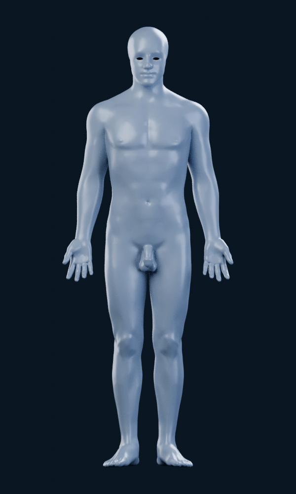
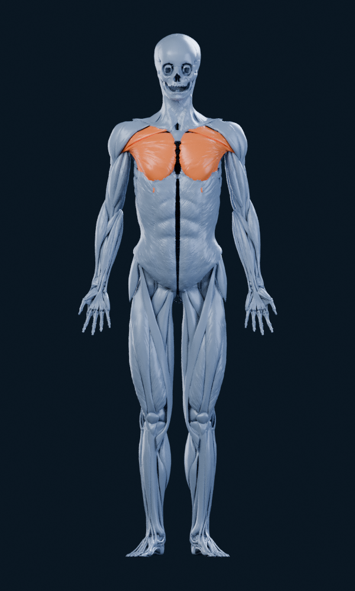
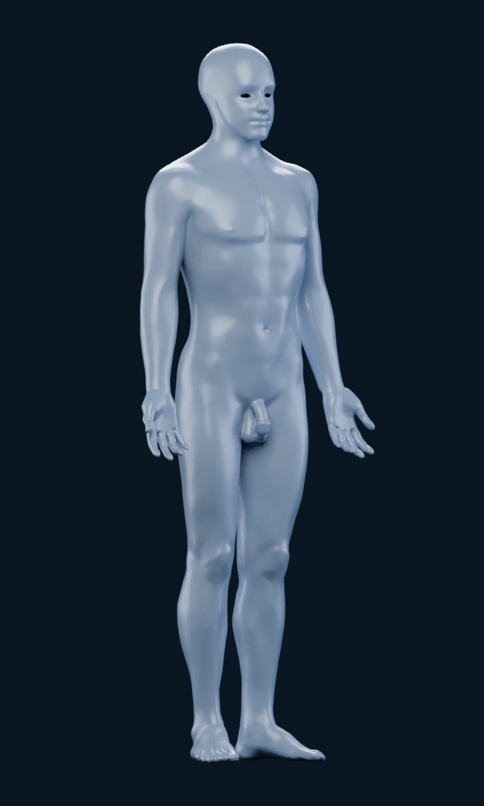
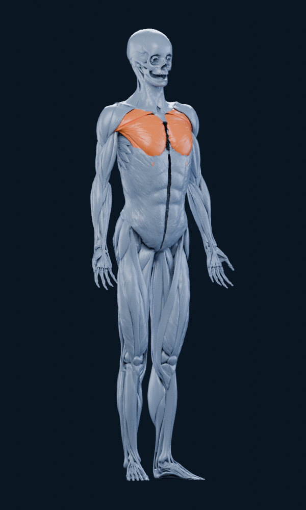
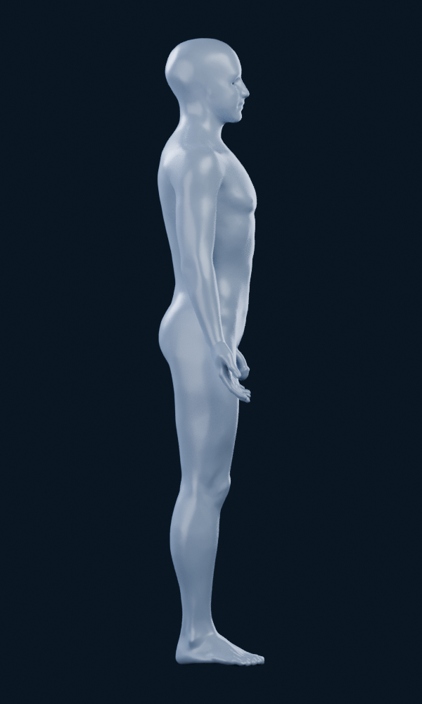
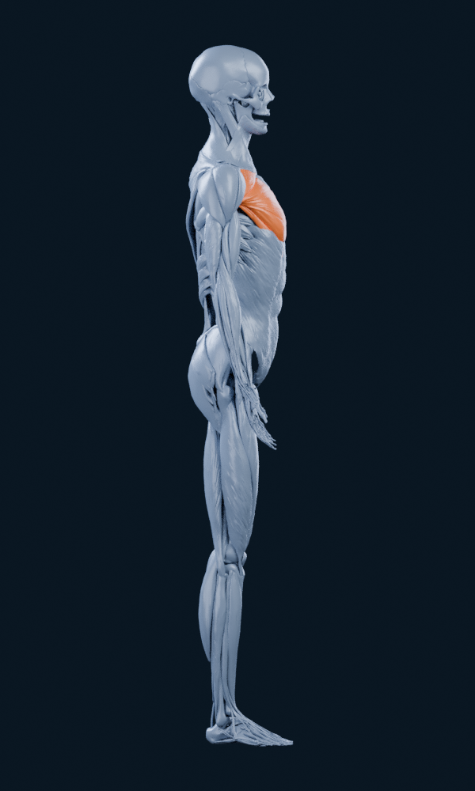
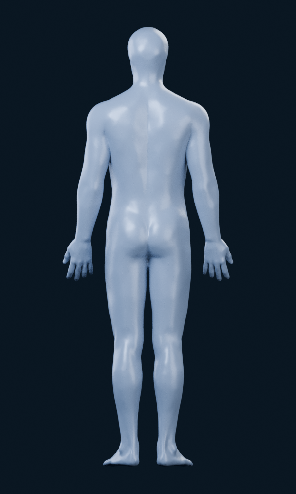
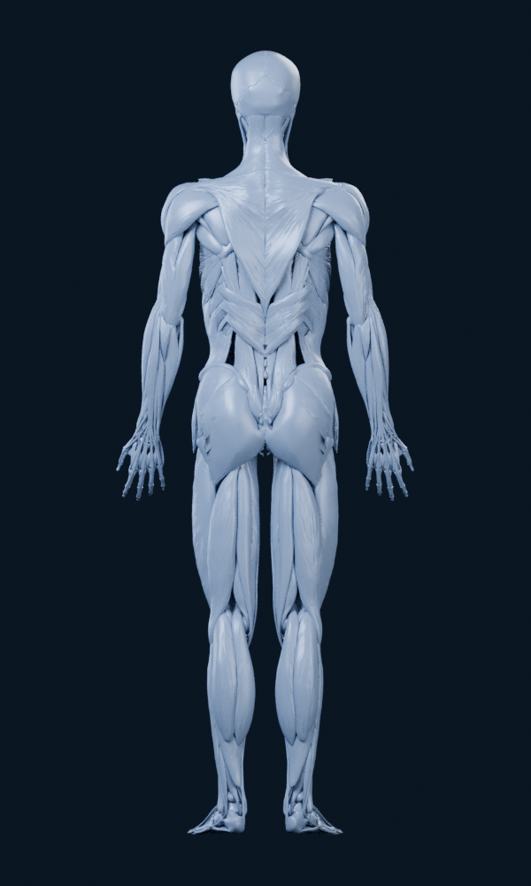

# M4A — Inspection des sources officielles BodyParts3D

Sources téléchargées et rendus calculés le **17 octobre 2026** ; dossier finalisé le **18 octobre 2026**. Référence : image jointe à la reprise de M4A. **Résultat : candidat non retenu pour intégration en l’état.** L’accès réseau fonctionne ; le blocage restant concerne la géométrie et sa conformité visuelle.

## Rendus réels, après nettoyage des coutures

Chaque image est calculée à partir des OBJ officiels. Les vues de contrôle ne sont pas des boutons ou des captures d’un écran de l’application. Cliquer sur une image pour l’inspecter à 600 × 1000 pixels.

| Vue | Peau complète FJ2810 | Structures musculaires + os |
| --- | --- | --- |
| Face |  |  |
| Trois quarts |  |  |
| Profil |  |  |
| Dos |  |  |

**Peau entière.** Le corps est reconnaissable et complet, mais le torse, les cuisses et le dos offrent peu de relief musculaire comparés à la référence athlétique. La peau est un seul élément non segmenté ; opaque, elle masque les structures musculaires internes. Le visage et les extrémités gardent les formes de la source, différentes du mannequin demandé.

**Muscles et os.** Les vrais pectoraux sont localisés et colorés en orange. L’assemblage est un écorché : crâne et orbites exposés, os/tendons visibles aux mains et pieds, séparation médiane du tronc, espaces entre structures aux cuisses et hanches. Le profil montre des surfaces très striées. Le dos expose des couches et séparations qui ne forment pas l’enveloppe musculaire continue de la référence. La paroi abdominale est constituée de nappes obliques ; aucun relief de grand droit n’est identifié et segmenté dans ce candidat.

Ces écarts ne se résument pas à des coutures de normales : la soudure des positions exactement identiques et le recalcul des normales lissées sont déjà appliqués. Les espaces visibles entre organes fermés ne sont pas automatiquement des trous topologiques dans un OBJ. L’ajout de la peau entière recouvrirait les muscles ; découper sa tête, ses mains et ses pieds ne fournirait pas les identités et reliefs manquants du tronc.

**Décision.** Ne pas intégrer ces variantes comme le mannequin M4A validé. Une décimation ne crée pas les structures absentes de la sélection, et un lissage ne fournit pas une nouvelle identité anatomique. Obtenir la référence réclame une reconstruction artistique/anatomique traçable ou une autre base, à décider avant substitution. Il s’agit d’un jugement sur ce candidat pour Logbook, pas sur la validité médicale de BodyParts3D comme atlas.

## Accès, version et licence

Les [pages de téléchargement](https://dbarchive.biosciencedbc.jp/en/bodyparts3d/download.html) et de [licence](https://dbarchive.biosciencedbc.jp/en/bodyparts3d/lic.html) ont répondu HTTP 200 depuis l’environnement cloud. Les liens suivis proviennent de la page officielle, pas d’un miroir tiers.

- Distribution : `isa_BP3D_4.0_obj_99.zip`, version **4.0**, IS-A, réduction de polygones annoncée **99 %** par l’éditeur.
- Fichier complet : **142 903 898 octets** ; **2 234 OBJ**, **479 605 380 octets décompressés**. Tous les CRC ZIP passent. Une réponse interrompue a été reprise par HTTP 206, puis le fichier complet vérifié.
- SHA-256 calculé localement : `40665852c49f218326590e204db91064a1ecfc3c6f8cbd7bbbcaac62c7cd409e`.
- Six tables officielles et README récupérés. Les **1 258 IDs élémentaires PART-OF** sont tous présents parmi les **2 234 IDs IS-A** et dans l’archive téléchargée. Aucun autre OBJ n’est nécessaire pour les sélections documentées ; l’archive PART-OF n’a pas été téléchargée et son identité binaire n’est pas affirmée.
- La page de licence, mise à jour **2025/02/27**, indique **CC BY 4.0** et l’attribution ci-dessous. Le README conserve un lien ancien et les en-têtes OBJ (par exemple FJ1447, FJ1468, FJ1521) mentionnent encore **CC BY-SA 2.1 Japan**. Ce décalage est conservé dans la provenance ; la licence déclarée pour la distribution actuelle est celle de la page officielle dédiée, sans prétendre que les en-têtes historiques ont été actualisés.

> BodyParts3D, © The Database Center for Life Science licensed under CC Attribution 4.0 International

[Provenance exacte, tailles et empreintes](m4a/bodyparts3d/provenance.json) ; [licence et modifications des rendus](m4a/bodyparts3d/ATTRIBUTION.md). Les empreintes sont nos mesures après téléchargement, pas des sommes publiées par l’éditeur.

## Identités anatomiques et côtés

Le [manifeste candidat](m4a/bodyparts3d/selection-candidate.json) contient **62 sélections latéralisées**, correspondant à **31 groupes nommés et 86 OBJ**. Les associations sont construites à partir des noms officiels IS-A ; les références FMA, BP, fichiers élémentaires et lignes des tables sont conservées. Tous les OBJ référencés existent. Cela ne valide pas encore leur usage produit.

| Structure | Droite : FMA → OBJ | Gauche : FMA → OBJ |
| --- | --- | --- |
| Pectoral, portion claviculaire | FMA34690 → FJ1447 | FMA34691 → FJ1447M |
| Pectoral, portion sternocostale | FMA79979 → FJ1464 | FMA79980 → FJ1464M |
| Pectoral, portion abdominale | FMA45874 → FJ1446 | FMA45875 → FJ1446M |
| Deltoïde, trois portions | FMA34680/34682/34684 → FJ1468/FJ1467/FJ1513 | FMA34681/34683/34685 → FJ1468M/FJ1467M/FJ1513M |
| Trapèze, trois portions | FMA33581/33584/33586 → FJ1520/FJ1554/FJ1521 | FMA33583/33585/33587 → FJ1520M/FJ1554M/FJ1521M |

Les en-têtes des 18 OBJ pectoraux/deltoïdes/trapèzes confirment ces identités. Les côtés sont ceux des tables, jamais déduits du seul suffixe `M` ou d’un découpage spatial : certains trapèzes dépassent légèrement le plan médian.

**Ne pas confondre IS-A et PART-OF.** Les concepts PART-OF `FMA13373`/`FMA13374`, nommés pectoraux, ne contiennent que les portions abdominale et sternocostale. La portion claviculaire est explicitement identifiée dans IS-A et incluse dans notre union des trois portions. Au total, 77 des 841 concepts communs ont des ensembles d’éléments différents entre arbres. Un identifiant BP doit conserver sa provenance.

**Limite de couverture.** Aucun nom `latissimus` ou `rectus abdominis` trouvé dans les tables et les commentaires OBJ inspectés. Les agrégats de paroi abdominale `FMA20278` (IS-A), `FMA78435` et `FMA14627` (PART-OF) ne donnent que `FJ1452`/`FJ1452M`, identifiés comme obliques externes. On peut conclure à l’absence d’une identité officielle exploitable pour ces deux muscles, pas à l’absence certaine de leur volume dans toute enveloppe ou tout agrégat. Dix-sept OBJ ont un en-tête anatomique vide ; les tables restent indispensables. Aucun mesh n’a été renommé grand dorsal ou grand droit par approximation visuelle.

## Mesures de géométrie

Les nombres ci-dessous sont ceux des sources, avant optimisation mobile. Les valeurs sont calculées depuis les OBJ, pas estimées depuis les captures. « Éléments » désigne des fichiers, pas un nombre de muscles entiers.

| Ensemble inspecté | Éléments OBJ | Sommets source | Triangles | Triangles dégénérés |
| --- | ---: | ---: | ---: | ---: |
| Archive complète | 2 234 | 4 209 773 | 6 681 030 | 149 |
| Ensemble musculaire d’audit | 425 | 1 733 522 | 2 404 604 | 3 |
| Candidats de sélection | 86 | 390 071 | 610 896 | 0 |
| Pectoraux bilatéraux | 6 | 15 971 | 20 992 | 0 |
| Peau FJ2810 | 1 | 102 467 | 203 382 | 0 |

Tous les indices inspectés sont valides, les coordonnées finies et les faces triangulaires. Les trois triangles dégénérés de l’ensemble musculaire sont dans `FJ2791` (aryépiglottique droit), hors sélection de surface. Le [résumé détaillé](m4a/bodyparts3d/audit-summary.json) conserve les bornes, empreintes et mesures par sélection.

Les 425 éléments du rendu musculaire sont l’union documentée de quatre concepts IS-A (421 éléments) et de quatre portions du trapèze non incluses dans ces racines. Ce nombre ne prouve pas une couverture exhaustive du système musculaire. Les 204 éléments osseux proviennent de `FMA5018` et `FMA10483`. Leur assemblage de rendu comprend **629 objets et 2 912 682 triangles**, distinct du modèle qui pourrait un jour être optimisé pour l’application.

### Coutures et topologie

Les OBJ dupliquent de nombreux sommets aux mêmes positions. Compter uniquement les arêtes par indices donnerait, par exemple, 1 512 arêtes frontières pour la peau ; ce n’est pas une preuve de trous. Après regroupement diagnostique des positions **strictement identiques**, aucun bord libre n’est compté dans les 426 éléments peau/muscles.

Il reste 36 arêtes non-manifold dans sept éléments musculaires, dont huit dans les trapèzes descendants `FJ1521`/`FJ1521M` des candidats. 61 des 86 OBJ candidats comportent plusieurs composantes connexes ; les portions pectorales en ont aussi plusieurs, parfois de très petits îlots. Ces mesures demandent une inspection locale avant un asset produit. Elles ne prouvent ni invalidité médicale ni absence d’intersections entre organes.

Le contrôle présenté n’est pas une analyse exhaustive des auto-intersections/intersections de tous les triangles. Aucun nombre d’intersections ou de pièces flottantes « corrigées » n’est inventé.

## Protocole visuel et reproductibilité

Blender **4.3.2**, Cycles CPU, **128 échantillons**, PNG **600 × 1000**. Pas de débruitage, cette compilation ne comprenant pas OpenImageDenoise. Matière gris bleuté satinée, lumière douce, fond bleu nuit ; seuls les six éléments des pectoraux deviennent orange dans la série musculaire.

Pour les images publiées : soudure des positions exactement identiques **à l’intérieur de chaque OBJ**, normales lissées, translation et échelle uniforme de cadrage. Aucun déplacement destiné à sculpter les muscles, aucune soudure entre organes, subdivision ou décimation. Le rendu peau passe de 102 467 à 101 691 sommets ; l’assemblage muscles/os de 2 013 465 à 1 460 004 sommets, à nombres de triangles inchangés.

Axes vérifiés par identités latéralisées, bornes et rendus : **+X gauche anatomique, −Y antérieur, +Z supérieur**. Les unités physiques n’ont pas été établies par les pages archivées ; la normalisation à 1,8 unité de scène n’est pas une mesure de taille du sujet. Caméras : 0°, −35°, −90°, 180° ; tête et pieds cadrés.

[Scripts et commandes de reproduction](../tools/m4a/README.md). Les métadonnées de chaque série conservent les éléments et paramètres. Aucune archive volumineuse ou géométrie de production n’est ajoutée au dépôt. Aucun GLB final, draw call mobile, FPS, test tactile ou test iPhone n’a été produit : ces étapes restent conditionnées à un choix de modèle conforme à [M4A](M4A.md).
