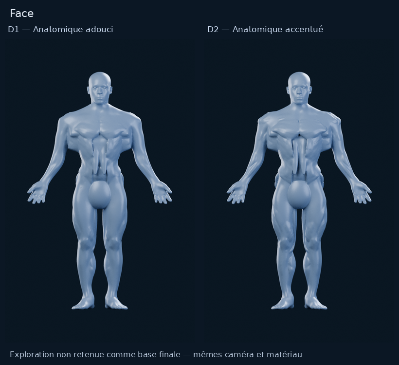
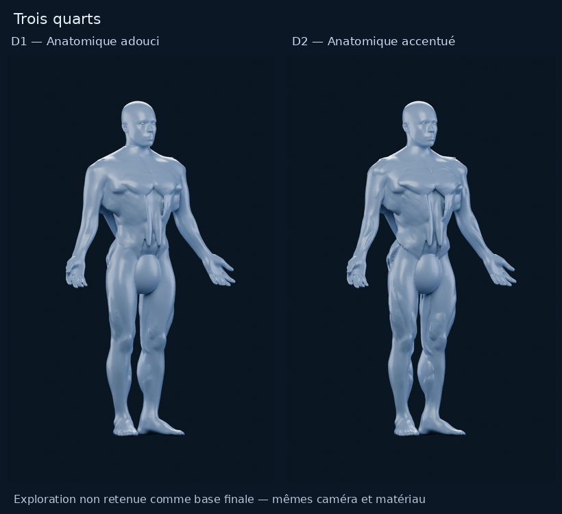
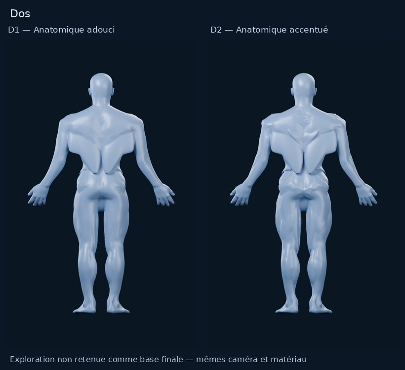
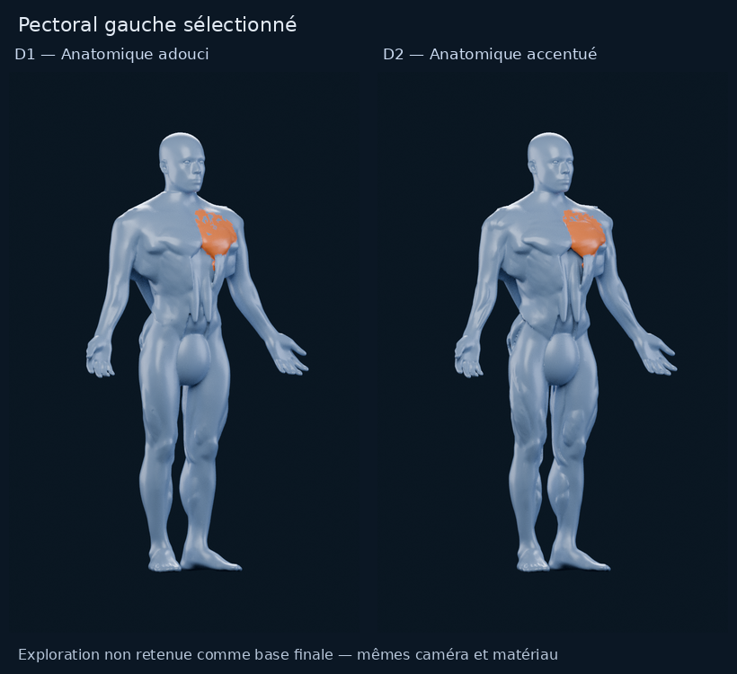

# M4A — BodyParts3D comme fondation d’un atlas fitness stylisé

19 octobre 2026 · [PR #11](https://github.com/mkfreyer/logbook/pull/11) en brouillon · aucune intégration.

**Recommandation : ne retenir ni D1 ni D2 comme base finale.** Les deux
reconstructions ci-dessous sont de vrais modèles et rendus Blender. Elles
réutilisent bien les volumes BodyParts3D audités, mais leur union automatique
ne produit pas le mannequin premium demandé. La source anatomique et les
regroupements restent utiles ; le résultat visuel n’est pas validable en l’état.
Arrêt après cette publication, sans nouvelle série de retouches.

## Comparaison visuelle

D1 = anatomique adouci, à gauche. D2 = anatomique accentué, à droite.
Les deux utilisent exactement le même matériau, les mêmes éclairages, cadrages
et paramètres de rendu. Chaque colonne montre le corps entier, sans zoom
pendant la sélection. Les planches sont de simples assemblages des PNG Blender,
sans génération d’image, repeinture ou correction locale des défauts.

[Prévisualisation D1 à 390 px](m4a/bp3d-fitness/comparisons/soft-mobile-390.png) ·
[Prévisualisation D2 à 390 px](m4a/bp3d-fitness/comparisons/defined-mobile-390.png) ·
[PNG originaux D1, 720 × 1 152](m4a/bp3d-fitness/soft/renders) ·
[PNG originaux D2, 720 × 1 152](m4a/bp3d-fitness/defined/renders).
Les fichiers à 390 px simulent une largeur d’affichage, pas un test dans l’app.

Pour comparer à la source déjà auditée : [peau BodyParts3D brute](m4a/bodyparts3d/renders/skin/three-quarter.png)
et [muscles BodyParts3D bruts](m4a/ecorche/bodyparts3d/three-quarter.png).
Ces deux vues historiques ont leur propre protocole ; elles servent de contexte,
pas de comparaison contrôlée de matériau avec D1/D2. La cible jointe dans le chat
a été consultée ; elle n’est pas redistribuée ni utilisée comme texture.

## Source, périmètre et groupes retenus

L’archive officielle existante `isa_BP3D_4.0_obj_99.zip` a été revérifiée
avant réemploi : 142 903 898 octets, SHA-256
`40665852c49f218326590e204db91064a1ecfc3c6f8cbd7bbbcaac62c7cd409e`.
Les tables et l’audit antérieur sont conservés : [audit anatomique](AUDIT_M4A_ANATOMIE.md),
[correspondances auditées](m4a/bodyparts3d/selection-candidate.json).
Aucun nouvel achat, téléchargement d’asset de remplacement ou dépendance commerciale.

**15 familles, 30 zones gauche/droite, 74 OBJ musculaires retenus** :
pectoraux, deltoïdes, biceps, triceps, avant-bras, trapèzes, dorsaux, abdominaux,
obliques externes, fessiers, quadriceps, ischio-jambiers, mollets, adducteurs,
tibial antérieur. Les deux dernières complètent les treize familles demandées.
[Liste détaillée avec IDs et regroupements](m4a/bp3d-fitness/GROUPES.md) ·
[identités FMA/BP/FJ et lignes des tables](m4a/bp3d-fitness/groups.json).

**Exception explicite :** aucune identité officielle exploitable de grand dorsal
ou de grand droit abdominal n’a été établie dans les données auditées. Les quatre
régions correspondantes sont donc des volumes artistiques originaux approximatifs,
sans identifiant FMA inventé. La liste de familles n’implique pas que toute la
surface ait une anatomie source vérifiée. Os, nerfs, organes, couches profondes
inutiles et objets tendineux isolés ne deviennent pas des zones interactives.

## Méthode réellement appliquée

1. Lecture directe des OBJ sélectionnés dans l’archive épinglée, soudure des
   positions identiques, normales recalculées et suppression de petits fragments.
2. Adaptation commune de largeur/volume : épaules élargies, taille resserrée,
   profondeur athlétique et bras légèrement écartés. Les groupes proviennent des
   volumes BodyParts3D, et non d’un torse B+ sur lequel on simulerait leur présence.
3. Peau BodyParts3D `FJ2810` conservée en retrait comme soutien continu pour
   articulations, mains et pieds. Les extrémités tendineuses des avant-bras et les
   parties médiales des aponévroses obliques sont raccourcies avant union.
4. Ajout des quatre compléments artistiques abdominaux/dorsaux, de deux supports
   internes de raccord abdomen/bassin, puis légère dilatation de 1,8 mm des pièces
   dans les unités de scène pour fermer des tangences locales. La tête neutre
   au-dessus de z = 1,535 et les deux yeux CC0 proviennent de B+ Puissance ; aucun
   torse ou membre B+ n’est repris. Les unités normalisées n’établissent pas la
   taille physique de la personne BodyParts3D.
5. Union voxel en une seule surface corporelle, lissage et décimation. Ce choix
   élimine les objets musculaires flottants, mais ne garantit ni une bonne
   silhouette ni des séparations esthétiques : c’est précisément la limite observée.
6. Projection par proximité des surfaces sources d’un attribut entier de faces
   `m4a_fitness_zone`, IDs 1–30 ; ID 0 = soutien non assigné. Un shader mélange
   bleu argenté et orange sur l’ID 1, pectoral gauche. Aucune texture peinte,
   normal map, IA d’image ou sculpture interactive n’est utilisée ici.

La première prévisualisation a révélé une déformation des poignets et des raccords
abdominaux défectueux. **Une correction bornée** de la remise en pose et du soutien
a été effectuée avant ces rendus. Elle a redressé les poignets, sans résoudre
l’abdomen ni le bassin. Aucune troisième variante ou correction supplémentaire
n’a été lancée après ce constat.

## Différences et coût géométrique

| Mesure | D1 — adouci | D2 — accentué |
| --- | ---: | ---: |
| Rétraction du soutien cutané, facteur de construction | 0,90 | 0,84 |
| Renforcement maximal transversal des volumes sources | +18 % | +25 % |
| Taille de voxel, unités de scène | 0,0036 | 0,0031 |
| Passes de lissage après union | 4 | 3 |
| Triangles du corps | 96 000 | 120 000 |
| Triangles visibles, yeux compris | **98 176** | **122 176** |
| Objets visibles | 3 : corps + 2 yeux | 3 : corps + 2 yeux |
| Objets musculaires séparés | 0 | 0 |
| Zones provisoires | 30 + soutien 0 | 30 + soutien 0 |

Les pourcentages ci-dessus sont des paramètres de déformation locale, pas des
mesures de masse musculaire ou des changements uniformes de circonférence.
D1 masque davantage les creux mais perd de la lisibilité. D2 expose davantage
les volumes, au prix d’irrégularités plus fortes. Une troisième variante serait
peu rentable tant que les raccords de construction restent incorrects.

Cycles CPU, Blender 4.3.2, 96 échantillons, seed 0, sans débruitage,
720 × 1 152, caméra orthographique fixe 2,30 ; matériau bleu argenté satiné et
quatre lumières partagés. Paramètres complets :
[D1](m4a/bp3d-fitness/soft/renders/render-metadata.json),
[D2](m4a/bp3d-fitness/defined/renders/render-metadata.json).

## Ce qui fonctionne et ce qui empêche la validation

Le réemploi anatomique est traçable, le corps reste entier, les groupes sont
regroupés par usage fitness, et une région peut effectivement être colorée en
orange. Le matériau et l’absence d’organes/os exposés évitent l’aspect médical brut.

Mais la référence présente des pectoraux pleins et raccordés, un abdomen lisible,
des deltoïdes arrondis, des jambes structurées et des transitions élégantes.
Ici, les pectoraux paraissent trop horizontaux, les épaules anguleuses, la paroi
abdominale verticale et creusée plutôt que structurée en muscles fitness. Le soutien
pelvien forme un volume ovoïde trop visible. Les mains et les transitions restent
moins soignées que la cible. Les muscles de jambe ne compensent pas ces défauts.
Le dos reste dominé par de grands aplats et des bords trop francs.
La séparation en surface provient des jonctions de l’union, pas d’un langage
artistique homogène ; aucune orientation de fibres convaincante n’est produite.

**À largeur mobile, ces défauts restent visibles et la lecture musculaire premium
n’est pas convaincante.** Augmenter les détails ou changer seulement le matériau
ne résoudrait pas les raccords. Le masque orange est visiblement fragmenté dans le haut du pectoral et déborde
localement vers sa jonction inférieure. Il démontre la coloration par ID, sans
démontrer un muscle proprement sélectionnable. Ses frontières ne constituent
pas une sélection produit prête à utiliser.

Les contrôles géométriques distinguent fermeture et qualité visuelle :

- D1 : un corps connecté, 0 bord ouvert, 0 arête non-manifold, 0 triangle dégénéré,
  0 intersection non adjacente détectée. Caractéristique d’Euler −2, genre 2 :
  la surface fermée conserve deux anses topologiques, donc pas une enveloppe de genre zéro.
- D2 : un corps connecté, 0 bord ouvert, 0 arête non-manifold, 0 triangle dégénéré,
  mais **une intersection de triangles détectée au pied** ; Euler −10, genre 6.
  Cette version accentuée présente donc aussi un défaut technique restant.
- Les yeux sont deux volumes séparés intentionnels. Le test ne classe pas leurs
  contacts avec le corps. Les candidats coplanaires sont comptés séparément.

Mesures complètes : [D1](m4a/bp3d-fitness/soft/geometry-check.json),
[D2](m4a/bp3d-fitness/defined/geometry-check.json).
Le rendu ne modifie ni les positions, ni les triangles, ni les étiquettes de zone
par rapport aux modèles construits ; cette identité est contrôlée sur les scènes de revue.

## Interactivité future, mobile et décision

Les IDs constituent un point de départ pour une future sélection par zone,
**pas une segmentation finale**. Les frontières devront être redessinées et le
transfert de labels revu. Le grand dorsal et le grand droit resteront explicitement
artistiques jusqu’à une éventuelle validation de leurs repères. Un attribut entier
par face n’est pas directement un contrat d’export glTF : il faudra choisir une
conversion en masque, en sommets ou en primitives avant toute intégration.
Aucun raycasting, tonnage, nombre de séries ou part du volume n’est implémenté.

98–122 k triangles et trois objets rendent un essai mobile envisageable à terme,
mais **aucune fluidité, mémoire GPU, qualité de picking ou compatibilité iPhone
n’est établie**. Il n’y a ni rig, ni LOD, ni GLB de production, ni WebView/Three.js.
Le cadrage de ces rendus reste centré sur le corps entier, y compris pour l’orange ;
aucun zoom automatique n’est ajouté à une expérience applicative.

**Choix recommandé : aucun des deux en l’état.** Conserver les repères anatomiques,
les groupes et cette preuve technique ; ne pas lancer automatiquement une nouvelle
variation de volume, de voxel ou de matériau. Une suite éventuelle demanderait une
reconstruction artistique délibérée des transitions et de la silhouette, validée
sur un périmètre limité avant le corps entier. Elle n’est pas engagée ici.
Davantage de calcul ou Astra Ultra n’apporterait pas, à lui seul, cette décision artistique.

Sources, modèles, licences et reproduction : [dossier de livraison](m4a/bp3d-fitness/README.md).
Les nouveaux modèles et rendus sont sous [CC BY-SA 4.0](m4a/bp3d-fitness/ATTRIBUTION.md),
avec attribution BodyParts3D/DBCLS et tête/yeux CC0 ; le code applicatif n’est pas relicencié.
Budget d’acquisition : **0 €**. Aucun outil payant, aucun achat, aucun recours à Astra.
Tous les essais antérieurs sont préservés. Aucun changement applicatif, SQLite,
M4B ou fusion. **Arrêt pour décision utilisateur.**
