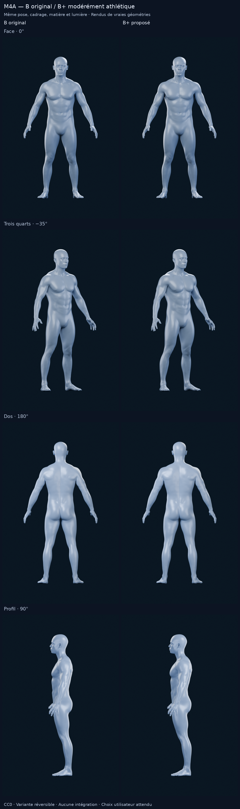
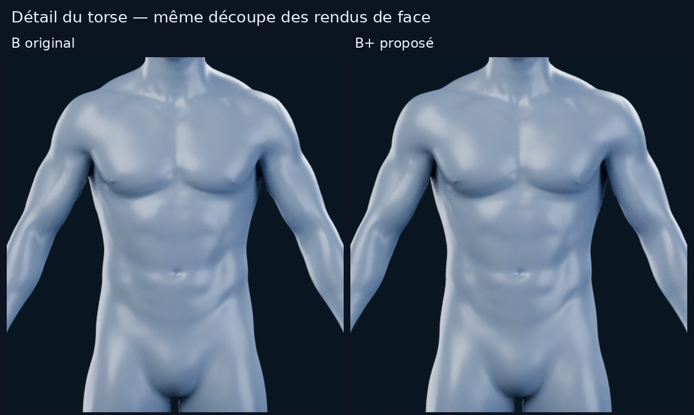
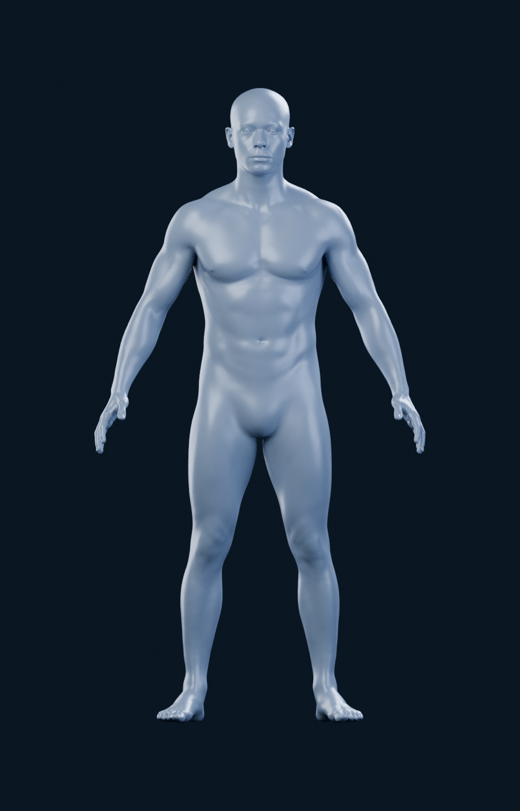
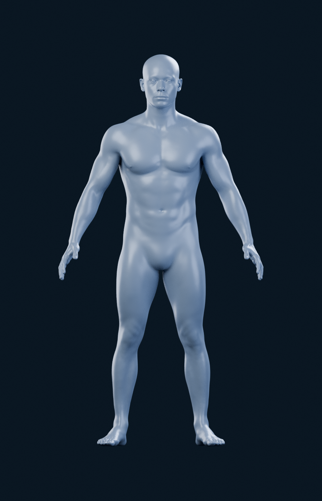
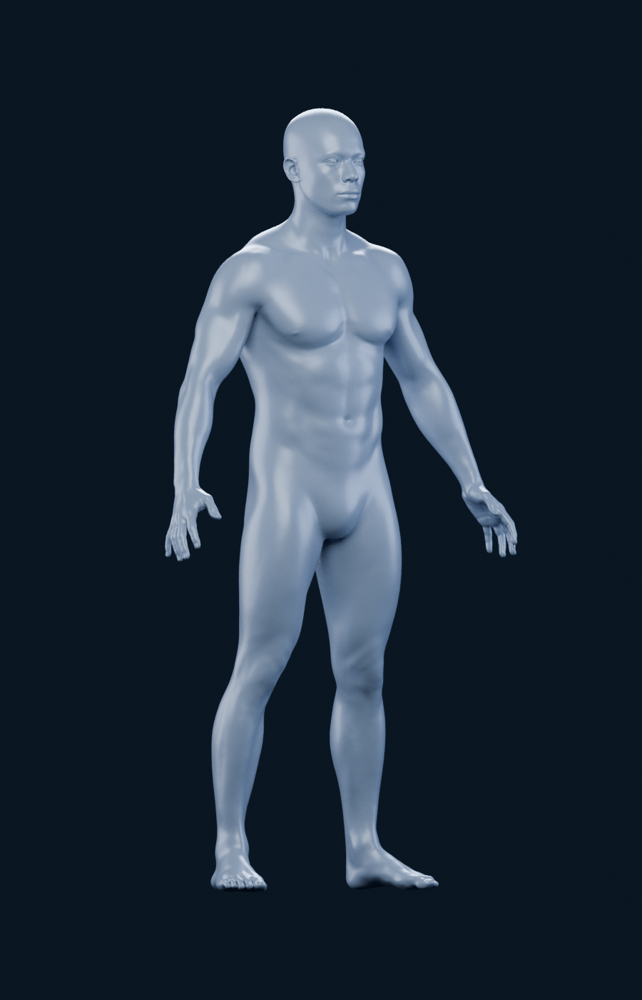
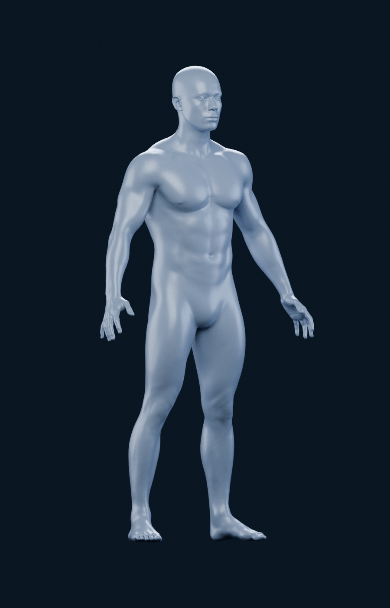
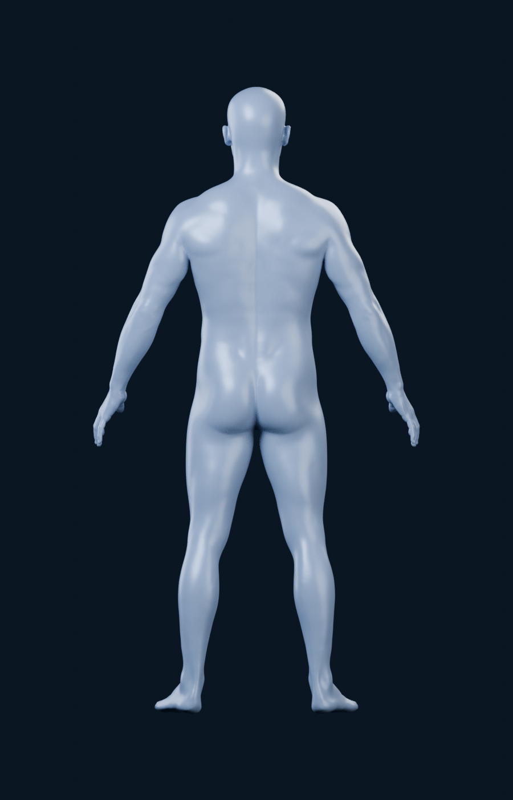
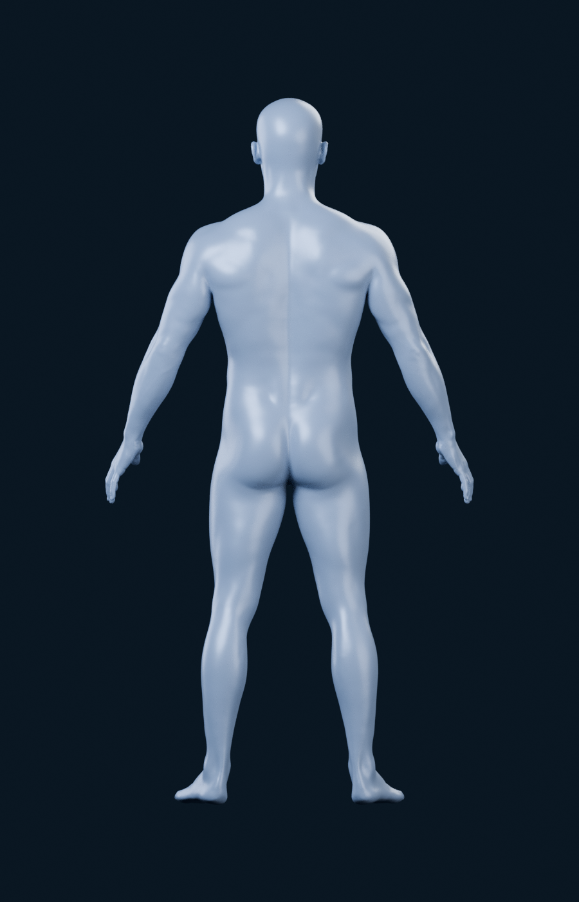
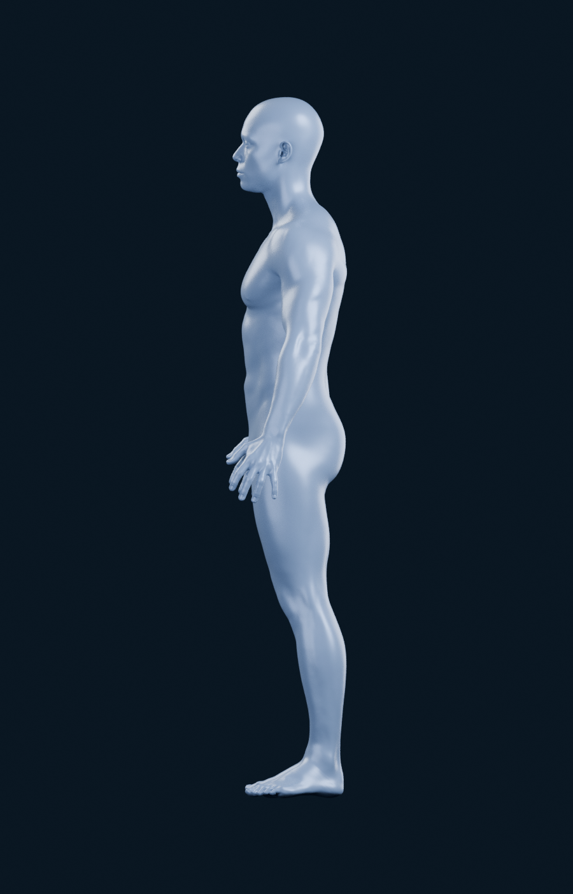
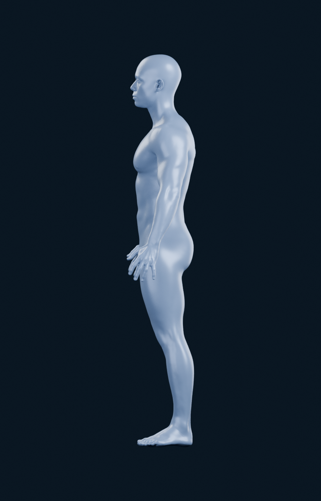

# M4A — B original et variante B+ modérément athlétique

Itération du **18 octobre 2026**, après `7c3688a`, sur la même branche et la
[PR #11 en brouillon](https://github.com/mkfreyer/logbook/pull/11).
Le choix provisoire de l’utilisateur est B ; C est écarté, A reste trop doux.
**Verdict proposé : B+. Arrêt pour validation visuelle, avant toute intégration.**

## Ce qui a réellement changé

B+ dérive du vrai corps masculin réaliste **Dan Ulrich / Blender Studio Human
Base Meshes v1.4.1**, sous CC0. Ce n’est ni une nouvelle image générée, ni un
remplacement du modèle. Une shape key réversible déplace progressivement les
sommets de sa cage d’origine, avant son Multires niveau 3. La valeur 0 restitue B ;
la valeur 1 donne B+. Les yeux, la pose et les proportions générales sont conservés.

| Zone | Modification artistique appliquée |
| --- | --- |
| Pectoraux | Un peu plus de projection et de largeur, transition douce vers le sternum et les épaules |
| Épaules | Deltoïdes plus pleins, léger élargissement de la silhouette haute, sans gonfler le cou |
| Bras | Épaississement modéré autour de l’axe natif du haut du bras, avec fondu avant le coude |
| Dos | Davantage de volume au haut du dos et de largeur aux dorsaux, sans creuser des sillons |
| Quadriceps | Face avant et bord externe légèrement plus pleins, avec fondu avant le genou et le bassin |

Pas de stries ajoutées, d’écorché, de gravure des abdominaux, de remeshing ou de
muscles collés sur le corps. Les champs d’influence sont des **masques de déformation
artistique**, pas une segmentation anatomique. La taille n’est pas amincie pour
simuler artificiellement une musculature plus forte. La déformation est bilatérale
et respecte la continuité au centre ; les petites asymétries du scan source restent.
Les [paramètres exacts](m4a/alternatives/studio-realistic-plus/settings.json) et
le [rapport de génération](m4a/alternatives/studio-realistic-plus/generation.json)
conservent amplitudes, zones, empreintes et méthode.

## Rendus comparatifs

Les trois vues B déjà publiées sont réutilisées **sans changement
de leurs PNG**. Seul son profil est nouveau. B+ est rendu sur les quatre angles.
Même matériau satin gris bleuté, fond bleu nuit, quatre lumières, Cycles CPU,
128 échantillons sans débruitage, 900 × 1400. Même centre et échelle provenant des
métadonnées B, caméra orthographique 2,30, hauteur normalisée 1,8.
La différence de volume ne vient donc pas d’un recadrage ou d’un changement d’éclairage.

| Vue | B original | B+ proposé |
| --- | --- | --- |
| Face 0° |  |  |
| Trois quarts −35° |  |  |
| Dos 180° |  |  |
| Profil 90° |  |  |

## Lecture par rapport à la référence fournie

La référence jointe au message utilisateur est visible et a été examinée. Elle
montre un corps athlétique bleu sur fond sombre, des épaules et des pectoraux bien
individualisés, des bras/quadriceps définis et des abdominaux très découpés.
L’orange sur les pectoraux correspond à un état de sélection, pas à la matière du
corps à reproduire pour cette comparaison.

- **B original** conserve un aspect de scan naturel, avec des volumes plus souples.
- **B+** se rapproche de la référence par la présence du haut du torse, les épaules,
  les bras et les cuisses. Le renforcement reste discret ; le visage et les
  proportions réalistes de B gardent la même identité.
- **Écart volontaire conservé** : B+ reste plus doux que les sillons et séparations
  très marqués de la référence. Les reproduire intégralement irait vers un rendu
  anatomique plus sec que le brief demandé. Aucun relief médical ou muscle interne
  n’est inventé pour combler cet écart.

La référence est une petite capture en trois quarts avec sa propre lumière et sa
propre pose. Elle sert à juger la direction visuelle ; ce n’est pas une comparaison
pixel à pixel avec nos rendus. Elle ne montre pas le dos ou un vrai profil : ces
vues servent ici à contrôler l’harmonie de B+. La capture utilisateur n’est pas
substituée par une version générée et n’est pas redistribuée comme asset 3D.

## Exploitabilité future — sans intégration à cette étape

| Usage | Verdict technique à ce stade |
| --- | --- |
| Segmentation musculaire | **Base exploitable, travail anatomique encore nécessaire.** Topologie, UV et face sets du corps B sont conservés. Aucun groupe musculaire gauche/droite n’est créé ; les masques B+ ne sont pas des limites de sélection fiables. |
| Affichage mobile fluide | **Candidat exploitable après optimisation, fluidité non validée.** Le corps de base reste à 10 582 sommets / 21 160 triangles. Le rendu Multires reste à 677 442 sommets / 1 354 880 triangles ; ce niveau n’est pas une livraison mobile. Transfert du détail et mesure sur iPhone restent à faire après choix. |
| Intégration 3D interactive | **Structure exploitable en principe, intégration non testée.** Surface continue et attributs conservés ; la déformation peut être figée après validation. Découpage des zones, export, raycasting, gestes et cycle de vie ne sont pas réalisés ici. |

B+ n’ajoute aucune face : il ne rend pas le budget géométrique plus coûteux que B.
Cela ne démontre pas un FPS, une consommation mémoire ou la qualité d’un futur
bake. Aucune optimisation, export GLB, instrumentation mobile, segmentation ou
scène interactive n’a été lancé sous couvert de cette étude visuelle.

## Contrôles de cette variante

La génération répétée donne exactement les mêmes coordonnées de shape key.
Le retour à la valeur 0 donne aussi exactement la géométrie Multires de B.
Topologie, UV, face sets et yeux sont vérifiés identiques. Le corps source est
fermé et sans arête partagée par plus de deux faces ; B+ conserve cette topologie.
Sur les **1 354 880 triangles évalués** : aucun nouveau triangle dégénéré au seuil
contrôlé, aucune normale retournée de plus de 90° par rapport à B.
La recherche exhaustive d’auto-intersections et les déformations d’un futur rig
ne sont pas réalisées ; ces contrôles ne constituent pas une certification anatomique.

Le déplacement maximal évalué est d’environ **0,0149 unité pour une hauteur
normalisée de 1,8**, soit moins de 1 % de la stature. Il s’agit de coordonnées du
modèle, pas d’une mesure de masse musculaire. Les pieds et les mains restent
inchangés ; la tête ne présente que l’écart numérique indiqué dans le rapport.
Un fondu Multires minime près du genou est mesuré, sans changement intentionnel
aux mollets. Les données détaillées sont conservées, y compris les limites.

## Conservation et reproduction

- [B-plus.blend](m4a/alternatives/studio-realistic-plus/B-plus.blend) conserve la
  source sélectionnée, la base B inchangée, la shape key B+, le Multires source,
  les deux yeux et les textes de licence. Il reste un outil d’étude hors runtime.
- [Générateur](../tools/m4a/alternatives/generate_bplus.py),
  [contrôle géométrique](../tools/m4a/alternatives/validate_bplus.py) et
  [instructions](../tools/m4a/alternatives/README.md).
- [Métadonnées de rendu B+](m4a/alternatives/studio-realistic-plus/render-metadata.json),
  [profil B](m4a/alternatives/studio-realistic-side/render-metadata.json),
  [contrôles géométriques](m4a/alternatives/studio-realistic-plus/geometry-validation.json).
- Les archives et études précédentes, la comparaison A/B/C, les sources officielles
  et tous leurs rendus restent conservés.

**Recommandation : B+**, pour son renforcement modéré conforme au retour produit,
avec validation visuelle par l’utilisateur encore attendue. Aucun modèle de
production n’est validé automatiquement. Aucun code applicatif, SQLite, migration,
dépendance, M4B ou fusion ; aucun recours à Astra Ultra.
