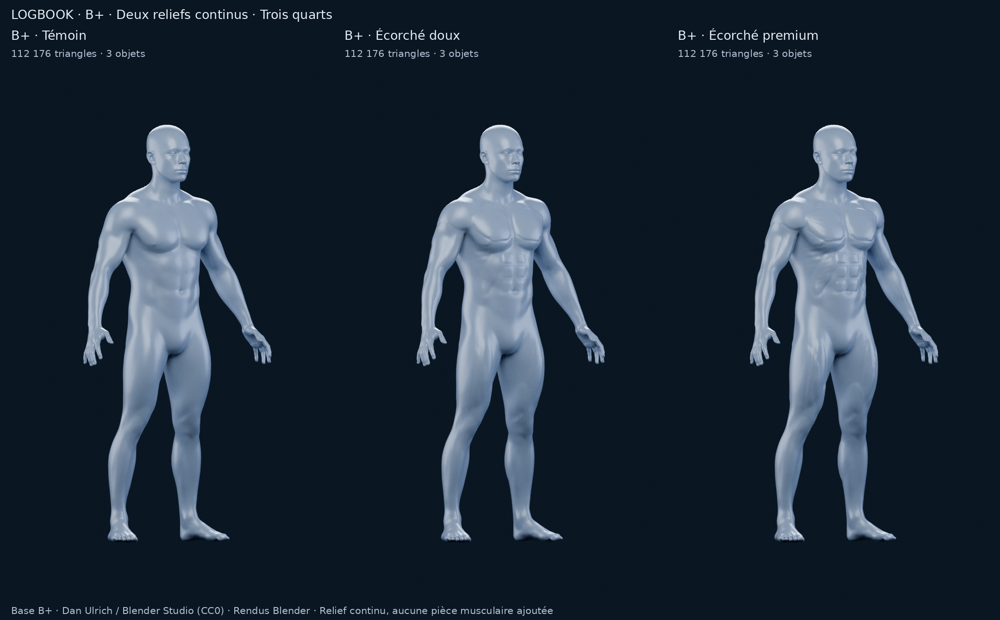

# M4A — B+ Écorché doux / Écorché premium

18 octobre 2026. **Exploration à choisir**, PR #11 en brouillon, sans fusion.
B+ original redevient la fondation ; L1/L2/L3 et S1/S2/S3 restent archivés.
Aucune intégration applicative, modification SQLite, segmentation finale ou M4B.

**Recommandation : B+ Écorché premium**, pour sa meilleure lecture musculaire à silhouette B+ conservée. Le résultat reste une proposition artistique : ses contours pectoraux / dorsaux et ses abdominaux réguliers doivent être validés visuellement. Il n'atteint pas encore toute la finesse anatomique de la référence.

[Galerie, sources et scènes Blender](m4a/bplus-fitness/README.md) · [Comparaison générale](m4a/bplus-fitness/comparaison.png) · [Détail du torse](m4a/bplus-fitness/detail-torse.png)

## Deux variantes, un témoin

La source est le **B+ modérément athlétique original**, issu des Human Base Meshes de Dan Ulrich / Blender Studio (géométrie CC0). Ce n'est ni B+ V2, ni une reconstruction L/S. Le fichier historique B+ et ses rendus restent inchangés.

Le témoin B+ a été rendu à nouveau avec le même allègement et le même studio que les deux candidats. Cela permet de comparer le relief sans confondre changement de matière, de caméra et de géométrie.

| | B+ témoin | B+ Écorché doux | B+ Écorché premium |
|---|---|---|---|
| Rôle | Contrôle, aucune sculpture ajoutée | Nouvelle variante 1 | Nouvelle variante 2 |
| Déplacement maximal du corps haute résolution | 0 mm | 3,87 mm | 7,28 mm |
| Relief | B+ existant | Séparations peu profondes, volumes discrets | Séparations et volumes plus présents |
| Lecture | Athlétique à peau lisse | Transition douce vers une anatomie fitness | Pectoraux / abdomen / cuisses plus lisibles |
| Risque artistique principal | Trop lisse pour la cible | Différence parfois faible à petite taille | Contours pectoraux / dorsaux géométriques et abdominaux réguliers |
| Triangles visibles | 112 176 | 112 176 | 112 176 |
| Objets maillés | 3 | 3 | 3 |
| Zones de démonstration | 2 pectoraux | 2 pectoraux | 2 pectoraux |

## Modifications réelles de la surface

Le relief déplace les sommets du corps B+ dans le sens des normales. Il est calculé sur son évaluation Multires haute résolution, avant la création d'une copie statique allégée. **Aucune pièce musculaire supplémentaire n'est assemblée au corps.**

- Pectoraux : volumes en éventail, séparation sternale et limite inférieure plus lisibles ; quelques ondulations superficielles suggèrent la direction des fibres.
- Deltoïdes, biceps et triceps : coiffes et reliefs longitudinaux intégrés à la surface existante ; épaules et bras gardent leur raccord B+.
- Abdominaux et obliques : trois paires de reliefs abdominaux, sillon central et accents obliques / dentelés. La régularité de cette construction reste visible.
- Dos et trapèzes : volumes ouverts et courbes peu profondes ; suppression des contours fermés qui évoquaient des pièces rapportées dans les essais internes.
- Quadriceps : trois directions de volume, séparations ouvertes ; ischios et deux chefs des mollets reçoivent des accents complémentaires.
- Avant-bras : directions discrètes, sans réseau tendineux médical. Tête, mains, pieds et transitions sensibles sont protégés du relief ajouté ; les genoux bénéficient d'une atténuation.

Les deux variantes utilisent la même logique, avec une amplitude différente. Le maximum mesuré concerne quelques sommets ; le déplacement moyen est de 0,10 mm pour Doux et 0,18 mm pour Premium. La stature normalisée reste de 1,80 m ; hauteur et largeur hors tout sont identiques au témoin. Seule la profondeur maximale augmente : +2,05 mm pour Doux et +4,07 mm pour Premium. Il s'agit de rendre les groupes visibles **dans B+**, pas de transformer sa silhouette en bodybuilder.

## Comparaison avec la référence

La référence sert à orienter la lecture des grands groupes, l'identité bleu argenté et le surlignage orange. Aucun pixel de la référence n'est utilisé pour fabriquer ou retoucher les rendus.

Premium se rapproche davantage de cette intention par la poitrine en éventail, le torse structuré et les cuisses plus dessinées. Doux conserve mieux la douceur du B+ initial, mais garde davantage l'aspect d'un corps à peau lisse. Le dos et les fibres restent moins explicites que dans la référence ; la matière satinée n'en reproduit pas la translucidité. Les pectoraux et dorsaux Premium peuvent encore évoquer un panneau sculpté, avec un bas de dorsaux anguleux, et les abdominaux une grille : **ce sont les principaux points à juger**, sans les présenter comme une anatomie finalisée.

## Rendus comparatifs

Quinze véritables rendus Blender 4.3.2 / Cycles CPU : cinq vues par modèle, **720 × 1 152 pixels, 96 échantillons**, graine fixe, sans débruitage. Caméra orthographique, cadrage, quatre lumières, exposition et matière communs. Fond sombre et matière bleu argenté satinée ; aucune image générative ou retouche de l'anatomie.

[Face](m4a/bplus-fitness/comparaison-front.png) · [Trois quarts](m4a/bplus-fitness/comparaison-three-quarter.png) · [Dos](m4a/bplus-fitness/comparaison-back.png) · [Profil](m4a/bplus-fitness/comparaison-side.png) · [Sélection orange](m4a/bplus-fitness/comparaison-selection.png)

Les sept planches sont de simples assemblages ou recadrages des quinze PNG. Les sources `.blend`, scènes de revue F12 et paramètres sont conservés pour les trois colonnes. Les signatures de géométrie, normales et masques sont comparées avant / après préparation du studio.

## Structure et limites techniques

**Un corps continu fermé de 110 000 triangles et deux yeux de 1 088 triangles chacun**, soit 112 176 triangles affichés. Chaque objet possède une composante, un genre topologique nul et aucun bord ouvert, sommet isolé, triangle quasi dégénéré ou coordonnée non finie. L'auteur haute résolution reste le B+ historique de 1 354 880 triangles corporels, accompagné du générateur reproductible ; les nouveaux fichiers sont des copies statiques de recherche.

Le garde-fou de sculpture atténue localement les déplacements qui risquent de retourner des triangles haute résolution. Le produit scalaire minimal des normales avant / après reste supérieur à 0,85. L'allègement réduit les détails fins et ne constitue pas une retopologie de production.

**Limite de contact héritée, à conserver dans la décision :** le contrôle triangle / triangle détecte des auto-croisements dans la tête et les pieds, y compris dans le B+ original sans relief ni allègement. Le contrôle natif ciblé y trouve 1 571 paires de triangles (1 062 pieds, 509 tête). Les trois copies allégées en ont respectivement 320 / 313 / 304, exclusivement dans ces mêmes régions protégées. Ces nombres dépendent de la tessellation ; leur baisse ne signifie pas une réparation. Aucun croisement n'est détecté dans le tronc ou les membres sculptés, ni aucun candidat coplanaire sur les copies testées.

Cela n'autorise pas à déclarer le modèle globalement sans auto-intersection. Les contacts tête / pieds demanderaient un nettoyage si cette base est choisie. Le contrôle ne constitue ni une validation médicale, ni un audit exhaustif de tout le corps haute résolution. Les deux yeux ajustés restent volontairement séparés ; leurs contacts avec le corps ne sont pas classés comme erreurs.

| Usage futur | Évaluation à ce stade |
|---|---|
| Segmentation musculaire | Possible sur la surface continue. Deux masques pectoraux de démonstration sont présents ; aucune partition complète, ni frontières anatomiques définitives. |
| Sélection orange | Démonstration Blender réelle : attribut scalaire interpolé sur la surface puis seuil de shader. Deux attributs gauche / droite sont préparés ; le rendu montre les deux pectoraux simultanément. Aucun muscle flottant ni objet rapporté. |
| Mobile iPhone | Base de recherche plausible : 112 k triangles / 3 objets. Fluidité **non mesurée** ; budget final, compression, ombrage et éventuelle cuisson du relief restent à évaluer après choix. |
| 3D interactive | Structure exploitable pour préparer des zones et un export ultérieurs, mais pas de GLB d'application, rig, picking, WebView ou Three.js livrés ici. |

[Audit géométrique Premium](m4a/bplus-fitness/premium/geometry-check.json) · [Contacts B+ natif](m4a/bplus-fitness/native-contact-check.json) · [Contrôles de livraison](m4a/bplus-fitness/validation.json) · [Manifest SHA-256](m4a/bplus-fitness/manifest.json) · [Provenance / licence](m4a/bplus-fitness/PROVENANCE.md)

## Reprise et préservation

La sauvegarde initiale a été vérifiée à nouveau : 3 606 fichiers, 97 888 638 octets, empreintes conformes. Le bundle officiel sur `download.blender.org` répond HTTP 200 avec la configuration réseau actuelle. Les sources nécessaires sont déjà disponibles : aucun téléchargement ni reconstruction des anciens candidats n’était nécessaire. Tous les fichiers historiques de `docs/m4a` et `tools/m4a` sont vérifiés inchangés depuis `70ceacb` ; seuls de nouveaux livrables sont ajoutés et la bannière de reprise est actualisée.

## Arrêt pour choix

**Choix recommandé : B+ Écorché premium**, si sa lecture pectoraux / abdomen vous convient ; Doux est l'alternative plus discrète. Cette recommandation porte sur la direction visuelle, pas sur une autorisation d'intégration.

La PR #11 reste en brouillon. Historique préservé, aucune modification applicative ou SQLite, aucun M4B et aucune fusion. Aucun recours à Astra Ultra. Arrêt après publication de ces rendus et de ce rapport, pour choix utilisateur.
