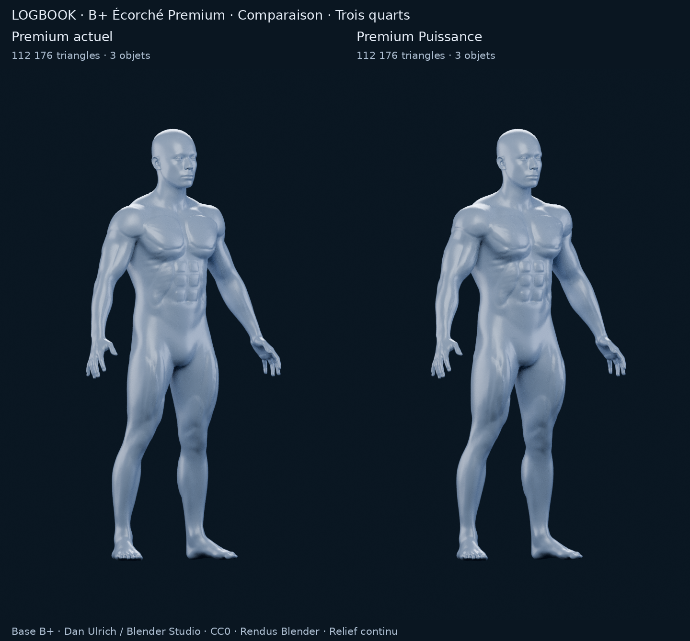

# M4A — B+ Écorché Premium Puissance

18 octobre 2026. **Une seule nouvelle direction**, issue du B+ Écorché Premium choisi par l'utilisateur. PR #11 en brouillon ; arrêt pour validation visuelle avant toute intégration.

**Recommandation : Premium Puissance pour poursuivre la direction validée.** Les épaules, les bras et les cuisses gagnent en présence ; les séparations et les indications de fibres sont renforcées. La version actuelle reste le témoin exact. La proposition n'est pas une finition anatomique définitive : les pectoraux gardent des contours stylisés, certains sillons restent réguliers et les fibres sont moins lisibles dans les vues éloignées.

[Galerie, sources Blender et reproduction](m4a/bplus-power/README.md) · [Comparaison générale](m4a/bplus-power/comparaison.png) · [Détail torse](m4a/bplus-power/detail-torse.png)

## Ce qui change réellement

Cette version part **du fichier `model.blend` du Premium validé**, avec correspondance des sommets. Le corps est épaissi par neuf champs de volume continus, puis son relief superficiel reçoit une correction relative. Il ne s'agit ni d'une nouvelle base L/S, ni d'une nouvelle série de variantes, ni d'un simple changement de matériau.

| Région | Évolution par rapport au Premium actuel |
|---|---|
| Pectoraux | Projection et plénitude augmentées ; bombé plus progressif vers le centre ; limite périphérique moins creusée pour contenir l'effet de plaque. |
| Épaules | Élargissement et profondeur des deltoïdes, légère remontée de leur couronne ; raccord existant conservé. |
| Bras | Épaississement radial des bras et avant-bras, directions biceps / triceps et sillons longitudinaux accentués. |
| Dorsaux / trapèzes | Largeur et profondeur accrues ; relief additionnel plus progressif, plutôt qu'un nouveau contour fermé en polygone. |
| Abdomen / obliques | Relief plus présent ; correction vers des ventres abdominaux elliptiques de tailles graduées ; obliques et dentelés renforcés. |
| Quadriceps | Épaisseur antérieure, relief des trois grandes directions et séparations longitudinales renforcés. |
| Ischios / mollets | Épaisseur postérieure et plénitude radiale augmentées, deux directions des mollets maintenues. |
| Fibres | Ondulations orientées plus fortes sur les grandes zones ; éventail pectoral, directions longitudinales sur bras / jambes et diagonales dans le dos. |

La taille, la tête, les extrémités et la pose restent cohérentes avec Premium. Le renforcement du haut du corps accentue le V visuel sans élargissement volontaire de la taille. Le déplacement maximal mesuré depuis le Premium parent est **17,95 mm**, pour **2,15 mm en moyenne sur les sommets du corps**. Ce sont des déplacements de surface, pas des pourcentages de masse musculaire.

Les champs radiaux des bras et avant-bras ciblent localement un facteur de 20 %, modulé spatialement. Cela **ne signifie pas** 20 % de circonférence ou de volume supplémentaire sur tout le membre. Les valeurs de fibre / relief du générateur sont des amplitudes demandées, atténuées ensuite par le lissage du déplacement et le contrôle local d'orientation. Les [mesures comparatives](m4a/bplus-power/comparison-geometry.json) portent sur les mêmes sommets dans des fenêtres fixes et documentent le résultat appliqué : décalage moyen vers l’extérieur de 7,27 mm sur la fenêtre pectorale, 9,79 mm sur les deltoïdes, 7,42 mm sur les bras et 6,77 mm sur les quadriceps. Ce ne sont pas des mesures de circonférence.

## Surface, structure et sélection future

| | Premium actuel | Premium Puissance |
|---|---:|---:|
| Triangles corporels | 110 000 | 110 000 |
| Triangles affichés avec les yeux | 112 176 | 112 176 |
| Sommets corporels | 55 002 | 55 002 |
| Objets maillés | 3 | 3 |
| Corps continu | 1 | 1 |
| Objets musculaires rapportés | 0 | 0 |
| Zones pectorales de démonstration | 2 | 2 |

**Topologie et trois attributs de sélection pectorale conservés à l'identique.** Aucun remesh, nouvel allègement ou ajout de morceaux musculaires. Les masques restent attachés aux mêmes sommets pendant la déformation. Le rendu orange sélectionne les deux pectoraux par seuil d'un attribut de surface interpolé ; aucune segmentation complète ou interaction applicative n'est développée.

Le déplacement est adouci sur les arêtes existantes ; le maillage source n'est pas lissé globalement. Le garde-fou local limite les changements d'orientation : produit scalaire minimal des normales avant / après **0,8506**. Chaque objet reste fermé, à une composante et de genre topologique nul, sans bord non-manifold, sommet isolé, triangle quasi dégénéré ou coordonnée non finie détecté.

Les petits auto-croisements hérités de B+ dans la tête / les pieds restent une réserve de production, comme dans le [rapport précédent](M4A_B_PLUS_ECORCHE.md). Le contrôle final retrouve les mêmes 304 paires de triangles en auto-croisement (226 dans les pieds, 78 dans la tête), aucun candidat coplanaire et aucun croisement détecté dans les régions sculptées. Ces nombres décrivent des paires de triangles, pas 304 défauts visuellement distincts. Un maillage fermé ne suffit pas à garantir l'absence globale d'intersections. Aucun nettoyage des extrémités n'est revendiqué dans cette itération.

**Compatibilité future :** la structure reste exploitable pour préparer une sélection musculaire plus complète et une intégration interactive après choix. Le budget géométrique n'augmente pas. La fluidité iPhone, le coût du matériau, la compression et l'export restent non mesurés ; aucun GLB d'application, rig, WebView, Three.js ou bake n'est livré.

## Comparaison visuelle et limites

[Face](m4a/bplus-power/comparaison-front.png) · [Trois quarts](m4a/bplus-power/comparaison-three-quarter.png) · [Dos](m4a/bplus-power/comparaison-back.png) · [Profil](m4a/bplus-power/comparaison-side.png) · [Sélection orange](m4a/bplus-power/comparaison-selection.png)

Les cinq images du Premium actuel sont **réutilisées à l'identique**, sans nouveau calcul ni changement d'éclairage. Cinq nouveaux rendus Blender 4.3.2 / Cycles CPU emploient exactement le même protocole : 720 × 1 152 pixels, 96 échantillons, graine fixe, même caméra, quatre lumières et matière bleu argenté satinée, sans débruitage. Sept planches assemblent ou recadrent ces dix PNG, sans anatomie repeinte ni image générative.

Puissance est préférable pour la demande d'un physique plus athlétique : deltoïdes et bras occupent davantage la silhouette, les cuisses sont plus pleines, le torse conserve son identité et gagne en relief. Les volumes et les sillons donnent une lecture fitness plus affirmée ; la matière garde une présentation propre et couverte, sans os, organes ou tendons exposés.

**Le progrès est plus net sur la puissance des volumes que sur l’effet écorché, particulièrement au dos.** Le niveau « franchement écorché » demandé reste donc partiellement atteint.

**Limites artistiques à juger :** les contours pectoraux hérités ne disparaissent pas complètement ; certains sillons abdominaux et dorsaux restent réguliers. Le dos ne devient pas un atlas anatomique précis. Les fibres sont suggérées par du relief, avec une lecture plus faible au cadrage corps entier qu'en détail. La matière est satinée opaque, sans la translucidité de la référence initiale. Il faut donc valider si ce niveau suffit pour l'« écorché fitness » attendu ; aucune équivalence à un modèle médical ou à la référence n'est revendiquée.

## Vérifications et arrêt

[Construction](m4a/bplus-power/power/construction.json) · [Audit géométrique](m4a/bplus-power/power/geometry-check.json) · [Comparaison des sommets et masques](m4a/bplus-power/comparison-geometry.json) · [Audit du studio](m4a/bplus-power/review-validation.json) · [Validation de livraison](m4a/bplus-power/validation.json) · [Manifest SHA-256](m4a/bplus-power/manifest.json)

Les anciennes sources, scripts et images sont préservés. Les nouveaux livrables sont isolés dans `docs/m4a/bplus-power/` ; seuls le rapport et l'en-tête du document de reprise sont ajoutés / actualisés ailleurs dans la documentation. La géométrie source conserve sa provenance Dan Ulrich / Blender Studio, CC0 ; [notice et chaîne de provenance](m4a/bplus-fitness/PROVENANCE.md).

**Arrêt pour validation de Premium Puissance.** PR #11 en brouillon, aucune intégration applicative, modification SQLite, segmentation complète, M4B ou fusion. Aucun recours à Astra Ultra.
