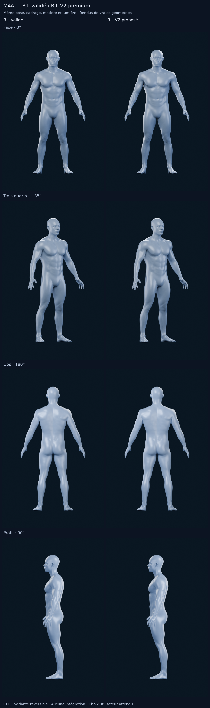
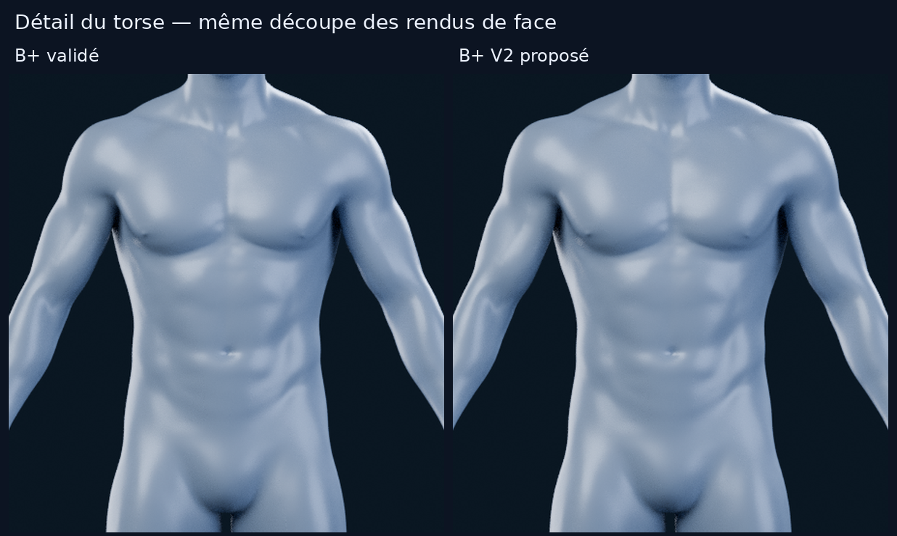
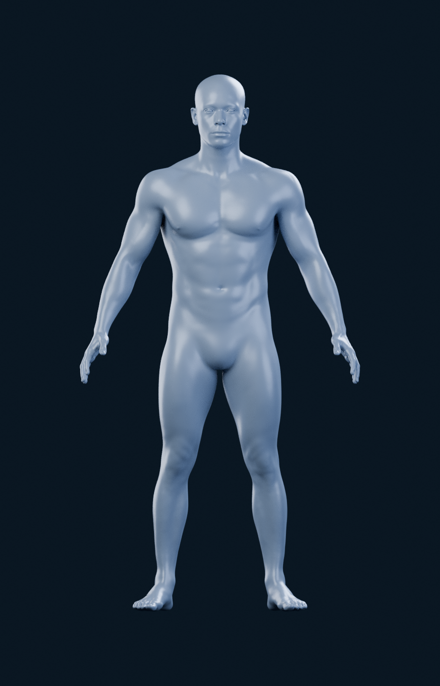
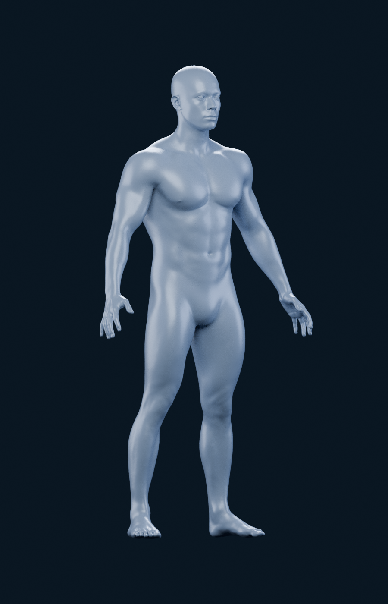
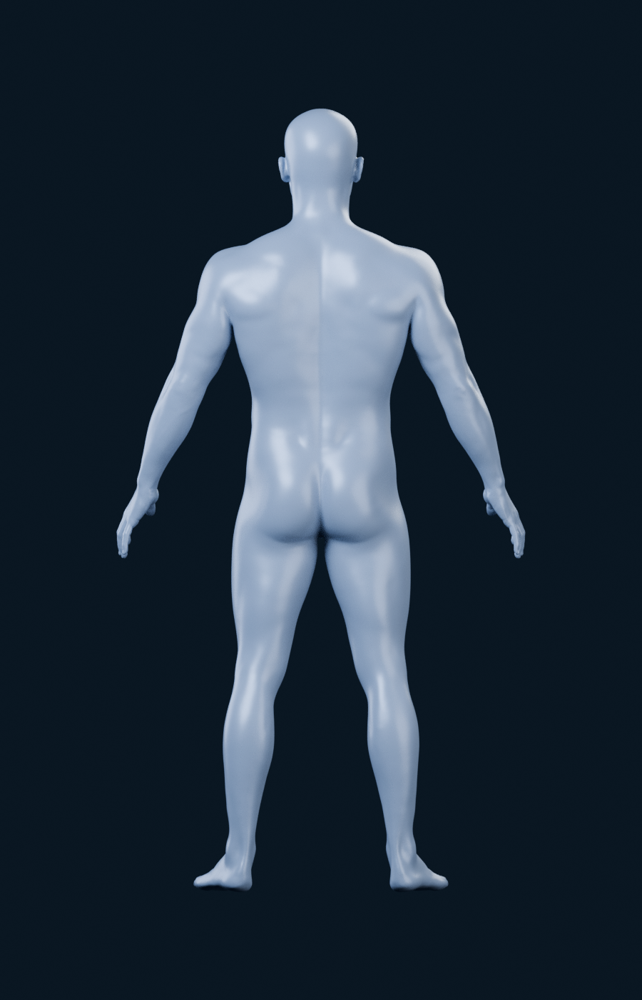
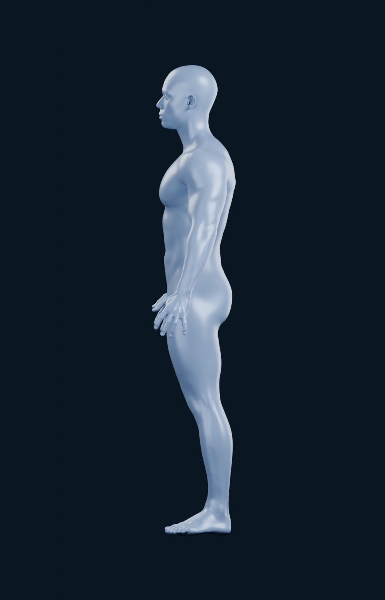

# M4A — B+ validé / B+ V2, volumes premium

Itération du **18 octobre 2026**, après `536f047`, même branche et
[PR #11 en brouillon](https://github.com/mkfreyer/logbook/pull/11).
**B+ est validé par l’utilisateur comme base visuelle. B+ V2 est une nouvelle
proposition, en attente de validation.** Aucune intégration ou suite technique
n’est commencée.

## Direction visuelle et modifications

La référence jointe est examinée : silhouette athlétique, pectoraux pleins,
épaules arrondies, haut du torse en V, bras/quadriceps présents, matière bleu
argenté sur fond sombre. B+ V2 reprend ces volumes sans reproduire les sillons
anatomiques très marqués de la capture. L’orange des pectoraux n’est pas repris
dans la matière commune des rendus.

La variante part du **fichier B+ validé**, pas d’un modèle régénéré ou d’une image
imitant la référence. Une nouvelle shape key est relative à la forme B+ existante.
La ramener à 0 retrouve exactement B+ ; sa valeur 1 produit B+ V2.
B original et B+ restent aussi conservés dans le fichier dérivé.

| Zone | Changement supplémentaire par rapport à B+ |
| --- | --- |
| Pectoraux | Remplissage surtout sur le haut du pectoral ; projection supplémentaire modérée et un peu plus de largeur, sans creuser le sternum |
| Épaules | Calotte plus ronde, légèrement plus large et plus haute ; un peu plus de profondeur devant/derrière pour éviter un simple étirement latéral |
| Bras | Volume du haut du bras augmenté autour de son axe natif, avec fondu avant le coude ; mains et poignets conservés |
| V du torse | Haut des dorsaux et épaules élargis ; **taille non amincie**, abdomen non gravé |
| Quadriceps | Un peu plus de projection avant et de remplissage externe, avec transitions vers bassin et genoux |
| Haut du dos | Petit complément de volume pour raccorder les épaules, sans gonfler excessivement les trapèzes ou le cou |

Les [réglages exacts](m4a/alternatives/studio-realistic-plus-v2/settings.json)
donnent les amplitudes **additionnelles** et les fondus. Par exemple, les champs
pectoraux/quadriceps ajoutent au maximum 0,006 unité vers l’avant, les épaules
0,009 vers l’extérieur et 0,004 vers le haut ; la zone dorsale 0,010 vers
l’extérieur. Ces amplitudes sont pondérées progressivement par la position, pour
une stature normalisée à 1,8 unité ; elles ne sont pas appliquées uniformément à
tout un muscle. Le champ radial du bras est de 0,085 avant pondération. Ce ne sont
ni des pourcentages de masse musculaire, ni des mesures corporelles.

Les champs d’influence restent des outils de déformation artistique, **pas une
segmentation musculaire**. Aucun muscle ajouté comme objet, aucune strie, arête
anatomique gravée, réduction de la taille ou modification du visage. La stylisation
vient des volumes plus pleins et de la silhouette, en gardant l’identité de B+.

## Comparaison des vrais rendus

Les **quatre PNG B+ validés sont réutilisés à l’identique**. B+ V2 est calculé sous
les quatre mêmes angles, à 900 × 1400, Cycles CPU, 128 échantillons sans débruitage.
Même centre et même échelle exacts, caméra orthographique 2,30, pose native,
éclairages, satin bleu argenté et fond bleu nuit. Aucun changement de matériau
ou de cadrage ne simule un gain de musculature.

| Vue | B+ validé | B+ V2 proposé |
| --- | --- | --- |
| Face 0° |  |  |
| Trois quarts −35° |  |  |
| Dos 180° |  |  |
| Profil 90° |  |  |

**Lecture proposée :** B+ V2 rapproche davantage le haut du corps et les cuisses
de la présence athlétique de la référence, avec une différence volontairement
modérée par rapport à B+. Le résultat reste plus doux que les séparations de
muscles de la capture : cette retenue suit la demande d’un rendu propre et lisse,
sans écorché ou look bodybuilder. La tête, le cou, les mains et les pieds conservent
l’identité du modèle. La référence n’offre qu’une petite vue trois quarts ; elle
ne permet pas un recalage pixel à pixel, ni la validation d’un dos qu’elle ne montre pas.

## Géométrie et compatibilité future

La cage reste à **10 582 sommets / 10 590 faces / 21 160 triangles** pour le corps,
et le Multires de rendu à **677 442 sommets / 1 354 880 triangles**. Aucun sommet,
aucune face et aucun niveau de subdivision ne sont ajoutés. Le fichier de travail
conserve une shape key supplémentaire ; il ne densifie pas le mesh.

La topologie et les UV de B+ restent utilisables pour une future optimisation et
une segmentation anatomique. Ces travaux ne sont pas réalisés ici. Les champs de
volume n’ajoutent aucun muscle sélectionnable. La fluidité mobile et le rendu
interactif restent non mesurés ; le niveau Multires est une source de rendu,
pas un budget mobile validé. Aucun export, bake, rig ou moteur interactif n’est lancé.

## Contrôles et limites du maillage source

La génération indépendante produit les mêmes coordonnées de shape key. Les deux
formes précédentes sont conservées sans changement ; la nouvelle clé à 0 donne
exactement le Multires du B+ validé. Les UV, face sets, yeux et transformations
sont conservés. Aucun nouveau triangle dégénéré n'est détecté ; aucune normale
de face complète ne se retourne et aucune nouvelle face native problématique
n'apparaît par rapport à B+ selon le critère d'orientation du rapport.

Le scan de départ conserve quelques très petits quads non plans sous l'aisselle.
Blender change les diagonales de quatre quads : huit enregistrements de triangles
diffèrent. Avec les **anciennes diagonales figées**, deux normales de triangles
changent de signe. Le contrôle des **faces et de la triangulation réellement
rendue** ne détecte pas de nouveau problème : sept triangles opposés à la normale
de leur propre face dans B+, six dans V2, tous sur des faces déjà concernées dans
B+. Ces diagnostics sont publiés dans le rapport, sans présenter le scan comme
parfait ni confondre les anciennes diagonales avec le rendu calculé.

Le déplacement additionnel maximal évalué est d'environ **0,00981 unité pour une
hauteur de 1,8**. Les pieds et les mains sont inchangés ; la tête reste dans la
tolérance numérique consignée. Pas de recherche exhaustive d'auto-intersections,
de validation anatomique ou de mesure mobile à cette étape. Une éventuelle
préparation de production devra contrôler et nettoyer les détails hérités du scan.

## Conservation et reproduction

- [Fichier Blender réversible](m4a/alternatives/studio-realistic-plus-v2/B-plus-v2.blend),
  [génération](m4a/alternatives/studio-realistic-plus-v2/generation.json),
  [provenance](m4a/alternatives/studio-realistic-plus-v2/provenance.json) et
  [contrôles géométriques](m4a/alternatives/studio-realistic-plus-v2/geometry-validation.json).
- [Métadonnées des rendus](m4a/alternatives/studio-realistic-plus-v2/render-metadata.json)
  et [empreintes des huit images comparées](m4a/alternatives/studio-realistic-plus-v2/render-files.json).
- [Générateur V2](../tools/m4a/alternatives/generate_bplus_v2.py),
  [validateur](../tools/m4a/alternatives/validate_bplus.py),
  [procédure](../tools/m4a/alternatives/README.md).
- Le B+ validé, le B original, les études A/B/C, leurs fichiers Blender,
  leurs images et les sauvegardes précédentes sont conservés.

**Proposition visuelle : B+ V2**, soumise au choix utilisateur. Le B+ validé n’est
pas remplacé automatiquement. Arrêt après ces rendus et leur analyse : aucune
segmentation complète, intégration applicative, modification SQLite, M4B ou fusion.
Aucun recours à Astra Ultra.
