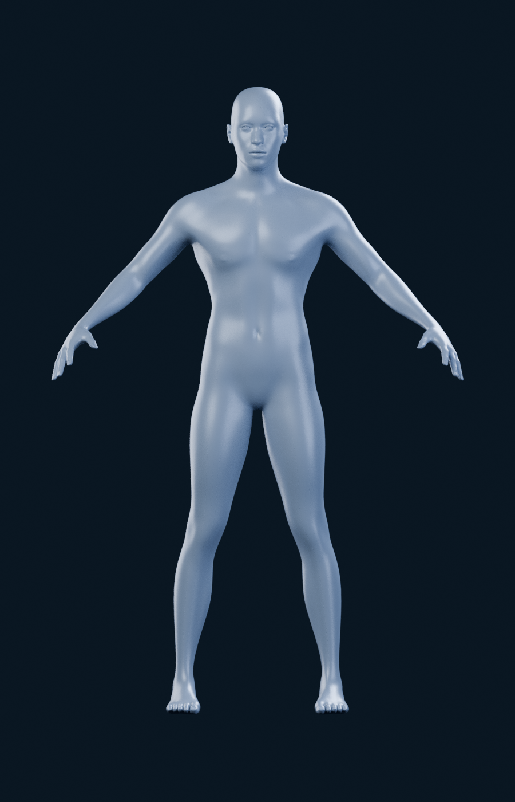
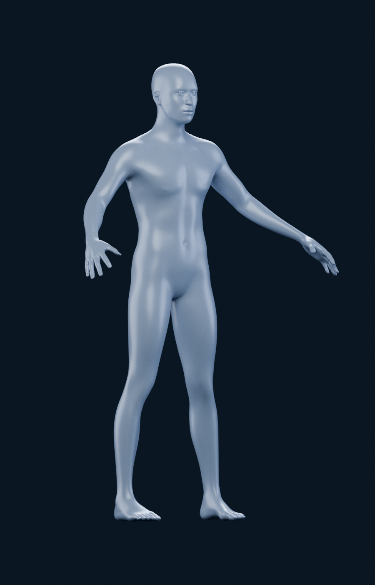
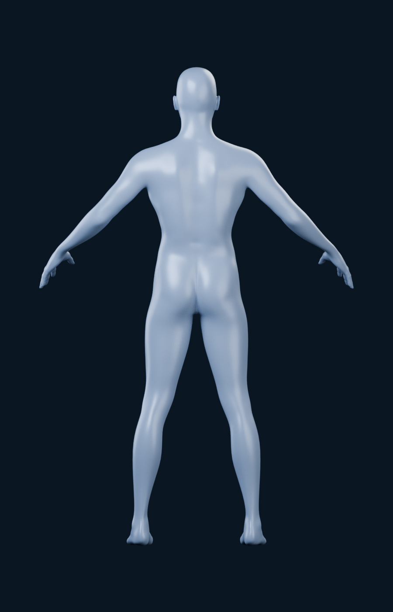

# M4A — Étude d’une nouvelle base 3D

État du **18 octobre 2026** : étude en cours, **comparaison des 2–3 meilleures bases non encore complète**. Aucun modèle retenu ni intégré ; le moteur interactif et M4B ne sont pas commencés. Suite à la décision utilisateur, la reconstruction de BodyParts3D est abandonnée pour cette étape. L’audit précédent reste dans [AUDIT_M4A_ANATOMIE.md](AUDIT_M4A_ANATOMIE.md).

## Critères et protocole

Corps masculin entier, athlétique et anatomiquement crédible ; muscles lisibles, surface relativement lisse ; matière satinée gris bleuté sur bleu nuit. La segmentation doit pouvoir suivre les vrais groupes musculaires gauche/droite, avec une géométrie optimisable pour iPhone. Les droits doivent autoriser adaptations et redistribution au sein de Logbook, application commerciale propriétaire.

Les comparaisons finales utiliseront le même moteur, matériau, éclairage, cadrage normalisé et angles : face **0°**, trois quarts **−35°**, dos **180°**. Les poses natives seront documentées ; aucune retouche d’image ne doit simuler une meilleure anatomie. Les images de vendeurs ne remplacent pas les rendus des fichiers réellement obtenus.

## MakeHuman / MPFB — premier candidat effectivement rendu

Source : [MPFB officiel, commit épinglé](https://github.com/makehumancommunity/mpfb2/tree/3af0cd5a2ffba072e93a34e5f6f494fdc4813ddf). MPFB est le générateur Blender de l’écosystème MakeHuman ; ils ne constituent pas deux bases indépendantes. Seuls les assets de base officiels sont utilisés, avec les yeux low-poly du [dépôt MakeHuman](https://github.com/makehumancommunity/makehuman/tree/a8bc2d54ff0ac92e78ff71431b1023eda42bf482/makehuman/data/eyes/low-poly).

**Licence.** Les assets de base et les résultats sont sous **CC0-1.0**, autorisant l’adaptation et la redistribution commerciale. Le logiciel MPFB est GPL ; son code ne fait pas partie de l’application. Cette distinction est explicite dans la [licence officielle](https://github.com/makehumancommunity/mpfb2/blob/3af0cd5a2ffba072e93a34e5f6f494fdc4813ddf/LICENSE.md) et la [FAQ d’utilisation dans un produit fermé](https://static.makehumancommunity.org/mpfb/faq/use_in_closed_source.html). Aucun asset communautaire dont les droits seraient différents n’est ajouté.

**Réglage évalué.** Homme adulte : gender 1, age 0,5, muscle 1, weight 0,35, proportions 0,55 ; cibles officielles supplémentaires de tonus abdominal (0,6), volume pectoral (0,25) et dorsal (0,25). Ces nombres sont des paramètres du générateur, pas des statistiques corporelles ou d’entraînement. Les helpers ont été retirés avec l’outil d’export MPFB, puis les yeux sources adaptés par son chargeur officiel. Aucune reconstruction de BodyParts3D ni géométrie de remplacement en primitives.

| Face | Trois quarts | Dos |
| --- | --- | --- |
|  |  |  |

**Qualité observée.** Corps entier cohérent, surface continue et lisse, silhouette en A-pose. Épaules et pectoraux présents, mais séparation des abdominaux, dorsaux, bras et cuisses nettement trop douce par rapport à la référence. Ce rendu ne justifie donc pas de valider MPFB comme solution finale. La musculature du réglage a réellement été portée au maximum prévu ; le matériau ne remplace pas le relief manquant.

**Segmentation à prévoir.** Enveloppe cutanée unique, sans muscles séparés ni nomenclature anatomique par face. Les groupes de rig et helpers ne sont pas des limites musculaires. Une segmentation de surface gauche/droite doit être dessinée et vérifiée sur références anatomiques : pectoraux, deltoïdes, biceps/triceps, abdominaux/obliques, dorsaux/trapèzes, fessiers, quadriceps/ischio-jambiers et mollets. Un découpage par boîtes englobantes serait insuffisant. Difficulté élevée si l’on exige une limite visuellement précise sur cette surface peu définie ; travail de définition musculaire également nécessaire.

**Optimisation.** Corps source mesuré : **13 380 sommets, 13 378 quads, 26 756 triangles**. La géométrie de base est raisonnable pour une future scène mobile ; l’optimisation géométrique serait de difficulté faible. Les rendus utilisent une subdivision commune de comparaison, pas un budget mobile validé. Aucun FPS iPhone ou résultat GPU n’est annoncé. [Paramètres, provenance et empreintes](m4a/alternatives/mpfb-athletic/provenance.json) ; [métadonnées des rendus](m4a/alternatives/mpfb-athletic/render-metadata.json).

## Autres bases examinées

| Base réelle | Licence / disponibilité vérifiée | Segmentation et optimisation | État de l’évaluation |
| --- | --- | --- | --- |
| **Blender Studio Human Base Meshes v1.4.1**, corps masculin réaliste et variante sculptée | Collection annoncée CC0 par la [page officielle](https://www.blender.org/download/demo-files/) ; [archive officielle](https://download.blender.org/demo/asset-bundles/human-base-meshes/human-base-meshes-bundle-v1.4.1.zip), 50 643 039 octets annoncés dans l’index | À déterminer depuis les vrais objets, leurs groupes et niveaux de subdivision. Aucun chiffre inventé à partir de captures | **À récupérer et rendre**. Le proxy de la machine attachée refuse encore le domaine ; la nouvelle configuration publiée n’y est pas appliquée au dernier contrôle. Ne pas annoncer la licence interne ou la qualité des fichiers comme déjà inspectées |
| **Muscular Male Basemesh**, alexlashko, CGTrader | [Fiche officielle](https://www.cgtrader.com/3d-models/character/man/muscular-male-basemesh), 49 USD affichés le 18/10, Royalty Free (no AI), OBJ/ZTL, niveau bas annoncé 18 002 polygones | Polygroups annoncés, sans preuve qu’ils correspondent aux muscles. Bas niveau intéressant ; détails élevés à transférer plutôt que livrer la version 18 millions de polygones | Piste payante ; fichier non acheté et non inspecté. Aucun rendu comparable produit. Les restrictions d’incorporation et de récupération de l’asset doivent être vérifiées pour la distribution de Logbook |
| **Stylized Muscular Male Anatomy Basemeshes**, -Sako-, CGTrader | [Fiche officielle](https://www.cgtrader.com/3d-models/character/human-anatomy/stylized-muscular-male-anatomy-basemeshes), 15 USD affichés le 18/10, Royalty Free, BLEND/FBX/OBJ ; version basse annoncée 34 000 polygones | Rig annoncé, sans segmentation musculaire attestée. Proportions stylisées à comparer à la référence ; nomenclature et détails à contrôler dans les fichiers | Piste payante ; source non acquise et non rendue. Les chiffres sont ceux du vendeur, pas des mesures locales |

Ces pistes ne constituent pas encore la sélection finale de 2–3 modèles rendus. Aucun achat ou contact de vendeur n’a été effectué.

### Pistes écartées et contraintes de licence

- **3D Scan Store** : scans musculaires intéressants, mais les [conditions officielles](https://www.3dscanstore.com/terms-and-conditions-licensing) interdisent explicitement l’usage dans un visualiseur anatomique en ligne ou hors ligne. La licence commerciale standard ne suffit donc pas à qualifier cette source pour Logbook. Aucun fichier téléchargé.
- **Fab / PolyOne Male Base Mesh** : la [fiche](https://www.fab.com/listings/6ea2f53a-fe66-4c16-8a6b-7ffa2037075c) décrit un corps de base à faible densité, pas une musculature fortement définie. La page n’expose pas suffisamment la licence sélectionnée et le fichier n’a pas été acquis ; aucune conformité supposée du seul fait qu’il est gratuit.
- **Licences marketplace** : « royalty free » n’autorise pas automatiquement la redistribution d’un GLB librement récupérable. Les [conditions CGTrader](https://help.cgtrader.com/hc/en-us/articles/360015124437-Royalty-Free-License) imposent une incorporation et des mesures empêchant la récupération de l’asset. Les [conditions Fab Standard](https://www.fab.com/eula) autorisent les projets commerciaux et adaptations, mais pas la redistribution autonome de l’asset. Ce point est concret pour une application qui embarque un modèle ; aucun paiement ou droit supplémentaire n’est présumé.

## Point de reprise

Les trois vues MPFB sont sauvegardées. Pour terminer la comparaison gratuite sans substitut approximatif, il faut appliquer à la machine attachée la configuration publiée autorisant **`download.blender.org`**, puis télécharger et vérifier le bundle Blender Studio, inventorier les vrais corps masculins et les rendre avec le même protocole. Au dernier contrôle, le runtime indique toujours l’ancienne liste de domaines et le téléchargement échoue en `CONNECT 403`.

Les scripts de rendu restent des outils d’audit. Aucune difficulté rencontrée ne justifie actuellement Astra Ultra : génération via API officielle, inventaire et rendu standard restent des tâches courantes. Aucun changement de modèle n’a été déclenché. Si une reconstruction anatomique ou une segmentation difficile devient nécessaire après votre choix, le problème et la tâche exacte seront présentés avant tout travail coûteux.

**La comparaison n’est pas encore prête pour le choix final du modèle.** La prochaine livraison doit comporter 2–3 bases réellement rendues sous les trois angles identiques, puis s’arrêter pour votre sélection.
