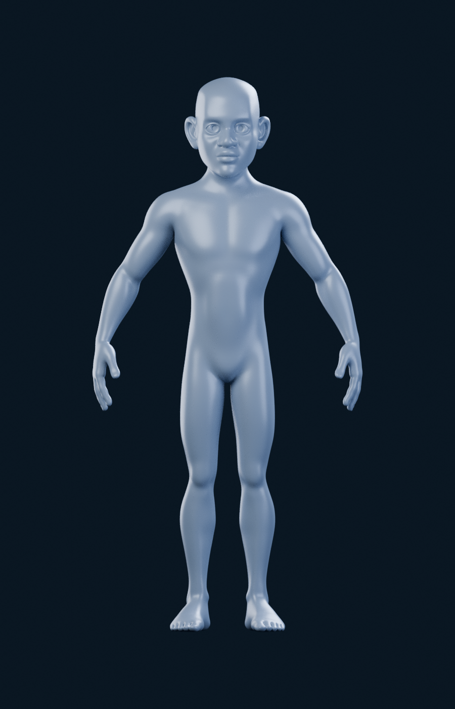
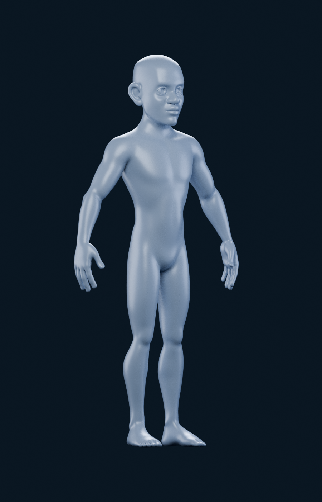
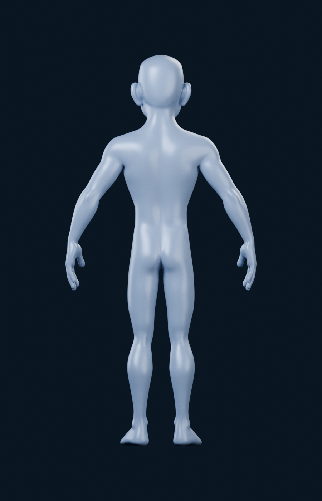
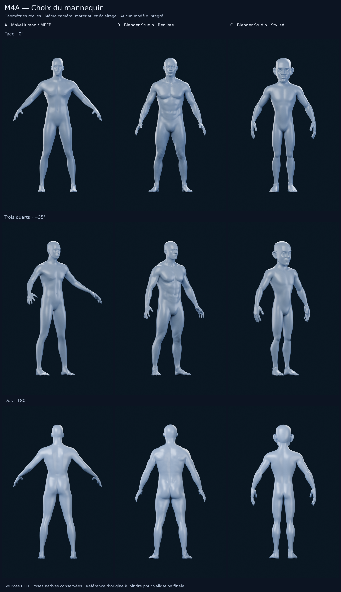

# M4A — Étude d’une nouvelle base 3D

> **Itération suivante :** B est choisi provisoirement, C écarté. La
> [comparaison B / B+](M4A_B_PLUS.md) renforce modérément B selon le retour produit.
> Verdict proposé : B+, encore soumis au choix visuel utilisateur. L’étude A/B/C
> ci-dessous est conservée comme historique, sans remplacer ses rendus.

État du **18 octobre 2026**, reprise depuis `1da5ba6` : **trois candidats réels comparés, neuf vues disponibles ; attente du choix utilisateur**. Aucun modèle retenu ni intégré ; le moteur interactif et M4B ne sont pas commencés. Suite à la décision utilisateur, la reconstruction de BodyParts3D est abandonnée pour cette étape. L’audit précédent reste dans [AUDIT_M4A_ANATOMIE.md](AUDIT_M4A_ANATOMIE.md).

## Critères et protocole

Corps masculin entier, athlétique et anatomiquement crédible ; muscles lisibles, surface relativement lisse ; matière satinée gris bleuté sur bleu nuit. La segmentation doit pouvoir suivre les vrais groupes musculaires gauche/droite, avec une géométrie optimisable pour iPhone. Les droits doivent autoriser adaptations et redistribution au sein de Logbook, application commerciale propriétaire.

Les neuf vues utilisent le même moteur, matériau, éclairage, cadrage normalisé et angles : face **0°**, trois quarts **−35°**, dos **180°**. Les poses natives seront documentées ; aucune retouche d’image ne doit simuler une meilleure anatomie. Les images de vendeurs ne remplacent pas les rendus des fichiers réellement obtenus.

## A — MakeHuman / MPFB, rendus sauvegardés conservés

Source : [MPFB officiel, commit épinglé](https://github.com/makehumancommunity/mpfb2/tree/3af0cd5a2ffba072e93a34e5f6f494fdc4813ddf). MPFB est le générateur Blender de l’écosystème MakeHuman ; ils ne constituent pas deux bases indépendantes. Seuls les assets de base officiels sont utilisés, avec les yeux low-poly du [dépôt MakeHuman](https://github.com/makehumancommunity/makehuman/tree/a8bc2d54ff0ac92e78ff71431b1023eda42bf482/makehuman/data/eyes/low-poly).

**Licence.** Les assets de base et les résultats sont sous **CC0-1.0**, autorisant l’adaptation et la redistribution commerciale. Le logiciel MPFB est GPL ; son code ne fait pas partie de l’application. Cette distinction est explicite dans la [licence officielle](https://github.com/makehumancommunity/mpfb2/blob/3af0cd5a2ffba072e93a34e5f6f494fdc4813ddf/LICENSE.md) et la [FAQ d’utilisation dans un produit fermé](https://static.makehumancommunity.org/mpfb/faq/use_in_closed_source.html). Aucun asset communautaire dont les droits seraient différents n’est ajouté.

**Réglage évalué.** Homme adulte : gender 1, age 0,5, muscle 1, weight 0,35, proportions 0,55 ; cibles officielles supplémentaires de tonus abdominal (0,6), volume pectoral (0,25) et dorsal (0,25). Ces nombres sont des paramètres du générateur, pas des statistiques corporelles ou d’entraînement. Les helpers ont été retirés avec l’outil d’export MPFB, puis les yeux sources adaptés par son chargeur officiel. Aucune reconstruction de BodyParts3D ni géométrie de remplacement en primitives.

| Face | Trois quarts | Dos |
| --- | --- | --- |
|  |  |  |

**Qualité observée.** Corps entier cohérent, surface continue et lisse, silhouette en A-pose. Épaules et pectoraux présents, mais séparation des abdominaux, dorsaux, bras et cuisses nettement trop douce par rapport à la référence. Ce rendu ne justifie donc pas de valider MPFB comme solution finale. La musculature du réglage a réellement été portée au maximum prévu ; le matériau ne remplace pas le relief manquant.

**Segmentation à prévoir.** Enveloppe cutanée unique, sans muscles séparés ni nomenclature anatomique par face. Les groupes de rig et helpers ne sont pas des limites musculaires. Une segmentation de surface gauche/droite doit être dessinée et vérifiée sur références anatomiques : pectoraux, deltoïdes, biceps/triceps, abdominaux/obliques, dorsaux/trapèzes, fessiers, quadriceps/ischio-jambiers et mollets. Un découpage par boîtes englobantes serait insuffisant. Difficulté élevée si l’on exige une limite visuellement précise sur cette surface peu définie ; travail de définition musculaire également nécessaire.

**Optimisation.** Corps source mesuré : **13 380 sommets, 13 378 quads, 26 756 triangles**. La géométrie de base est raisonnable pour une future scène mobile ; l’optimisation géométrique serait de difficulté faible. Les rendus utilisent une subdivision commune de comparaison, pas un budget mobile validé. Aucun FPS iPhone ou résultat GPU n’est annoncé. [Paramètres, provenance et empreintes](m4a/alternatives/mpfb-athletic/provenance.json) ; [métadonnées des rendus](m4a/alternatives/mpfb-athletic/render-metadata.json).

## B — Blender Studio, corps masculin réaliste

Collection réelle `Body Male - Realistic`, **Dan Ulrich**, dans le bundle officiel
Human Base Meshes v1.4.1. Corps `GEO-body_male_realistic` et ses deux yeux, sans
rig, matériau source ni déformation ajoutée. Les trois niveaux Multires sculptés
sont conservés ; aucune subdivision supplémentaire n'est ajoutée.

| Face | Trois quarts | Dos |
| --- | --- | --- |
|  |  |  |

**Corps de base mesuré : 10 582 sommets, 10 590 faces, 21 160 triangles**, sans
les yeux. Il s'agit d'une enveloppe continue, une composante connectée, aucun
groupe de sommets musculaire nommé. Les **102 face sets numériques** facilitent
le travail de sculpture, mais aucune table ne les identifie comme les groupes
musculaires attendus par Logbook. Une segmentation anatomique reste à dessiner
et vérifier ; difficulté élevée, avec un relief plus exploitable que MPFB.

La base est raisonnable pour un futur essai mobile. Le détail du rendu est porté
par le **Multires 3 : 677 442 sommets et 1 354 880 triangles** pour le corps évalué : conserver ce niveau en production
ne constituerait pas une optimisation. Un transfert du détail vers des normales
et un budget de géométrie adapté seraient à étudier après choix. Aucun test GPU
ou FPS iPhone n'a été réalisé.

## C — Blender Studio, corps masculin stylisé

Collection réelle `Body Male - Stylized`, **Julien Kaspar**, basée sur **Snow**.
Corps `GEO-body_male_stylized` et ses deux yeux. La source n'a pas de modificateur ;
un niveau de subdivision de comparaison est ajouté, comme pour MPFB.

| Face | Trois quarts | Dos |
| --- | --- | --- |
|  |  |  |

**Corps de base mesuré : 12 502 sommets, 12 500 faces, 25 000 triangles**, sans
les yeux. Enveloppe continue, une composante connectée, aucun groupe musculaire
nommé ; **42 face sets numériques**, sans nomenclature anatomique associée.
La segmentation serait difficile sur cette surface douce et stylisée. Géométrie
de base raisonnable, mais un travail artistique supplémentaire serait nécessaire
pour obtenir une forte définition musculaire. Aucune modification de cette nature
n'a été entreprise avant le choix utilisateur.

## Sources et licences Blender Studio contrôlées

L'accès réel au domaine officiel réussit désormais : **HTTP 200** via le proxy,
TLS vérifié. La configuration du runtime indique les révisions **2/2** et le
fichier de politique réseau contient le domaine. Le statut agrégé de politique
reste `unknown` ; la preuve d'accès est le téléchargement réellement terminé,
pas une supposition à partir de ce statut.

ZIP officiel : **50 643 039 octets**, tous les CRC conformes, SHA-256
`811f43accbb31a88266d932f8f5563b2d13586fca0ba2693aad1f5fe582b3515`.
Les métadonnées des deux collections et le README embarqué déclarent **CC0**.
Un autre bloc texte concerne le **Rain Rig sous CC BY 4.0** : conservé dans les
preuves, sans utiliser ce rig ni un asset Rain. Voir [licences](m4a/alternatives/blender-studio/LICENSE.ASSETS.md),
[inventaire reproduit indépendamment](m4a/alternatives/blender-studio/inventory.json)
et [provenance / reprise réseau](m4a/alternatives/blender-studio/provenance.json).
Les originaux du bundle restent dans le dossier de travail, hors runtime Logbook.

## Autres bases examinées

| Base réelle | Licence / disponibilité vérifiée | Segmentation et optimisation | État de l’évaluation |
| --- | --- | --- | --- |
| **Blender Studio Human Base Meshes v1.4.1**, réaliste et stylisé | Bundle officiel acquis et vérifié ; CC0 dans le README et les deux collections | Corps continus ; face sets numériques non anatomiquement nommés. Multires 3 conservé pour le réaliste | **Deux candidats rendus**, trois vues chacun, ci-dessus |
| **Muscular Male Basemesh**, alexlashko, CGTrader | [Fiche officielle](https://www.cgtrader.com/3d-models/character/man/muscular-male-basemesh), 49 USD affichés le 18/10, Royalty Free (no AI), OBJ/ZTL, niveau bas annoncé 18 002 polygones | Polygroups annoncés, sans preuve qu’ils correspondent aux muscles. Bas niveau intéressant ; détails élevés à transférer plutôt que livrer la version 18 millions de polygones | Piste payante ; fichier non acheté et non inspecté. Aucun rendu comparable produit. Les restrictions d’incorporation et de récupération de l’asset doivent être vérifiées pour la distribution de Logbook |
| **Stylized Muscular Male Anatomy Basemeshes**, -Sako-, CGTrader | [Fiche officielle](https://www.cgtrader.com/3d-models/character/human-anatomy/stylized-muscular-male-anatomy-basemeshes), 15 USD affichés le 18/10, Royalty Free, BLEND/FBX/OBJ ; version basse annoncée 34 000 polygones | Rig annoncé, sans segmentation musculaire attestée. Proportions stylisées à comparer à la référence ; nomenclature et détails à contrôler dans les fichiers | Piste payante ; source non acquise et non rendue. Les chiffres sont ceux du vendeur, pas des mesures locales |

Les pistes payantes restent documentées à titre de contexte ; elles ne sont pas rendues et ne remplacent aucune colonne. Aucun achat ou contact de vendeur n’a été effectué.

### Pistes écartées et contraintes de licence

- **3D Scan Store** : scans musculaires intéressants, mais les [conditions officielles](https://www.3dscanstore.com/terms-and-conditions-licensing) interdisent explicitement l’usage dans un visualiseur anatomique en ligne ou hors ligne. La licence commerciale standard ne suffit donc pas à qualifier cette source pour Logbook. Aucun fichier téléchargé.
- **Fab / PolyOne Male Base Mesh** : la [fiche](https://www.fab.com/listings/6ea2f53a-fe66-4c16-8a6b-7ffa2037075c) décrit un corps de base à faible densité, pas une musculature fortement définie. La page n’expose pas suffisamment la licence sélectionnée et le fichier n’a pas été acquis ; aucune conformité supposée du seul fait qu’il est gratuit.
- **Licences marketplace** : « royalty free » n’autorise pas automatiquement la redistribution d’un GLB librement récupérable. Les [conditions CGTrader](https://help.cgtrader.com/hc/en-us/articles/360015124437-Royalty-Free-License) imposent une incorporation et des mesures empêchant la récupération de l’asset. Les [conditions Fab Standard](https://www.fab.com/eula) autorisent les projets commerciaux et adaptations, mais pas la redistribution autonome de l’asset. Ce point est concret pour une application qui embarque un modèle ; aucun paiement ou droit supplémentaire n’est présumé.

## Comparaison proposée au choix

| Candidat | Lecture visuelle | Limite pour M4A |
| --- | --- | --- |
| **A — MPFB** | Corps cohérent, silhouette athlétique modérée ; paramètres maximaux de muscle déjà évalués | Relief des abdominaux, bras, dos et cuisses trop doux dans l'étude précédente |
| **B — Blender réaliste** | Volumes corporels naturels et davantage de relief visible au torse et aux bras | Définition encore modérée ; pas un écorché ni un mannequin aux muscles individuellement découpés ; détail Multires à transférer pour mobile |
| **C — Blender stylisé** | Surface propre, tête plus grande et proportions stylisées | Torse lisse, séparation musculaire faible ; une direction artistique différente |

Les poses natives sont conservées (bras écartés vers le bas, ouvertures des jambes
et des mains différentes). Tous les candidats sont ramenés uniformément à 1,8 unité
de haut ; même caméra 2,30, résolution 900 × 1400, angles 0° / −35° / 180°,
matériau satin gris bleuté, quatre lumières et fond bleu nuit, Cycles CPU 128 samples
sans débruitage. Les différences de pose ne sont pas des différences de zoom.
Les neuf vues cadrent le corps entier : aucun nouveau cadrage MPFB n'est nécessaire.
Les six nouveaux rendus sont enregistrés avec leurs métadonnées dans
[studio-realistic](m4a/alternatives/studio-realistic/render-metadata.json) et
[studio-stylized](m4a/alternatives/studio-stylized/render-metadata.json).

**Avis pour le choix : B est la base gratuite la plus prometteuse parmi ces trois
candidats pour une direction athlétique réaliste.** Cela ne valide pas sa fidélité
à la référence ni une future segmentation. Lors de la comparaison A/B/C, l'image d'origine n'était pas accessible.
Elle est maintenant fournie et examinée dans l'itération B/B+.
Il est possible de choisir A, B, C ou aucun si le relief reste insuffisant.

## Reprise et arrêt avant intégration

La sauvegarde de `1da5ba6` a été restaurée dans `/workspace/work/m4a-alternatives/` :
**3 606 fichiers / 97 888 638 octets**, tailles et SHA-256 conformes. Les trois PNG
MPFB déjà terminés sont réutilisés à l'identique. Aucun nouvel audit BodyParts3D
ni génération MPFB n'a été relancé. Le [guide initial](M4A_REPRISE_ENVIRONNEMENT.md)
reste la procédure de récupération ; les scripts d'acquisition/inventaire/rendu
complètent maintenant la [procédure de reproduction](../tools/m4a/alternatives/README.md).

**Arrêt pour le choix utilisateur.** Aucun modèle sélectionné automatiquement,
aucune intégration, moteur interactif, M4B, modification SQLite ou fusion.
La PR #11 reste en brouillon, sur la même branche. Aucun recours à Astra Ultra ;
un problème qui le justifierait serait présenté avant toute tâche coûteuse.
