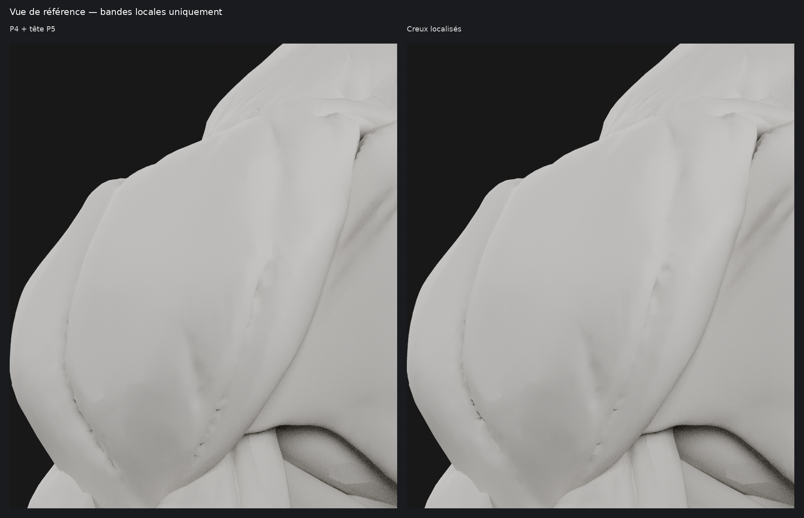

# M4A — creux localisés, bombé P4 préservé

**Verdict : bombé préservé, correction des creux encore insuffisante. Essai non validé.**

**Base : P4 + tête P5 (`0ab3d83`). La géométrie de `62fe3ff` n’est pas utilisée.**
Le bombé central est restauré à sa forme P4 et verrouillé. Cette proposition
ne modifie que des bandes de **3 mm maximum de chaque côté des trajets**.

## Comparatifs sans annotations

- [Bombé principal — extrait avant/après](m4a/ecorche-beatriz-creux-localises/renders/ventre-preserve.png).
- [Premier creux — terminaison](m4a/ecorche-beatriz-creux-localises/renders/creux-1-detail.png).
- [Second creux — délimitation](m4a/ecorche-beatriz-creux-localises/renders/creux-2-detail.png).
- [Épaule gauche](m4a/ecorche-beatriz-creux-localises/renders/comparatif-epaule-gauche.png),
  [face](m4a/ecorche-beatriz-creux-localises/renders/comparatif-face.png)
  et [profil](m4a/ecorche-beatriz-creux-localises/renders/comparatif-profil.png).

Dans chaque paire : caméra, cadrage, éclairage et matériau mat neutre identiques.
Le gros plan est recalé sur les repères de l’image fournie ; les traits rouges
sont ensuite ajustés sur la concavité réelle voisine. Aucun trait n’est peint
dans les rendus. Les extraits sont des recadrages des pixels Blender, sans retouche.

## Corrections et préservation

- **Premier creux** : partie haute conservée ; reprise du retour inférieur
  et terminaison plus basse suivant le guide bleu.
- **Second creux** : reprise du fond de l’ancien trajet et création de la
  dépression locale sur le guide bleu. Son extrémité est atténuée avant la pièce
  du bras : le dernier point demandé sort du deltoïde visible. Aucun muscle
  voisin n’est modifié pour prolonger artificiellement le trait.
- Les anciens fonds sont raccordés entre leurs berges dans leurs bandes ;
  les nouveaux creux ont une section arrondie. Le calcul ne déplace pas la
  surface entre ces bandes et n’ajoute pas de volume sur les portions voisines.
  Le comblement atteint localement **4 mm** sur les anciens fonds les plus profonds.
- **203 sommets modifiés sur 5 971 par épaule**, soit environ 3,4 %.
  **901 sommets du bombé central restent strictement identiques à P4**, ainsi
  que tous les sommets hors bandes. Les corrections sont appliquées en miroir.
- Volume conservé par équilibre local entre comblement et creusement dans
  les seules bandes : écart relatif inférieur à **0,000001 %**.
  Dimensions maximales identiques ; enveloppes de silhouette face/profil conservées.
- Topologie inchangée : **11 938 triangles par deltoïde**. Les **298 autres objets**,
  dont tête P5, gorge, pectoraux et reste du corps, restent strictement inchangés.

Ces points sont contrôlés sur le master et le GLB, avec comparaison aux
coordonnées du fichier d’origine : [vérification](m4a/ecorche-beatriz-creux-localises/verification.json).

## Résultat visuel et arrêt

Le réglage retenu conserve le bombé et le volume, avec une amplitude nominale
du nouveau creux d’environ **1 mm**. Toutefois, les gros plans montrent encore
les anciens trajets ; le premier creux présente des raccords irréguliers,
et le déplacement du second n’est pas assez net. **Le résultat ne satisfait pas
encore la demande de creux propres et remplacés sans doublon.** Les contrôles
géométriques réussis ne doivent pas être présentés comme une réussite visuelle.

Conserver **`0ab3d83` comme référence validée**. Cette proposition sert à documenter
la tentative et ses limites ; elle ne doit pas devenir la nouvelle base finale.

La seconde terminaison s’arrête vers `(139, 368)` dans le repère de référence,
au lieu de `(132, 379)`, pour rester sur le deltoïde visible et préserver le bras.

Aucune segmentation interactive, aucune modification de Logbook ou SQLite,
aucun M4B, aucune fusion. PR #12 maintenue en brouillon. Arrêt après les rendus,
sans nouvelle série automatique de retouches.

[Sources Blender, GLB et reproduction](m4a/ecorche-beatriz-creux-localises/README.md).
