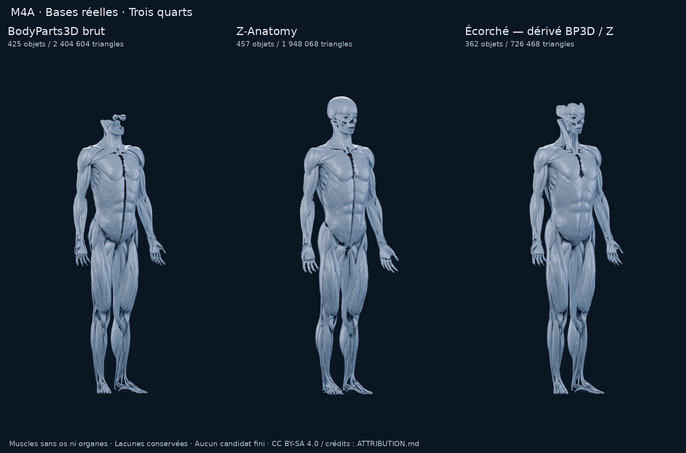

# M4A — Recherche d’une base écorchée stylisée

**18 octobre 2026 · PR #11 en brouillon · choix utilisateur attendu.**
La cible devient un mannequin masculin aux muscles visibles, élégant et satiné,
bleu/gris sur bleu nuit, avec sélection orange, sans organes ni os apparents.
Les études [A/B/C](M4A_CHOIX_MODELE.md), [B+](M4A_B_PLUS.md),
[B+ V2](M4A_B_PLUS_V2.md) et [BodyParts3D](AUDIT_M4A_ANATOMIE.md) sont conservées.
Leur mannequin à peau lisse n’est plus la cible de cette recherche.

**Verdict : aucun des trois fichiers gratuits n’est prêt visuellement pour la
cible premium. Écorché est la meilleure base technique libre inspectée, sous
réserve d’accepter sa licence ShareAlike et une vraie reprise artistique.**
Z-Anatomy est la meilleure réserve anatomique complémentaire. BodyParts3D brut
ne convient pas seul. Une piste payante reste à auditer sur fichiers ; une page
de vente n’est pas une validation du modèle.

## Rendus réels à comparer



| Vue | Planche des trois candidats |
| --- | --- |
| Face | [PNG](m4a/ecorche/comparaison-front.png) |
| Trois quarts | [PNG](m4a/ecorche/comparaison-three-quarter.png) |
| Dos | [PNG](m4a/ecorche/comparaison-back.png) |
| Grand pectoral gauche orange | [PNG](m4a/ecorche/comparaison-selection.png) |
| Ensemble des trois angles | [PNG](m4a/ecorche/comparaison.png) |

| Candidat | Face | Trois quarts | Dos | Pectoral orange |
| --- | --- | --- | --- | --- |
| BodyParts3D brut | [PNG](m4a/ecorche/bodyparts3d/front.png) | [PNG](m4a/ecorche/bodyparts3d/three-quarter.png) | [PNG](m4a/ecorche/bodyparts3d/back.png) | [PNG](m4a/ecorche/bodyparts3d/selection.png) |
| Z-Anatomy | [PNG](m4a/ecorche/z-anatomy/front.png) | [PNG](m4a/ecorche/z-anatomy/three-quarter.png) | [PNG](m4a/ecorche/z-anatomy/back.png) | [PNG](m4a/ecorche/z-anatomy/selection.png) |
| Écorché | [PNG](m4a/ecorche/ecorche/front.png) | [PNG](m4a/ecorche/ecorche/three-quarter.png) | [PNG](m4a/ecorche/ecorche/back.png) | [PNG](m4a/ecorche/ecorche/selection.png) |

Ces douze images proviennent de **Blender 4.3.2 / Cycles CPU**, 128 échantillons,
600 × 1000, AgX, sans débruitage. Aucune image générative. Caméra orthographique
2,30, mêmes angles, cible, quatre éclairages, fond bleu nuit et matière satinée
communs ; les textures et couleurs des sources sont remplacées. Géométrie sans
subdivision, sans sculpture ni comblement. Les planches ajoutent des légendes et
redimensionnent les PNG, sans retouche des volumes.

La référence corporelle de chaque fichier est normalisée à 1,80 m. Pour BP3D,
c’est l’enveloppe originale, mesurée mais non affichée ; pour Écorché, le corps
source complet, os mesurés mais non affichés ; pour Z, les extrémités musculaires
et aponévrotiques sélectionnées, sa collection Skin ne contenant pas de maillage.
Les centres/échelles exacts figurent dans les inventaires. Cela garde un cadrage
commun sans agrandir artificiellement un corps auquel manque le sommet du crâne.
Il ne s’agit pas d’un recalage médical entre modèles.

**Aucun os, œil ou organe n’est rendu.** La tête et les doigts peuvent pourtant
paraître squelettiques : les muscles seuls ne forment pas une enveloppe complète.
C’est une limite visible, contraire à la cible produit, et non une finition
validée. Nous ne cachons pas ces lacunes avec une tête ou des mains inventées.

## Fichiers réellement inspectés

Ces trois essais **ne sont pas trois anatomies indépendantes** : BP3D est leur
origine commune ; Z enrichit cette base ; Écorché combine BP3D et des apports Z.

| Base et disponibilité | Contenu rendu mesuré | Qualités | Limites pour Logbook |
| --- | --- | --- | --- |
| **BodyParts3D 4.0**, archive officielle OBJ, 142 903 898 octets, SHA identique à l’audit initial | 425 objets musculaires ; 1 205 641 sommets après soudure exacte interne ; **2 404 604 triangles** | Identifiants FMA, pièces séparées et côtés documentés ; atlas de référence traçable | Dorsaux et grand droit abdominal non identifiés dans cette livraison ; nombreux faisceaux fins et lacunes sans squelette ; proportions d’atlas, pas une sculpture athlétique premium |
| **Z-Anatomy**, dépôt `Models-of-human-anatomy`, commit `0fee499c81db03fcbafecbe7ace68d5d5a18aa92`, ZIP 86 734 957 octets, `Startup.blend` réel | **445 maillages musculaires + 12 tendons/aponévroses**, 974 393 sommets, **1 948 068 triangles** | Tous les groupes demandés nommés et bilatéraux ; grand droit et dorsaux présents ; aponévrose crânienne plus couvrante | Atlas très détaillé ; fascia couvrant retiré pour lire les muscles ; défauts de surfaces/orientation, tête et extrémités à reprendre ; droits du sous-ensemble à tracer dans un atlas aux notices mixtes |
| **Écorché — Charleeh**, commit `320805e06aee51e2e6f6b22533eb2a59d43f2d4d`, **GLB réel 14 314 536 octets** | Source complète : 634 maillages / 981 126 triangles ; rendu : **362 muscles**, 358 236 sommets, **726 468 triangles** ; 272 maillages de couche squelette exclus | Noms, côté, couche, origine et parfois FMA dans les extras ; dorsaux/grand droit ajoutés ; volume déjà réduit ; GLB directement inspectable | Toujours trop médical et incomplet sans os ; trous au crâne, sternum et articulations ; stries et tendons fins ; nettoyage de triangles et optimisation encore requis |

Les [sources et SHA-256](m4a/ecorche/sources.json), les inventaires complets
([BP3D](m4a/ecorche/bodyparts3d/inventory.json),
[Z](m4a/ecorche/z-anatomy/inventory.json),
[Écorché](m4a/ecorche/ecorche/inventory.json)) rendent ces mesures vérifiables.
Les scripts de l’atlas, ses add-ons et le visualiseur web tiers ne sont pas exécutés.

La nomenclature et les gros volumes sont ceux de véritables bases anatomiques,
mais ce n’est pas une certification médicale. L’auteur d’Écorché déclare notamment
une symétrisation, des corrections de superpositions, une reconstruction des
surfaces obliques/dentelées et une quantification à 0,1 mm. Ces opérations sont
décrites dans son attribution ; nous vérifions ici le fichier obtenu, pas toutes
ses insertions ou les bornes d’erreur annoncées. Une future stylisation devra
conserver des limites musculaires crédibles plutôt que prendre ces reconstructions
pour une vérité anatomique indépendante.

## Muscles et côtés réellement disponibles

Nombre de composants **par côté**, gauche et droite ayant ici les mêmes comptes.
La [table de couverture](m4a/ecorche/coverage.json) conserve chaque nom d’objet.
Un composant anatomique n’est pas automatiquement une zone UX définitive.

| Groupe | BP3D brut | Z-Anatomy | Écorché | Lecture et sélection futures |
| --- | ---: | ---: | ---: | --- |
| Grand pectoral | 3 | 3 | 3 | Volume reconnaissable ; trois portions à réunir logiquement par côté |
| Deltoïde | 3 | 3 | 3 | Épaule identifiable ; jonctions à adoucir pour le style premium |
| Biceps brachial | 2 | 2 | 2 | Deux chefs, distincts des biceps fémoraux |
| Triceps brachial | 3 | 3 | 3 | Présent au dos du bras ; détails fins à simplifier |
| Grand dorsal | **Absent de la correspondance vérifiée** | 1 | 1 | Présent dans Z/Écorché ; ne pas substituer le trapèze à ce groupe |
| Trapèze | 3 | 3 | 3 | Régions distinctes et repérables au dos |
| Grand droit abdominal | **Absent de la correspondance vérifiée** | 1 | 1 | Ne pas appeler les obliques « grand droit » ; rendu des abdos encore irrégulier |
| Quadriceps | 3 | 4 | 4 | Rectus femoris + vastes ; intermedius non retrouvé dans le brut audité |
| Ischio-jambiers | 4 | 4 | 4 | Deux chefs du biceps fémoral, semi-tendineux et semi-membraneux |
| Fessiers | 2 | 3 | 3 | Maximus/medius dans BP3D ; minimus également nommé dans Z/Écorché |
| Mollets | 3 | 3 | 3 | Deux chefs du gastrocnémien et soléaire |

Les noms/côtés vérifiés correspondent au signe du centre des objets : pas de
discordance détectée pour les pièces explicitement latéralisées. Cela ne certifie
pas médicalement tous les contours, insertions ou intersections.

L’orange est une **vraie sélection de trois maillages du grand pectoral gauche** :
BP3D `FJ1446M`, `FJ1447M`, `FJ1464M` ; Écorché `FMA45875`, `FMA34691`,
`FMA79980` ; Z utilise les trois noms `.l` correspondants. Il n’y a ni masque
dessiné sur la peau, ni sélection interactive développée. Les douze pièces de
soutien Z ne sont pas présentées comme des muscles sélectionnables.

## Qualité géométrique et aptitude iPhone

| Contrôle sur les scènes préparées | BP3D | Z | Écorché |
| --- | ---: | ---: | ---: |
| Coordonnées non finies | 0 | 0 | 0 |
| Triangles de double aire ≤ 10⁻¹² m² | 16 | 0 | 236 |
| Objets de volume signé négatif < −10⁻¹⁰ m³ | 0 | 228 | 2 |

Rapports : [BP3D](m4a/ecorche/bodyparts3d/geometry-check.json),
[Z](m4a/ecorche/z-anatomy/geometry-check.json),
[Écorché](m4a/ecorche/ecorche/geometry-check.json).
Ce seuil repère les triangles quasi effondrés ; il diffère du critère de l’audit
historique, qui relevait trois dégénérescences strictes BP3D. Les chiffres ne
constituent donc pas une régression du fichier source. Pour Écorché, les obliques
et dentelés représentent 186 des 236 triangles signalés ; il faut les examiner et
nettoyer, même si leur proportion est faible. Aucun pectoral orange n’est concerné
par ce seuil.

Le volume signé est seulement un indicateur pour une surface ouverte ou non
manifold. Z présente 226 objets gauches parmi les 228 négatifs : orientation à
contrôler avant un moteur qui élimine les faces arrière. Nous conservons les
surfaces source dans les rendus ; aucune réparation automatique prétendument
anatomique. Ni intersections exhaustives ni étanchéité certifiée.

Écorché est **envisageable**, pas « mobile fluide validé ». Ses 726 k triangles et
362 objets musculaires restent coûteux ; les deux atlas bruts le sont davantage.
Une future version devrait réduire les détails profonds/invisibles, nettoyer les
pièces, réduire les triangles en gardant les silhouettes et un identifiant de
sélection, et partager les matières. Un budget de l’ordre de 50–150 k triangles
visibles serait une hypothèse de départ à mesurer sur les iPhone visés, pas une
garantie. Aucun export optimisé, bake, rig, moteur ou benchmark iPhone n’est fait.

Les pièces nommées et bilatérales permettent une future correspondance entre
muscle et statistiques. Elles ne constituent pas à elles seules une segmentation
produit validée : distinguer muscles superficiels touchables, muscles profonds et
tissus de soutien, puis vérifier les limites sélectionnées. Le tap précis et le
zoom automatique dépendront aussi du moteur et des occultations.

L’UX demandée reste le critère futur : corps entier seul, rotation 360° au doigt,
aucun bouton de vue ou zoom manuel, tap du bon muscle en orange, rapprochement
depuis l’orientation actuelle, fiche nom/tonnage/séries/part du volume, fermeture
vers le corps entier. **Aucune de ces interactions n’est implémentée en M4A.**

## Licences et application propriétaire

Les [notices conservées et attributions](m4a/ecorche/ATTRIBUTION.md) font partie
des livrables. **Pas d’achat, pas de droit commercial supposé à partir d’un aperçu.**

| Source | Licence vérifiée | Conséquence pratique |
| --- | --- | --- |
| BP3D officiel | [CC BY 4.0 sur la page actuelle](https://dbarchive.biosciencedbc.jp/en/bodyparts3d/lic.html), mise à jour 2025-02-27 ; anciens en-têtes OBJ BY-SA 2.1 Japan conservés | Usage commercial permis par la licence officielle, attribution requise. Diffuser ici les dérivés sous BY-SA 4.0 préserve aussi les obligations de partage historiques |
| Z-Anatomy sélectionné | [Notice CC BY-SA 4.0 du dépôt](https://github.com/Z-Anatomy/Models-of-human-anatomy/blob/0fee499c81db03fcbafecbe7ace68d5d5a18aa92/License.txt) | Commercial possible pour le contenu couvert, attribution et ShareAlike des adaptations. **L’atlas complet n’est pas déclaré commercialement utilisable** : rein/oreille interne ont des notices NC. Ces organes sont exclus ; provenance du sous-ensemble musculaire à sécuriser avant diffusion commerciale |
| Écorché | [Licence explicite du modèle CC BY-SA 4.0](https://github.com/Charleeh/ecorche/blob/320805e06aee51e2e6f6b22533eb2a59d43f2d4d/LICENSE.md), [origine détaillée](https://github.com/Charleeh/ecorche/blob/320805e06aee51e2e6f6b22533eb2a59d43f2d4d/ATTRIBUTION.md) ; code tiers MIT non utilisé | Usage commercial autorisé avec attribution et adaptations du modèle sous BY-SA. Les apports Z sont listés ; aucun rein/oreille interne parmi eux. Cette déclaration est plus ciblée que celle de l’atlas entier ; elle ne supprime pas la nécessité de conserver la chaîne des droits |

ShareAlike ne signifie pas automatiquement publier tout le code de l’app : les
droits sur l’asset adapté et ceux sur une collection/application doivent être
distingués. En revanche, on ne peut pas rendre le modèle dérivé exclusif ou lui
appliquer des restrictions incompatibles avec CC. Le futur conditionnement iOS
devra respecter ces droits et l’absence de restrictions techniques supplémentaires.
Voir la [licence](https://creativecommons.org/licenses/by-sa/4.0/) et la
[FAQ Creative Commons sur adaptations/collections](https://creativecommons.org/faq/).
Si un mannequin propriétaire exclusif est indispensable, écarter ces dérivés SA.

## Pistes payantes et sources écartées

Pages primaires consultées le **18 octobre 2026**. Les informations suivantes
sont des déclarations commerciales, **pas des mesures sur fichiers**. Aucun
modèle payant acquis, aucun aperçu commercial présenté comme notre rendu.

| Piste | Éléments vérifiés sur la page | Licence et décision |
| --- | --- | --- |
| [Alex Lashko — Muscle Anatomy Visualized](https://alexlashko.com/store/OlM1p/muscle-anatomy-visualized-ecorche) | Blender 3.5 / FBX / OBJ ; muscles et os annoncés séparés et nommés ; **68 749 triangles musculaires annoncés** ; archive 170 MB ; textures 8K et UV gauche/droite superposées | Standard **19 USD** avec plafonds ; Extended **149 USD**, projets/ventes/vues sans plafonds selon la page. **Priorité d’audit payant pour la structure et la densité**, sous réserve du droit d’utilisation précis dans le visualiseur Logbook et d’une inspection réelle sans squelette. Fichiers non obtenus ; ni tête sans os, ni nomenclature, ni qualité validées |
| [George Zaky — Stylized Male Anatomy Écorché](https://www.artstation.com/marketplace/p/nOwx3/stylized-male-anatomy-ecorche) | Style simplifié intéressant pour la direction artistique ; BLEND / FBX / OBJ, archive RAR 38 MB ; **seul le BLEND conserve les pièces séparées**, FBX/OBJ réunis en un mesh | Standard affichée **18,45 USD** à la dernière consultation, susceptible de varier avec taxes/offres ; plafonds 2 000 ventes ou 20 000 vues mensuelles. **Piste artistique à confirmer**, pas recommandation d’intégration : noms, groupes, droits adaptés à une app diffusée largement et maillage à vérifier |
| [Mikkel Terndrup Kristensen — Separated and named parts](https://the1mendor.artstation.com/store/rvLlR/3d-male-ecorche-reference-model-seperated-and-named-parts) | 265 pièces latines annoncées, muscles et os ; FBX/ZTL/ZPR ; FBX binaire annoncé 450 MB | Standard **15 USD**, Extended **150 USD** à la consultation ; moins prioritaire pour mobile avant inspection/retopologie. Non acquis, licence exacte du visualiseur à confirmer |
| [3DScanStore](https://www.3dscanstore.com/terms-and-conditions-licensing) | Des modèles peuvent être beaux et détaillés | **Écarté** : les conditions interdisent explicitement les visualiseurs anatomiques/photographiques en ligne ou hors ligne, y compris avec licence commerciale |
| [Visible Human Male / University of Denver](https://digitalcommons.du.edu/visiblehuman/) | Piste indépendante anatomique, mais la ressource exploitable repérée porte sur le membre inférieur | Pas un mannequin entier répondant au brief ; non rendu comme faux candidat complet |
| Sketchfab, candidats sans téléchargement/licence vérifiables | Aperçus repérés mais fichiers non obtenus | Non retenus ; pas d’extraction de visualiseur ni de segmentation supposée |

Le [contrat produit ArtStation](https://www.artstation.com/marketplace-product-eula)
autorise les stock assets incorporés dans des œuvres commerciales, avec les limites
de chaque licence et sans redistribution autonome de l’asset. Les
[conditions du site liées à la page](https://cdn2.unrealengine.com/artstation-terms-of-service-eu-65335878bd2c.pdf)
renvoient aux droits définis par le vendeur. Cela justifie une piste commerciale,
**pas une certification de l’usage spécifique de carte anatomique interactive**.
La confirmation de cet usage et la licence correspondant à la diffusion prévue
doivent précéder un achat. Aucun vendeur n’a été contacté au nom de l’utilisateur.

## Recommandation et point d’arrêt

1. **Ne valider aucun de ces fichiers gratuits comme mannequin premium fini.**
   La matière Logbook ne résout pas les trous, l’aspect clinique ou les proportions.
2. **Si l’on retient une base libre : Écorché**, pour ses groupes complets,
   ses côtés et sa densité réduite. Prévoir une reprise artistique réelle
   de la tête/extrémités, des volumes athlétiques et de la douceur des séparations,
   puis nettoyage et optimisation. Licence SA à accepter explicitement comme choix
   de produit. Z reste une source anatomique complémentaire, pas un meilleur mesh
   mobile prêt à embarquer.
3. **Si la priorité est de réduire cette reprise : auditer d’abord le fichier
   Alex Lashko**, ou George Zaky si son esthétique est préférée. Ce sont des
   hypothèses à vérifier après autorisation d’acquisition, pas des gagnants validés.

**L’utilisateur choisit la base ou la piste suivante avant toute intégration.**
Pas de M4B, de segmentation complète, de modification SQLite, d’autre fonctionnalité,
d’achat, de changement de moteur ou de fusion. Aucun recours à Astra Ultra.

## Conservation et reproduction

La [sauvegarde initiale](M4A_REPRISE_ENVIRONNEMENT.md) a de nouveau été vérifiée :
**3 606 fichiers / 97 888 638 octets**. Accès à `download.blender.org` retesté :
HTTP 200 via la configuration réseau appliquée ; aucun contournement proxy/TLS.
Le bundle Blender déjà acquis et les variantes précédentes ne sont pas refaits.

Les trois scènes musculaires retenues, leurs inventaires, contrôles, origines et
outils de reproduction sont sauvegardés dans
[le checkpoint écorché](m4a/ecorche/checkpoint/README.md).
Il ne contient pas l’atlas intégral ni ses organes aux notices NC.
Le manifeste donne chaque taille et SHA-256 ; les empreintes de géométrie restent
identiques après purge des données inutilisées, sauvegarde et rechargement.

Repartir des sources épinglées, sans dépendances de l’application :

```sh
python3 tools/m4a/acquire_ecorche.py --output-dir /workspace/work/m4a-ecorche/sources
```

La préparation utilise `tools/m4a/prepare_ecorche.py` avec `--candidate`, `--source`
et `--output`. Les commandes complètes figurent dans le checkpoint. Une fois les
scènes préparées disponibles, pour chaque candidat :

```sh
blender --background --factory-startup --disable-autoexec --threads 2 \
  --python tools/m4a/render_ecorche.py -- \
  --prepared /workspace/work/m4a-ecorche/prepared/ecorche \
  --output /workspace/work/m4a-ecorche/regenerated/ecorche
python3 tools/m4a/make_ecorche_sheets.py --root /workspace/work/m4a-ecorche/regenerated
```

Contrôles réalisés : empreintes des sources et CRC des archives ; coordonnées,
triangles, noms et côtés ; vrais trois composants orange ; même protocole de rendu ;
inspection visuelle des vues ; sauvegarde géométriquement identique ; PNG/JSON,
liens locaux et syntaxe Python ; préservation des artefacts précédents.
Le [rapport de validation](m4a/ecorche/validation.json) consigne ces contrôles :
85 fichiers historiques inchangés, sauvegarde restaurée de 27 fichiers et un
rendu orange Écorché recalculé après restauration, **pixels RGBA identiques**.
Les espaces de fin de ligne de la notice Z originale sont conservés à l’identique ;
le contrôle d’espaces Git des fichiers rédigés exclut uniquement cette copie source.
Pas de test applicatif lancé : aucun code runtime, dépendance, schéma ou donnée
de Logbook modifié. Les essais visuels restent des outils de recherche hors app.
