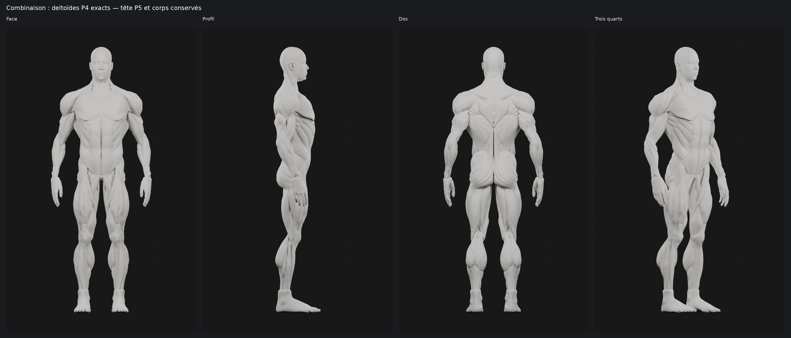

# M4A — combinaison à valider : deltoïdes P4 et tête P5

**Les deux deltoïdes de la passe 4 sont restaurés à l’identique.**
Le reste du mannequin validé est conservé, avec la tête humaine de P5 et
la gorge reconstruite en P4 déjà conservée dans P5. Il ne s’agit pas d’une
nouvelle sculpture. Les essais P5 et P6 restent archivés.

## Rendus de validation

Les dix captures sont de vrais rendus Blender du mannequin assemblé.
Matériau mat neutre identique aux passes précédentes, éclairage symétrique,
Cycles CPU, 48 échantillons ; aucune retouche des pixels du corps.
Les planches ajoutent seulement un fond et des légendes, sans redimensionnement.

- [Face et dos des épaules](m4a/ecorche-beatriz-combinaison-p4-p5/renders/epaules-face-dos.png).
- [Gros plans des deux deltoïdes](m4a/ecorche-beatriz-combinaison-p4-p5/renders/deux-deltoides.png).
- [Épaule de profil et trois quarts arrière](m4a/ecorche-beatriz-combinaison-p4-p5/renders/epaule-profil-arriere.png).
- [Toutes les captures individuelles et leurs empreintes](m4a/ecorche-beatriz-combinaison-p4-p5/renders/).

## Assemblage réellement effectué

| Élément | Source conservée | Intervention |
| --- | --- | --- |
| Deltoïdes gauche et droit | P4, scène `10_PASSE4_NEUTRE` | Copie exacte des objets et maillages, y compris leurs shape keys actives |
| Tête humaine et yeux | P5 | Aucune modification |
| Gorge / cou | État P5 conservant la gorge P4 | Aucune modification, aucun nouveau raccord |
| Pectoraux, bras, dos, trapèzes, dorsaux, bassin et jambes | État validé P5, également conservé dans P6 | Aucune modification |

Les courbures, reliefs, creux et contacts des épaules P4 sont repris tels quels :
aucun lissage, remesh, changement de volume, incision ou déplacement de sommets.
La restauration annule uniquement les modifications des deltoïdes P5/P6.

## Vérifications

Le [contrôle indépendant](m4a/ecorche-beatriz-combinaison-p4-p5/verification.json)
ouvre les **fichiers P4 et P5 d’origine**, dont les SHA-256 sont vérifiés :

- Pour les deux deltoïdes : coordonnées évaluées, ordre et indices des faces,
  normales, coordonnées de base, arêtes, boucles, shape keys et groupes d’auteur
  identiques à P4. Écart maximal de coordonnées **0 m**, écart de volume **0 m³**.
- Pour les **298 autres objets** : données géométriques et topologie identiques
  à P5, avec également correspondance de la géométrie évaluée à l’état P6 validé.
- Pour la gorge : triangles entièrement sous 1,570 m identiques à P4 ; toute
  la surface tête/cou et les yeux restent exactement ceux de P5.
- Le master conserve **300 objets et 498 058 triangles**, dont **11 938 par deltoïde**.
- Le GLB de contrôle est décodé, comparé au master et réimporté dans Blender.
  Il contient **498 057 triangles** : l’exporteur élimine une occurrence d’une
  face déjà dupliquée ailleurs dans le modèle, sans enlever de surface unique.

Ces contrôles prouvent la restauration, pas une validation anatomique médicale
ni une performance mobile. Le master reste un asset de travail à optimiser
avant toute éventuelle intégration.

## Fichiers livrés

- [Master Blender](m4a/ecorche-beatriz-combinaison-p4-p5/ecorche-p4-p5.blend),
  scène active `16_COMBINAISON_P4_P5` ; scènes précédentes préservées.
- [GLB de contrôle](m4a/ecorche-beatriz-combinaison-p4-p5/ecorche-p4-p5.glb),
  forme évaluée figée et identifiants d’objets conservés.
- [Méthode reproductible et attribution](m4a/ecorche-beatriz-combinaison-p4-p5/README.md).

## Arrêt pour validation

Cette combinaison reprend les formes P4 choisies par l’utilisateur et la tête
P5 conservée provisoirement. **Aucune nouvelle segmentation des trois faisceaux
n’est commencée.** Les groupes d’auteur hérités de P4 sont conservés comme
données historiques ; ils ne constituent pas une segmentation interactive validée.
Les portions du deltoïde ne sont donc pas encore sélectionnables séparément
dans le GLB.

Une éventuelle identification et coloration des portions sera une étude séparée,
sans déformation des formes validées, après choix visuel explicite.
Aucun changement applicatif, aucune modification SQLite, aucun M4B,
aucune fusion. La PR #12 reste en brouillon.
