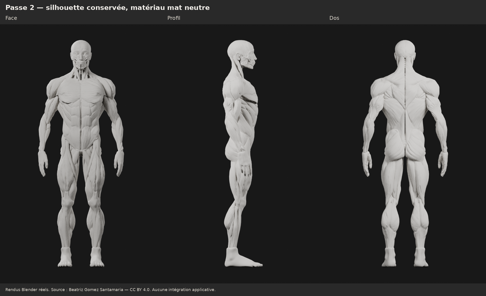

# M4A — Deuxième passe ciblée sur l’écorché athlétique

Une seule proposition, dérivée de la version validée du commit `03aa2eb`.
**La silhouette est conservée ; les modifications concernent 12 objets sur 390.**
L’original et la première passe restent disponibles à l’identique.

## Modifications réellement effectuées

| Zone | Intervention | Mesure géométrique par côté |
| --- | --- | --- |
| Deltoïde | Redistribution des ventres antérieur, moyen et postérieur en éventail vers leur insertion commune ; contours continus, attaches atténuées | Volume −0,13 % ; déplacement local ≤ 3,5 mm ; aucun élargissement global |
| Triceps | Petit renfort des deux pièces postérieures repérées, avec atténuation aux extrémités | Volumes des pièces +11,3 % et +7,2 % ; déplacement ≤ 3 mm |
| Biceps | Renfort plus discret du ventre musculaire | Volume de la pièce +3,2 % ; déplacement ≤ 1,1 mm |
| Haut du dos | Rapprochement des bords médians des trapèzes et transition postérieure adoucie | Écart géométrique réduit d’environ 58–74 % sur les quatre coupes contrôlées ; volume du trapèze +1,0 % |
| Surfaces | Régularisation locale des petites aspérités des deltoïdes, bras, pectoraux et de la transition scapulaire | Déplacement de finition plafonné à 0,45–0,7 mm selon la zone |

Les volumes ci-dessus sont ceux des **pièces de maillage fermées**, calculés par
intégration géométrique. Ce ne sont pas des gains de masse musculaire biologique.
Le volume pectoral varie de **+0,02 %** après finition. Les **grands dorsaux,
cuisses, mollets et 378 objets au total sont géométriquement inchangés**.

## Deltoïdes : travail de forme et limite

La retouche est guidée par l’organisation des portions claviculaires,
acromiales et spinales vers la tubérosité deltoïdienne. Des déformations larges
redistribuent les formes, avec une contrainte de volume et une protection du
gabarit latéral. La surface reste continue ; aucune séparation n’est peinte,
aucune plaque n’est ajoutée et aucun muscle n’est détaché.

La différenciation est **modérée** et doit être jugée sur les trois gros plans,
en particulier de profil. Cette passe ne constitue pas une reconstruction
anatomique indépendante de chaque faisceau. Trois groupes de sommets pondérés
(`DELT_ANTERIEUR`, `DELT_MOYEN`, `DELT_POSTERIEUR`) sont conservés dans Blender
comme aides d’édition ; leurs frontières ne sont pas une segmentation médicale
validée et ne sont pas exportées comme masques interactifs.

Le sillon dorsal reste visible, notamment vers le cou et en dehors de la zone
retouchée. La finition réduit les aspérités ciblées ; certains reliefs anguleux
et les détails d’écorché de la source subsistent. Aucune validation anatomique
spécialisée ni contrôle exhaustif de toutes les intersections n’est revendiqué.

## Rendus pour validation

Les comparatifs utilisent **exactement le même matériau mat neutre**, les mêmes
caméras orthographiques et le même éclairage blanc pour les deux versions.
Métal et coat à zéro, roughness 0,85. Rendus Blender 4.3.2 / Cycles CPU,
48 échantillons, sans retouche des captures. Les planches ajoutent titres et marges.

- Avant/après : [face](m4a/ecorche-beatriz-passe2/renders/comparatif-face.png),
  [profil](m4a/ecorche-beatriz-passe2/renders/comparatif-profil.png),
  [dos](m4a/ecorche-beatriz-passe2/renders/comparatif-dos.png).
- Deltoïde : [antérieur](m4a/ecorche-beatriz-passe2/renders/comparatif-epaule-avant.png),
  [latéral](m4a/ecorche-beatriz-passe2/renders/comparatif-epaule-profil.png),
  [postérieur](m4a/ecorche-beatriz-passe2/renders/comparatif-epaule-arriere.png).
- [Détail du haut du dos](m4a/ecorche-beatriz-passe2/renders/comparatif-haut-dos.png).
- [Présentation bleu argenté](m4a/ecorche-beatriz-passe2/renders/apres-bleu-trois-quarts.png).

## Fichiers et vérifications

- [Master Blender](m4a/ecorche-beatriz-passe2/ecorche-passe2.blend) : scènes
  précédentes conservées, avant/après mat, présentation bleue, shape keys
  `PASSE1_VALIDEE` / `PASSE2_CIBLEE` sur les pièces retouchées.
- [GLB retouché](m4a/ecorche-beatriz-passe2/ecorche-passe2.glb) : même géométrie,
  matériau bleu et identifiants des pièces conservés pour un futur travail de sélection.
- [Paramètres et mesures](m4a/ecorche-beatriz-passe2/passe2.json),
  [contrôles](m4a/ecorche-beatriz-passe2/verification.json),
  [reproduction](m4a/ecorche-beatriz-passe2/README.md).

**Aucun triangle ajouté** : master 531 777 triangles, GLB 531 775 triangles et
390 objets. L’exporteur élimine deux occurrences de faces dupliquées, sans perte
de surface visible. La symétrie, les coutures, les indices, l’absence de
retournement sur les triangles contrôlés, les objets inchangés et les surfaces
du GLB sérialisé sont vérifiés. Réimport Blender effectué. L’optimisation mobile
et la segmentation complète restent à faire après validation.

**Proposition recommandée pour validation visuelle de cette deuxième passe.**
L’amélioration des deltoïdes reste progressive ; votre choix sur les gros plans
prime sur les seules mesures. Aucun changement applicatif ni SQLite ; M4B
non lancé. PR conservée en brouillon, sans fusion. Arrêt pour validation.

Source : **[Ecorche - Anatomy study](https://sketchfab.com/3d-models/ecorche-anatomy-study-e402d3d541eb4b199c57d5410f5d3c57)**,
**[Beatriz Gomez Santamaria](https://sketchfab.com/BeatrizGomez)**,
**[CC BY 4.0](https://creativecommons.org/licenses/by/4.0/)** selon les métadonnées
du GLB fourni. Adaptation Logbook : reconstruction symétrique, volumes athlétiques
et corrections locales de cette deuxième passe. Attribution conservée dans l’export.
