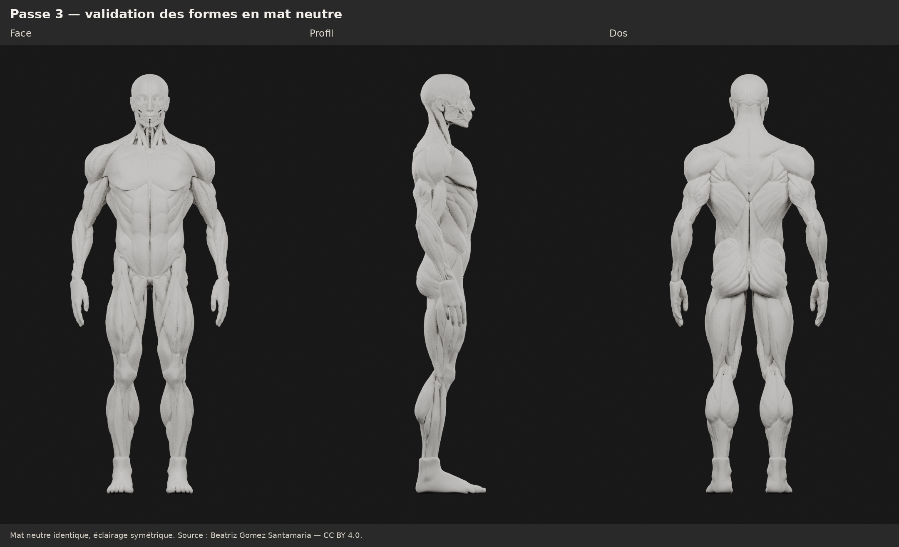

# M4A — Troisième passe : épaules, surfaces et raccords du thorax

Proposition dérivée de `0297e9b`, **à valider visuellement**. La deuxième passe
et tout l’historique sont conservés. Aucun changement dans l’application.

## Corrections réalisées

| Zone | Intervention et résultat mesuré |
| --- | --- |
| Deltoïdes | Reconstruction locale de surface, puis remodelage des ventres antérieur, moyen et postérieur suivant trois trajets en éventail vers l’insertion commune. Volume −0,33 % ; dimensions de la pièce variant de quelques millimètres. |
| Symétrie des épaules | La géométrie de départ était déjà symétrique, erreur maximale 0,00002 mm. L’ancien éclairage était dissymétrique. Les nouveaux rendus utilisent des sources blanches équilibrées gauche/droite. Les corrections géométriques sont appliquées par symétrie. |
| Pectoraux | Surface reconstruite et régularisée pour retirer les replis et stries irrégulières. Volume conservé à la précision de mesure ; attache humérale et séparation sternale maintenues. |
| Haut du dos | Bords médians rapprochés, relief postérieur adouci et petite attache fibreuse médiane reconstruite pour combler la fente visuelle. Écart entre trapèzes réduit d’environ 52 à 82 % supplémentaires sur quatre coupes par rapport à la passe 2 ; volume −0,01 %. |
| Thorax latéral | Bords de cinq pièces latérales régularisés, avec recalage local près de la face inférieure du pectoral pour réduire les contacts pénétrants et les espaces excessifs. Les pièces restent séparées. |
| Finition de face | Petites irrégularités des grands droits atténuées, avec volume conservé. |

Les **bras, grands dorsaux, cuisses et mollets restent exactement à la géométrie
de la passe 2**. Au total : **18 objets corrigés, 372 inchangés**. Les volumes
du tableau sont des volumes géométriques de pièces fermées, pas des gains de
masse biologique. La silhouette générale est conservée ; les vues permettent
de juger les petites redistributions locales.

## Pourquoi une reprise locale du maillage

Les aperçus ont montré que la triangulation et les replis sources limitaient
le nettoyage. Les deux deltoïdes et les deux pectoraux ont donc été reconstruits
localement par voxelisation à **3 mm**, puis réduits et retouchés. Le reste du
corps conserve sa topologie. Chaque muscle reste un objet indépendant.

Le master passe de **531 777 à 567 369 triangles**, soit **+35 592 / +6,69 %**.
La reconstruction complémentaire de l’attache médiane ajoute **1 objet non
musculaire et 5 436 triangles** : total final **572 805 triangles / 391 objets**,
soit **+7,72 %** par rapport à la passe 2. Les mesures du GLB final sont dans
[export.json](m4a/ecorche-beatriz-passe3/export.json). L’écart de deux triangles
correspond à des occurrences de faces dupliquées retirées par l’exporteur,
sans perte de surface visible.

Les quatre pièces reconstruites sont fermées ; aucun auto-contact non adjacent
n’y est détecté par le contrôle effectué. Les autres pièces ciblées gardent
leurs indices et leurs coutures. La symétrie, les objets inchangés, les volumes,
la correspondance des surfaces du GLB sérialisé et son réimport Blender sont
vérifiés dans [verification.json](m4a/ecorche-beatriz-passe3/verification.json).
Ce contrôle ne certifie pas toutes les relations anatomiques ou intersections
entre tous les objets du corps. L’attache médiane est une construction
stylisée de tissu de liaison, en contact avec les deux trapèzes ; elle n’est
pas présentée comme un ligament médicalement certifié. Un indicateur
`interactive_muscle_zone: false` la destine à être exclue de la sélection
musculaire par un futur chargeur ; aucune logique applicative n’est développée.

## Comparatifs de validation

Tous les nouveaux rendus utilisent le **même matériau mat neutre**, sans métal
ni coat, roughness 0,85, avec le même éclairage symétrique avant/après.
Cycles CPU, 48 échantillons, sans débruitage ni retouche des captures.
Les dix vues « après » sont recalculées avec l’attache médiane ; les dix vues
« avant » inchangées sont conservées, avec leur provenance dans les métadonnées.
Les planches ajoutent seulement des titres et des marges.

- [Diagnostic de l’ancien éclairage](m4a/ecorche-beatriz-passe3/renders/diagnostic-eclairage.png) :
  même géométrie de passe 2, comparaison ancien éclairage / éclairage équilibré.
  Sur les zones mesurées, l’écart de luminosité gauche/droite passe de 13,6 %
  à 0,3 % ; [méthode et données](m4a/ecorche-beatriz-passe3/lighting-audit.json).
  Le filtrage utilisé pour mesurer le bruit ne modifie aucune capture livrée.
- Avant/après : [face](m4a/ecorche-beatriz-passe3/renders/comparatif-face.png),
  [profil](m4a/ecorche-beatriz-passe3/renders/comparatif-profil.png),
  [dos](m4a/ecorche-beatriz-passe3/renders/comparatif-dos.png).
- [Les deux épaules](m4a/ecorche-beatriz-passe3/renders/deux-epaules.png) et
  [trois angles du deltoïde](m4a/ecorche-beatriz-passe3/renders/deltoide-trois-angles.png).
- Deltoïdes avant/après : [droite](m4a/ecorche-beatriz-passe3/renders/comparatif-epaule-droite.png),
  [gauche](m4a/ecorche-beatriz-passe3/renders/comparatif-epaule-gauche.png),
  [profil](m4a/ecorche-beatriz-passe3/renders/comparatif-epaule-profil.png),
  [postérieur](m4a/ecorche-beatriz-passe3/renders/comparatif-epaule-arriere.png).
- Gros plans : [haut du dos](m4a/ecorche-beatriz-passe3/renders/comparatif-haut-dos.png),
  [pectoraux](m4a/ecorche-beatriz-passe3/renders/comparatif-pectoraux.png),
  [transition latérale](m4a/ecorche-beatriz-passe3/renders/comparatif-thorax-lateral.png).

## Limites et fichiers

La différenciation des deltoïdes est un **travail réel de forme**, guidé par les
repères de la source. Elle reste à juger sur les trois angles ; ce n’est pas une
validation anatomique spécialisée. Les trois portions sont continues, avec des
groupes de sommets d’édition. Certaines jonctions gardent un liseré irrégulier
en très gros plan. Il n’y a pas de segmentation médicale indépendante ni de masques
interactifs exportés. Les reliefs latéraux du thorax restent stylisés ; leur
cartographie anatomique complète n’est pas certifiée. Un sillon peu profond et des détails d’écorché du cou restent visibles ;
une fente persiste plus bas, hors de la zone supérieure reconstruite.

Le changement de topologie des quatre pièces reconstruites invalide une éventuelle
correspondance de leurs anciens triangles. Leurs identifiants d’objets sont
conservés. Les couleurs sources y sont reprojetées pour l’édition ; les rendus
et le GLB de validation utilisent le matériau neutre. L’optimisation mobile et
la sélection interactive restent des travaux futurs, après validation.

- [Blender éditable](m4a/ecorche-beatriz-passe3/ecorche-passe3.blend) : scènes
  historiques, avant/après exacts dans les scènes 07/08, formes d’édition,
  caméras et éclairage de contrôle.
- [GLB mat neutre](m4a/ecorche-beatriz-passe3/ecorche-passe3.glb).
- [Paramètres, repères et mesures](m4a/ecorche-beatriz-passe3/passe3.json),
  [reproduction](m4a/ecorche-beatriz-passe3/README.md).

**Arrêt pour validation de cette proposition.** Aucun code Logbook ou SQLite
modifié, aucune intégration, aucun M4B, aucune fusion. PR maintenue en brouillon.

Source : **[Ecorche - Anatomy study](https://sketchfab.com/3d-models/ecorche-anatomy-study-e402d3d541eb4b199c57d5410f5d3c57)**,
**[Beatriz Gomez Santamaria](https://sketchfab.com/BeatrizGomez)**,
**[CC BY 4.0](https://creativecommons.org/licenses/by/4.0/)** selon les métadonnées
du fichier fourni. Adaptation Logbook : reconstruction symétrique et volumes
athlétiques, puis corrections de forme, surfaces et contacts de cette troisième passe.
