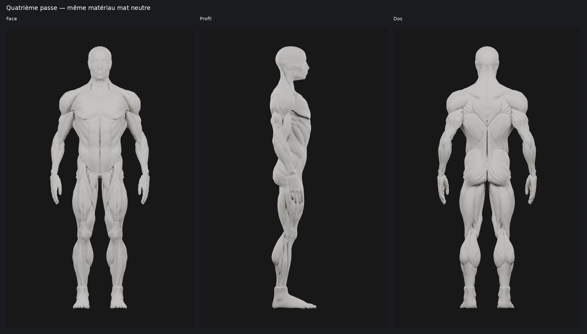

# M4A — Quatrième passe : deltoïde antérieur, gorge et tête

Proposition dérivée de la troisième passe `033a92a`, **à valider visuellement**.
La base, les proportions et les volumes validés du corps sont conservés.

## Corrections réellement effectuées

| Zone | Intervention |
| --- | --- |
| Deltoïde antérieur | Redistribution continue de la forme vers le ventre antérieur, légèrement relevé. La transition antérieur/moyen est déplacée vers l’arrière pour limiter la dominance du moyen sur l’avant. Les extrémités du muscle sont atténuées dans le champ de déformation. Aucun trait peint, incision nouvelle ou faisceau rapporté. |
| Volume de l’épaule | Conservation du volume fermé de chaque deltoïde, sans changement de topologie. Déplacement maximal d’environ **3,89 mm** ; dimensions de la pièce variant d’au plus **0,29 mm**. Les deux côtés sont traités par symétrie. |
| Gorge / cou | Reconstruction d’une enveloppe continue qui remplit visuellement les cavités entre les structures cervicales. La base descend sous les raccords claviculaires ; les reliefs cervicaux existants sont conservés lorsque visibles. |
| Visage / tête | Substitution des nombreuses pièces de dissection par une surface de présentation continue, guidée par les contours de la tête source. Joues, mâchoire et front simplifiés ; nez, bouche et masses orbitales conservés sous une forme très adoucie. Les cavités et l’exposition des couches faciales profondes disparaissent dans la proposition. |

Les **295 autres pièces conservées sont rigoureusement identiques**, coordonnées
et indices compris. Cela inclut les pectoraux, bras, trapèzes, dorsaux, cuisses,
mollets et l’attache médiane reconstruite à la passe 3. L’enveloppe cervicale
recouvre toutefois certains petits détails de dissection autour du cou : c’est
l’effet de présentation recherché, sans retoucher ces muscles sous-jacents.

## Méthode et fichiers

Les deltoïdes reçoivent une déformation locale à progression douce, suivant
leur orientation en éventail. Une compensation normale répartie conserve
leur volume ; il ne s’agit pas d’un grossissement de l’épaule. Les trois
groupes de poids d’auteur restent disponibles dans Blender. La retouche
reste réversible par shape keys.

Pour la tête et la gorge, les sections des triangles de la passe 3 servent à
échantillonner une enveloppe extérieure symétrique : **235 niveaux et 256
directions**. Une fermeture morphologique des petites cavités, suivie d’une
régularisation de courbure, construit une vraie surface 3D. Un filtrage plus
fin préserve quelques repères faciaux. Le maillage obtenu est réduit localement.
Ce n’est ni un flou appliqué aux captures, ni une texture qui masque les trous.

Les **94 pièces fines de tête/dissection** sont remplacées uniquement dans la
nouvelle scène de présentation par **1 surface non musculaire**. Elles ne sont
pas supprimées du master : les scènes historiques et `09_AVANT_PASSE4` les
conservent intégralement. Aucun muscle du corps n’est fusionné avec cette surface.

- [Master Blender](m4a/ecorche-beatriz-passe4/ecorche-passe4.blend) : toutes les scènes
  antérieures, comparaison exacte et proposition `10_PASSE4_NEUTRE`.
- [GLB mat neutre](m4a/ecorche-beatriz-passe4/ecorche-passe4.glb) : forme finale de cette
  passe, objets et identifiants conservés, retouches appliquées.
- [Enveloppe source calculée](m4a/ecorche-beatriz-passe4/head-throat-envelope.npz) et
  [paramètres](m4a/ecorche-beatriz-passe4/head-throat-envelope.json).
- [Mesures de construction](m4a/ecorche-beatriz-passe4/passe4.json),
  [export](m4a/ecorche-beatriz-passe4/export.json),
  [vérification](m4a/ecorche-beatriz-passe4/verification.json) et
  [reproduction / attribution](m4a/ecorche-beatriz-passe4/README.md).

Le master passe de **572 805 à 488 822 triangles**, soit environ **−14,7 %**,
et de **391 à 298 objets**. La nouvelle enveloppe compte **27 672 triangles**.
Le GLB compte **488 821 triangles, 288 826 sommets et 10 116 832 octets**.
L’écart d’un triangle correspond à une occurrence dupliquée ancienne retirée
par l’exporteur ; une copie de la même surface reste présente. Ce point est
contrôlé dans `verification.json`.

## Rendus de validation

Même matériau **`PASSE3_MAT_NEUTRE`** que dans la troisième passe : gris clair
chaud, metallic 0, roughness 0,85, coat 0. Éclairage blanc équilibré identique
gauche/droite et avant/après. Cycles CPU, 48 échantillons, sans débruitage ni
retouche des captures. Les six vues « avant » déjà disponibles à ces angles
sont réutilisées sans modification ; les autres sont recalculées. Empreintes
et provenance : [métadonnées](m4a/ecorche-beatriz-passe4/renders/metadata.json).
Les planches ajoutent seulement des marges et légendes aux images natives.

- Corps avant/après : [face](m4a/ecorche-beatriz-passe4/renders/comparatif-face.png),
  [profil](m4a/ecorche-beatriz-passe4/renders/comparatif-profil.png),
  [dos](m4a/ecorche-beatriz-passe4/renders/comparatif-dos.png).
- [Deux épaules](m4a/ecorche-beatriz-passe4/renders/deux-epaules.png) ; comparatifs
  [droite](m4a/ecorche-beatriz-passe4/renders/comparatif-epaule-droite.png),
  [gauche](m4a/ecorche-beatriz-passe4/renders/comparatif-epaule-gauche.png),
  [profil du deltoïde](m4a/ecorche-beatriz-passe4/renders/comparatif-epaule-profil.png).
- [Gorge en deux vues](m4a/ecorche-beatriz-passe4/renders/gorge-deux-vues.png) ;
  avant/après [face](m4a/ecorche-beatriz-passe4/renders/comparatif-gorge.png) et
  [trois quarts](m4a/ecorche-beatriz-passe4/renders/comparatif-gorge-trois-quarts.png).
- [Tête en trois vues](m4a/ecorche-beatriz-passe4/renders/tete-trois-vues.png) ;
  avant/après [face](m4a/ecorche-beatriz-passe4/renders/comparatif-tete.png),
  [profil](m4a/ecorche-beatriz-passe4/renders/comparatif-tete-profil.png),
  [trois quarts](m4a/ecorche-beatriz-passe4/renders/comparatif-tete-trois-quarts.png).

## Appréciation et limites

La gorge et le visage deviennent nettement moins agressifs. La finition
antérieure de l’épaule reste volontairement mesurée, pour conserver le volume
validé ; elle doit être appréciée sur les comparatifs de forme, pas comme un
nouveau découpage en trois objets. Le visage est très simplifié, peu expressif,
avec des oreilles et repères faciaux schématiques : **ce choix esthétique reste
à valider**.

Les deux deltoïdes et la nouvelle surface sont contrôlés comme surfaces fermées,
connectées, sans auto-contact non adjacent détecté. Les autres pièces sont
comparées à la base, le GLB est décodé pour comparer les surfaces réellement
exportées, puis réimporté dans Blender. Ce contrôle ne vaut pas certification
médicale ni audit exhaustif des contacts entre tous les objets.

Les objets musculaires utiles restent exploitables pour préparer une sélection
future. La surface tête/gorge porte `interactive_muscle_zone: false`. Les trois
poids du deltoïde ne constituent pas encore une segmentation interactive finale.
Avec près de 489 000 triangles et 298 objets, le fichier reste un **master
d’auteur à optimiser pour mobile** ; aucune performance iPhone/Android n’est
affirmée ni testée dans l’application à ce stade.

**Proposition : soumettre cette quatrième passe à validation visuelle**, en
particulier le niveau de simplification du visage et la lecture antérieure du
deltoïde. Arrêt après cette livraison. Aucun changement applicatif, SQLite,
M4B ou fusion.

## Attribution

**Ecorche - Anatomy study — Beatriz Gomez Santamaria**
([source](https://sketchfab.com/3d-models/ecorche-anatomy-study-e402d3d541eb4b199c57d5410f5d3c57)),
**[CC BY 4.0](https://creativecommons.org/licenses/by/4.0/)** selon les métadonnées
du fichier fourni. Adaptation Logbook : reconstruction symétrique, volumes
athlétiques et passes de finition ; cette passe ajoute une redistribution
antérieure du deltoïde et une surface tête/gorge de présentation simplifiée.
Crédit, licence et modifications conservés dans les documents et le GLB.
