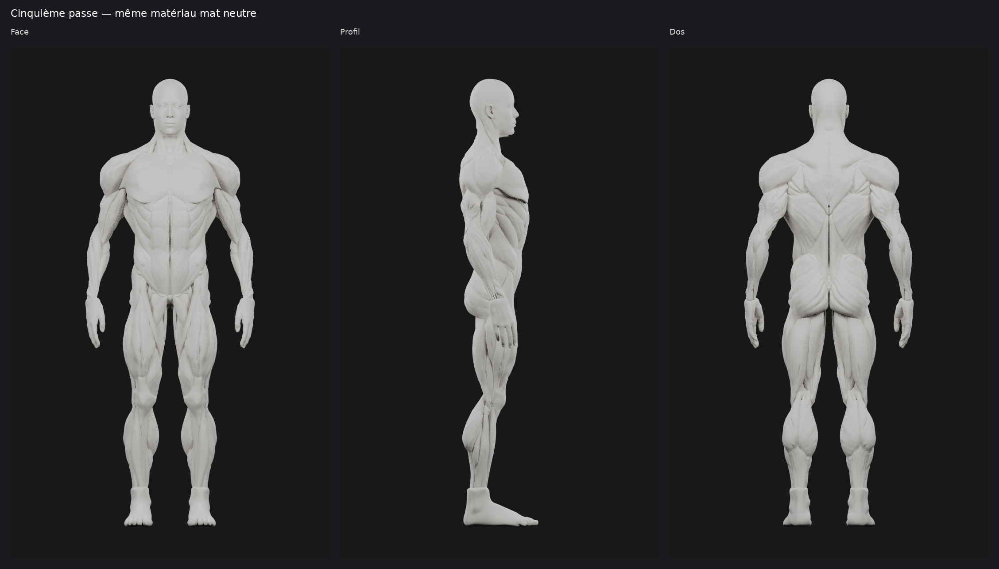

# M4A — Cinquième passe : tête humaine et définition des deltoïdes

Proposition unique dérivée de la passe 4 `9e49c78`, **à valider visuellement**.
Le corps validé et la gorge ne sont pas repris en sculpture.

## Corrections réalisées

| Zone | Intervention |
| --- | --- |
| Tête / visage | Remplacement de la tête trop abstraite par une tête humaine issue du bundle gratuit Blender Studio déjà disponible. Paupières, nez, lèvres, mâchoire et oreilles gardent une forme humaine. Pas de dissection faciale, cheveux ni détail ajouté inutilement. Deux globes oculaires neutres occupent les paupières ; le même matériau mat est employé partout. |
| Calage de la tête | Adaptation de la hauteur et de la profondeur pour raccorder menton et occiput aux attaches cervicales fixes. Sommet à 1,80 m ; raccord sous la mâchoire et ajustement très limité sur la nouvelle surface postérieure. |
| Gorge / cou | Géométrie de gorge conservée sous Z = 1,570 m, sans nouvelle sculpture. Les pièces cervicales et trapèzes existants ne sont pas déplacés. Le raccord est construit sur la nouvelle tête au-dessus de cette limite. |
| Deltoïdes | Régularisation locale des petites irrégularités, puis remodelage de trois ventres convexes en éventail suivant les repères antérieur, moyen et postérieur. Transitions plus concentrées entre les ventres, convergence conservée vers l’insertion humérale. Aucun trait peint, découpage détaché ou incision étroite. |
| Volume des épaules | Volume fermé conservé, topologie inchangée et corrections appliquées par symétrie. Déplacement local maximal d’environ 6,61 mm ; largeur de la pièce +1,18 mm et profondeur +4,55 mm, hauteur inchangée. Il s’agit d’une redistribution de forme, pas d’un changement de gabarit général. |

Les **295 autres pièces du corps restent strictement identiques**, coordonnées
et indices compris : pectoraux, bras, dos, trapèzes, dorsaux, cuisses, mollets
et raccord médian dorsal. Les anciennes versions et la tête de passe 4 sont
conservées dans leurs dossiers et dans les scènes du master.

## Rendus comparatifs

Même matériau **`PASSE3_MAT_NEUTRE`** que les passes 3 et 4 : gris clair chaud,
metallic 0, roughness 0,85, coat 0. Même éclairage blanc équilibré avant/après,
Cycles CPU 48 échantillons, sans débruitage ni retouche des captures. Les vues
« avant » existantes sont réutilisées à l’identique ; l’angle arrière de l’épaule
est recalculé. Les planches ajoutent seulement des légendes et marges.

- Corps avant/après : [face](m4a/ecorche-beatriz-passe5/renders/comparatif-face.png),
  [profil](m4a/ecorche-beatriz-passe5/renders/comparatif-profil.png),
  [dos](m4a/ecorche-beatriz-passe5/renders/comparatif-dos.png).
- [Deux épaules](m4a/ecorche-beatriz-passe5/renders/deux-epaules.png) et
  [trois angles du deltoïde](m4a/ecorche-beatriz-passe5/renders/deltoide-trois-angles.png).
  Avant/après : [droite](m4a/ecorche-beatriz-passe5/renders/comparatif-epaule-droite.png),
  [gauche](m4a/ecorche-beatriz-passe5/renders/comparatif-epaule-gauche.png),
  [profil](m4a/ecorche-beatriz-passe5/renders/comparatif-epaule-profil.png),
  [arrière](m4a/ecorche-beatriz-passe5/renders/comparatif-epaule-arriere.png).
- [Tête en trois vues](m4a/ecorche-beatriz-passe5/renders/tete-trois-vues.png).
  Avant/après : [face](m4a/ecorche-beatriz-passe5/renders/comparatif-tete.png),
  [trois quarts](m4a/ecorche-beatriz-passe5/renders/comparatif-tete-trois-quarts.png),
  [profil](m4a/ecorche-beatriz-passe5/renders/comparatif-tete-profil.png).
- [Métadonnées des captures](m4a/ecorche-beatriz-passe5/renders/metadata.json) et
  [planches](m4a/ecorche-beatriz-passe5/renders/planches.json).

## Sources et structure

La tête vient uniquement de **Head (Animation) - Realistic**, auteur **Dan
Ulrich**, collection explicitement **CC0** du bundle Human Base Meshes v1.4.1.
Le niveau Multires 1 conserve les formes utiles sans chercher un visage détaillé.
La tête est adaptée au mannequin actuel ; le corps Blender Studio n’est pas utilisé.
Le corps anatomique reste l’adaptation **Beatriz Gomez Santamaria — CC BY 4.0**.
[Déclarations et provenance des sources](m4a/ecorche-beatriz-passe5/HEAD_SOURCE_LICENSE.md).

- [Master Blender](m4a/ecorche-beatriz-passe5/ecorche-passe5.blend) : toutes les scènes
  précédentes, `11_AVANT_PASSE5`, `12_PASSE5_NEUTRE`, clés de forme des deltoïdes.
- [GLB mat neutre](m4a/ecorche-beatriz-passe5/ecorche-passe5.glb) : forme de cette passe,
  identifiants conservés, deux yeux non musculaires et surface tête/gorge exclue
  de la sélection musculaire par son indicateur `interactive_muscle_zone: false`.
- [Données de tête extraites](m4a/ecorche-beatriz-passe5/head-donor.npz) et
  [provenance / paramètres](m4a/ecorche-beatriz-passe5/head-donor.json).
- [Mesures](m4a/ecorche-beatriz-passe5/passe5.json),
  [export](m4a/ecorche-beatriz-passe5/export.json),
  [contrôles](m4a/ecorche-beatriz-passe5/verification.json),
  [reproduction](m4a/ecorche-beatriz-passe5/README.md).

Le master compte **498 058 triangles et 300 objets** 
contre 488 822 triangles et 298 objets à la passe 4. Le supplément provient
de la nouvelle tête et des deux yeux ; les deltoïdes ne gagnent aucun triangle.
Le GLB sérialise **498 057 triangles, 293 448 sommets, 300 objets et
10 281 020 octets**. Une occurrence de face dupliquée ancienne est retirée
par l’exporteur, avec une copie de la même surface conservée. Les muscles
restent des objets séparés ; les
trois groupes de poids du deltoïde sont des aides d’auteur et ne constituent
pas encore trois zones interactives finalisées.

## Appréciation et limites

La nouvelle tête est nettement plus humaine que l’enveloppe abstraite de la
passe 4, tout en restant sobre et sans dissection. Elle est chauve et ses yeux
sont neutres, sans iris peints. Le raccord conserve une lecture anatomique de
cou musculaire ; aucune retouche du corps n’est effectuée pour masquer le calage.

La lecture des trois portions du deltoïde est travaillée par les convexités et
les changements de courbure. Elle reste continue : **il faut valider la netteté
sur les vues avant, profil et arrière**, sans la confondre avec une segmentation
médicale certifiée ou une séparation en trois muscles flottants.

Les contrôles passent : 295 pièces inchangées, **10 251 triangles de gorge
strictement conservés** sous la limite protégée, volume et symétrie des épaules,
surfaces fermées, conformité du GLB réellement sérialisé et réimport Blender.
Les 20 captures sont contrôlées par leurs empreintes ; les 14 planches utilisent
leurs pixels natifs. Les deux deltoïdes n’ont aucun auto-contact non adjacent
détecté. Les **179 paires de contacts** de la tête correspondent exactement
aux surfaces des lèvres fermées de la source ; aucun contact nouveau du raccord
n’est détecté par ce contrôle.
Ce contrôle ne certifie pas médicalement l’anatomie et ne constitue pas un audit
exhaustif des contacts entre tous les objets.

Le fichier reste un **master d’auteur à optimiser pour mobile**. Aucune mesure
de fluidité iPhone/Android ni intégration dans Logbook n’est réalisée.

**Proposition : soumettre cette tête et cette définition des épaules à validation.**
Arrêt après livraison. Aucun changement applicatif, SQLite, M4B ou fusion.

Attribution du corps : **Ecorche - Anatomy study — Beatriz Gomez Santamaria**,
[source](https://sketchfab.com/3d-models/ecorche-anatomy-study-e402d3d541eb4b199c57d5410f5d3c57),
[CC BY 4.0](https://creativecommons.org/licenses/by/4.0/) selon les métadonnées
du GLB fourni. Adaptations Logbook : reconstruction symétrique, volumes athlétiques,
passes de finition ; cette passe remodèle les deltoïdes et adapte une tête CC0
au-dessus de la gorge conservée. Crédit, licences et modifications conservés dans le GLB.
