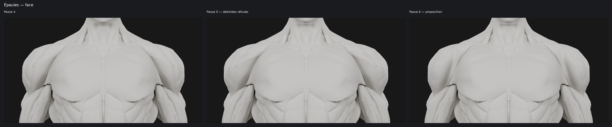

# M4A — Passe 6 : épaules plus compactes et raccord pectoral/deltoïde

Proposition unique dérivée de `354d364`, **à valider visuellement**.
Les deltoïdes de passe 5 sont remplacés ; la tête validée de passe 5 et tout
le reste du mannequin sont conservés.

## Corrections réellement effectuées

| Point demandé | Intervention |
| --- | --- |
| Épaules trop gonflées | Reprise depuis les deltoïdes P4, avec contrôle de leur limite extérieure de face. Le volume fermé final baisse d’environ **3,9 %** par rapport à P4/P5 ; la profondeur de la pièce diminue d’environ **7,9 mm par rapport à P5**, sa largeur d’environ **2,5 mm**. Aucun grossissement compensatoire de la calotte. |
| Creux qui rentrent dans le deltoïde | Remplacement des anciennes dépressions sculptées par une surface reconstruite, en préservant l’épaisseur de la pièce. Les vieux tracés ne sont pas simplement accentués. |
| Trois faisceaux | Construction de trois volumes elliptiques recouvrants, orientés antérieur / moyen / postérieur et raccordés par une enveloppe arrondie. Les changements de courbure portent la lecture, sans trait peint, lame de coupe ou portion flottante. |
| Jonction pectoral / deltoïde | Approche et arrondi local du bord du deltoïde vers le pectoral, jusqu’à environ **3,5 mm** de correction locale. Le pectoral ne bouge pas. L’écart médian sur les échantillons de contrôle passe de **6,2 mm en P4 / 7,0 mm en P5 à 3,6 mm en P6**. |

**298 objets restent strictement identiques à P5**, coordonnées et indices
compris : tête, yeux, gorge / cou, pectoraux, dos, trapèzes, dorsaux, bras,
cuisses et mollets. Seuls `deltoid.right` et `deltoid.left` changent. Les
deux côtés sont construits par symétrie.

Les dimensions citées concernent la boîte englobante de chaque deltoïde ;
le volume est celui d’une surface fermée, pas une mesure de masse biologique.
Les coupes de contrôle de face restent légèrement à l’intérieur du gabarit P4.

## Comparatifs demandés

Même matériau **`PASSE3_MAT_NEUTRE`** : gris clair chaud, metallic 0,
roughness 0,85, coat 0. Même éclairage blanc équilibré et caméras assorties,
Cycles CPU 48 échantillons, sans débruitage ni retouche des captures.
Les planches recopient les pixels natifs et ajoutent seulement légendes et marges.

Les trois colonnes comparent les **épaules exactes de P4, P5 et P6** :

- [Face, avec les deux épaules](m4a/ecorche-beatriz-passe6/renders/comparatif-epaules-face.png).
- [Arrière, avec les deux épaules](m4a/ecorche-beatriz-passe6/renders/comparatif-epaules-dos.png).
- [Profil](m4a/ecorche-beatriz-passe6/renders/comparatif-epaule-profil.png).
- [Trois quarts avant — droite](m4a/ecorche-beatriz-passe6/renders/comparatif-epaule-droite.png)
  et [gauche](m4a/ecorche-beatriz-passe6/renders/comparatif-epaule-gauche.png).
- [Trois quarts arrière](m4a/ecorche-beatriz-passe6/renders/comparatif-epaule-arriere.png).

La nouvelle passe seule :

- [Les deux deltoïdes en gros plan](m4a/ecorche-beatriz-passe6/renders/deux-deltoides.png).
- [Profil / trois quarts arrière](m4a/ecorche-beatriz-passe6/renders/profil-arriere.png).
- [Mannequin complet : face, profil, dos](m4a/ecorche-beatriz-passe6/renders/validation-corps.png).

Huit captures antérieures sont réutilisées **sans modification** ; les quatre
vues de torse P4/P5 manquantes et les neuf vues P6 sont calculées dans Blender.
[Métadonnées et empreintes](m4a/ecorche-beatriz-passe6/renders/metadata.json).

## Méthode, structure et contrôles

Les sections de la passe 4 donnent une enveloppe de référence qui retire les
dépressions internes héritées. Trois volumes elliptiques y définissent les
convexités musculaires et leurs transitions. Le déplacement radial distingue
la face interne de la face externe pour conserver une épaisseur réelle ; la
compacité est obtenue sans repousser la surface vers l’extérieur pour récupérer
artificiellement du volume.

Les deux deltoïdes seuls sont reconstruits par voxelisation locale à **1,8 mm**,
puis réduits au nombre de triangles utile. La projection de conservation du
volume est désactivée à cette étape pour ne pas réintroduire les anciens replis.
Les deux pièces finales sont fermées, connectées, sans auto-contact non adjacent
détecté dans le contrôle effectué.

Chaque deltoïde reste à **11 938 triangles**, comme auparavant : **aucun triangle
supplémentaire au total**. Le master reste à **498 058 triangles / 300 objets**.
Le GLB sérialise **498 057 triangles / 293 448 sommets / 300 objets**,
pour **10 281 260 octets**. Une occurrence de face dupliquée ancienne est
retirée par l’exporteur ; une copie de la même surface reste présente.
[Mesures d’export](m4a/ecorche-beatriz-passe6/export.json).

Les contrôles indépendants comparent les scènes témoins aux états historiques,
les 298 pièces protégées à P5, la symétrie, le volume et la limite frontale sur
41 hauteurs. Le raccord est mesuré sur **206 points sources fixes**, projetés
sur chaque surface réelle : la diminution de l’écart ne repose pas sur le choix
de nouveaux points plus favorables. Aucun de ces échantillons P6 n’est situé
à plus de 1 mm à l’intérieur du pectoral selon ce contrôle local. Cela ne
constitue pas une certification de tous les contacts anatomiques.

Le contrôle final compare aussi les triangles réellement exportés avec le
master, réimporte le GLB dans Blender et vérifie les empreintes des 21 captures.
[Résultats détaillés](m4a/ecorche-beatriz-passe6/verification.json).

## Fichiers et limites de validation

- [Master Blender](m4a/ecorche-beatriz-passe6/ecorche-passe6.blend), scènes témoins
  P4/P5 et proposition `15_PASSE6_NEUTRE`.
- [GLB de contrôle](m4a/ecorche-beatriz-passe6/ecorche-passe6.glb), mêmes identifiants
  d’objets, matériau neutre et rôles non musculaires de la tête conservés.
- [Surface de travail](m4a/ecorche-beatriz-passe6/shoulder-surface.npz),
  [paramètres](m4a/ecorche-beatriz-passe6/shoulder-surface.json),
  [mesures de construction](m4a/ecorche-beatriz-passe6/passe6.json),
  [reproduction et attribution](m4a/ecorche-beatriz-passe6/README.md).

La proposition retrouve un gabarit proche de P4 et adoucit le raccord. Les trois
portions sont travaillées comme des volumes continus ; **leur netteté ne doit
pas être considérée comme validée sur la seule base des mesures**. Elle reste
plus douce que les bords entre objets séparés des obliques / dentelés. Les
vues de profil et de trois quarts arrière sont déterminantes pour ton choix.

Les groupes de poids antérieur / moyen / postérieur sont des aides d’auteur,
pas une segmentation médicale ou interactive finalisée. La topologie locale
change malgré un nombre de triangles identique ; d’éventuels masques par indices
de triangles ne pourraient pas être réutilisés directement sur les deltoïdes.
Le modèle reste un master à optimiser pour mobile ; aucun FPS applicatif n’est
affirmé. Aucun asset payant, aucune intégration, modification SQLite, M4B ou fusion.

**Arrêt pour validation de cette proposition et du comparatif P4 / P5 / P6.**
L’historique précédent est conservé intégralement.

Corps : **Ecorche - Anatomy study — Beatriz Gomez Santamaria**,
[source](https://sketchfab.com/3d-models/ecorche-anatomy-study-e402d3d541eb4b199c57d5410f5d3c57),
[CC BY 4.0](https://creativecommons.org/licenses/by/4.0/) selon les métadonnées
du GLB fourni. Tête et yeux conservés : **Dan Ulrich / Blender Studio — CC0**.
Adaptations Logbook : reconstruction symétrique et athlétique, passes de finition ;
cette passe reconstruit les deltoïdes et adoucit leur raccord au pectoral.
