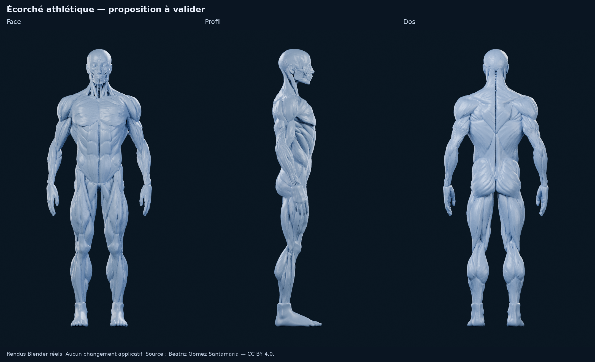

# M4A — Écorché reconstitué, symétrique et athlétique

Proposition d’asset pour **validation visuelle**, sans intégration dans Logbook.
Une seule direction est livrée : reconstruction du côté manquant à partir du
côté intact, puis retouche modérée des volumes. Le fichier original est conservé.

## Résultat et réserve principale

**Base de travail exploitable avec modifications, pas encore mannequin final validé.**
Les principaux volumes musculaires visibles du côté intact sont présents des
deux côtés. Les pectoraux reconstitués recouvrent la zone de dissection ; les
épaules, bras, dos et jambes gagnent en puissance sans changer les longueurs des
membres. La silhouette reste réaliste dans son ensemble, sous réserve de votre
validation artistique et d’une vérification anatomique spécialisée.

**L’exigence sur les trois faisceaux du deltoïde n’est pas complètement satisfaite.**
Le relief directionnel du muscle source est conservé et son volume est travaillé
de façon non uniforme, mais les portions antérieure, moyenne et postérieure ne
sont ni trois objets anatomiquement validés, ni trois zones suffisamment
distinctes pour être déclarées prêtes pour une sélection indépendante. Les
[gros plans de contrôle](m4a/ecorche-beatriz-retouche/renders/controle-deltoide.png)
montrent cette limite ; aucune fausse séparation n’est ajoutée par la couleur.

## Source utilisée

Le GLB fourni est **Ecorche - Anatomy study**, de **Beatriz Gomez Santamaria**,
et non le précédent Meshy ni le modèle HEPL cité plus tôt.

- [Page source](https://sketchfab.com/3d-models/ecorche-anatomy-study-e402d3d541eb4b199c57d5410f5d3c57).
- [Autrice](https://sketchfab.com/BeatrizGomez).
- Licence inscrite dans les métadonnées du fichier fourni : **[CC BY 4.0](https://creativecommons.org/licenses/by/4.0/)**.
- [Original non modifié](m4a/ecorche-beatriz-retouche/source.glb) : 16 350 740 octets,
  SHA-256 `137e2e80bdcf9c87ff49ab32cb5de70f8de542870c78a7d5170e8743d241a73a`.
- Modifications : reconstruction bilatérale, ajustement médian, retouche des
  ventres musculaires, normalisation uniforme à 1,80 m et présentation bleu argenté.

L’attribution et la mention de modification sont fournies avec l’asset et dans
les métadonnées de l’export. La licence permet l’adaptation et l’usage commercial
avec attribution, lien vers la licence et indication des changements. La licence
rapportée ici vient du GLB, sans nouvelle vérification de la page web de l’autrice.

## Méthode Blender

1. Lecture des six blocs de maillage du GLB, de leurs normales et couleurs.
   Ils ne constituent pas six muscles : le regroupement par connectivité
   géométrique retrouve **402 pièces**, sans fournir leurs noms anatomiques.
2. Repérage du plan sagittal, puis utilisation du **côté droit anatomique**,
   le plus complet, comme référence. Les pièces de ce côté sont copiées par
   symétrie. Les structures qui traversent le milieu sont coupées sur le plan
   puis reconstruites à partir de leur portion de référence. Les pièces
   exclusivement liées à la dissection du côté incomplet sont écartées de la
   proposition, tout en restant dans la scène originale.
3. Les pièces restent distinctes : **155 paires bilatérales et 80 structures
   médianes**, soit **390 objets**. Les pectoraux, deltoïdes, grands dorsaux,
   trapèzes et grands droits ont des repères nommés ; les autres pièces gardent
   leur identifiant source et une indication de région, sans nom médical inventé.
4. Renforcement paramétrique des ventres musculaires, exécuté dans Blender :
   axe longitudinal estimé pour chaque pièce, amplitude progressive au centre,
   atténuation vers les extrémités et les zones tendineuses. Les attaches ne sont
   pas déplacées par une simple mise à l’échelle de tout le muscle. Un ajustement
   médian reste toutefois appliqué pour empêcher les paires de se croiser.
5. Limitation des déplacements près des surfaces voisines et des replis fins.
   Les sommets dupliqués aux coutures source reçoivent le même déplacement.
   Les contrôles de triangles protègent les zones sensibles ; ils ne certifient
   pas l’absence de toute intersection entre muscles sur l’ensemble du corps.
6. Matériau bleu argenté commun, éclairage et caméras identiques pour les
   comparatifs. Rendus **Cycles CPU, 48 échantillons**, sans retouche des captures.
   Les planches ajoutent uniquement titres et mise en page.

Il s’agit d’une **retouche paramétrique assistée**, pas d’une sculpture manuelle
anatomique exhaustive. La symétrie copie les formes et les trajets du côté intact ;
elle ne prouve pas à elle seule la justesse de toutes les insertions du modèle source.

## Volumes modifiés

| Zone | Intervention | Déplacement maximal local constaté |
| --- | --- | ---: |
| Pectoraux | Reconstruction bilatérale, ventre plus plein | 17,4 mm |
| Deltoïdes | Coiffe plus présente, relief source préservé | 12,3 mm |
| Grands dorsaux | Élargissement modéré du ventre musculaire | 13,4 mm |
| Trapèzes | Haut du dos plus présent | 9,0 mm |
| Grands droits | Renforcement discret, sans épaissir fortement les attaches | 2,9 mm |
| Bras, avant-bras | Amplification locale des principales pièces musculaires | Variable selon pièce |
| Cuisses, mollets, fessiers | Amplification locale, longueurs et articulations conservées | Variable selon pièce |

Les pourcentages du script sont des plafonds **radiaux locaux**, et non des gains
de masse ou de volume biologique. **88 objets bilatéraux** sont effectivement
retouchés. Une paire de pièces fessières très fines reste à son volume reconstruit :
la retouche y a été annulée par le contrôle de retournement des triangles.
La tête, les mains, les pieds et les structures osseuses ne sont pas hypertrophiés.

Pour distinguer l’effet de la reconstruction de celui des volumes, voir le
[comparatif « symétrie seule / retouche »](m4a/ecorche-beatriz-retouche/renders/comparatif-volumes.png).

## Rendus de validation

- [Face avant/après](m4a/ecorche-beatriz-retouche/renders/comparatif-face.png).
- [Profil avant/après](m4a/ecorche-beatriz-retouche/renders/comparatif-profil.png).
- [Dos avant/après](m4a/ecorche-beatriz-retouche/renders/comparatif-dos.png).
- [Trois quarts avant/après](m4a/ecorche-beatriz-retouche/renders/comparatif-trois-quarts.png).
- [Épaule, vues antérieure et postérieure](m4a/ecorche-beatriz-retouche/renders/controle-deltoide.png).
- [Pectoral gauche orange](m4a/ecorche-beatriz-retouche/renders/selection-comparatif.png).

Le profil avant/après montre le côté intact dans les deux versions pour comparer
les volumes. La face et le dos montrent la reconstruction du côté disséqué.
L’orange est une démonstration de changement de matériau d’un objet indépendant,
sans sélection tactile ni logique applicative développée.

## Structure et limites pour Logbook

| Point | État |
| --- | --- |
| Rotation et cadrage futurs | Géométrie 3D et objets indépendants conservés ; aucune caméra automatique applicative codée |
| Coloration d’un pectoral | Démontrée dans Blender sans colorer le deltoïde voisin |
| Sélection future par muscle | Possible sur les pièces déjà identifiées ; regroupement et nomination anatomique restent à faire |
| Trois faisceaux du deltoïde | Non segmentés indépendamment, lisibilité à améliorer |
| Détail anatomique | Fibres et séparations héritées de la source ; tête et cou restent ceux d’un écorché détaillé |
| Continuité | Les grands manques superficiels sont restaurés ; le sillon médian du haut du dos reste très sombre et accentué, et les contacts entre pièces demandent encore une revue à 360° |
| Mobile | Master trop détaillé pour être livré tel quel : réduction des objets et géométrie, LOD et mesures sur appareil nécessaires |
| UV, textures, animation | Aucune nouvelle texture, aucun atlas UV ni rig/animation créé |
| Application, SQLite, M4B | Aucun changement |

Le master contient **531 777 triangles** contre **418 978** pour la source.
Ce surcoût vient essentiellement de la reconstruction du côté manquant ;
l’amplification musculaire ne subdivise pas les pièces bilatérales.
Le GLB fait **11 551 668 octets**, avec **531 775 triangles** et **390 objets**.
L’exporteur retire deux occurrences de faces dupliquées ; la correspondance des
surfaces est vérifiée, sans perte de surface visible. Les couleurs originales
sont conservées dans le master, mais exclues du GLB bleu pour qu’un lecteur glTF
ne les multiplie pas par le matériau de présentation. Les mesures et contrôles sont dans
[export.json](m4a/ecorche-beatriz-retouche/export.json) et
[verification.json](m4a/ecorche-beatriz-retouche/verification.json).

## Fichiers livrés

- [Master Blender éditable](m4a/ecorche-beatriz-retouche/ecorche-athletique.blend) :
  scènes originale, symétrique sans amplification, athlétique et démonstration orange ;
  shape keys de comparaison sur les pièces retouchables ; caméras et lumières.
- [GLB retouché](m4a/ecorche-beatriz-retouche/ecorche-athletique.glb) :
  volumes appliqués, objets distincts et identifiants source ; ce n’est pas un
  export déjà optimisé pour l’application.
- [Original](m4a/ecorche-beatriz-retouche/source.glb),
  [inventaire et paramètres](m4a/ecorche-beatriz-retouche/construction.json),
  [sources de reconstruction](../tools/m4a-ecorche/README.md).

**Recommandation : valider d’abord la silhouette reconstruite sur les vues
face/profil/dos.** Cette proposition est une base de retouche sérieuse, mais
je ne la présente pas comme satisfaisant entièrement votre exigence sur les trois
faisceaux du deltoïde, ni comme prête à intégrer dans Logbook.
Arrêt à cette livraison pour votre validation ; aucune suite technique engagée.
