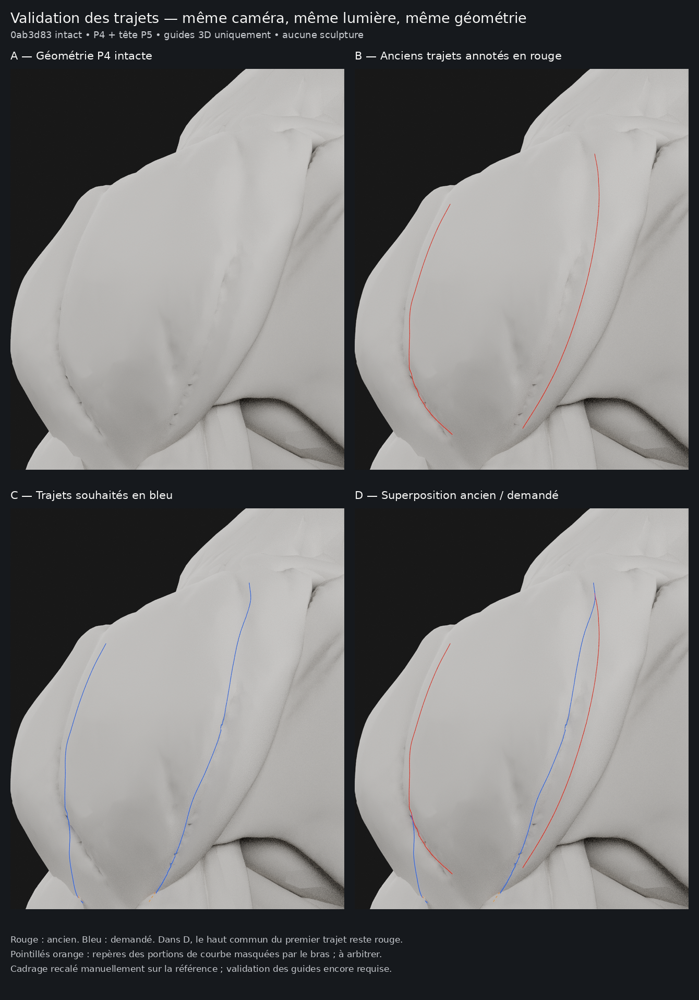

# M4A — validation des trajectoires 3D, sans sculpture

**Livraison de l’étape 1 uniquement. La référence reste `0ab3d83` :
deltoïdes P4, tête P5, gorge et corps conservés. Aucun creux n’est encore modifié.**

## Contrôle à valider

- [Superposition en pleine résolution](m4a/ecorche-beatriz-guides-deltoides/renders/reference-superposition.png).
- [Nouveaux trajets seuls](m4a/ecorche-beatriz-guides-deltoides/renders/reference-nouveaux-bleus.png).
- [Terminaisons en gros plan](m4a/ecorche-beatriz-guides-deltoides/renders/detail-terminaisons.png).
- [Profil et face — contrôle sur le volume](m4a/ecorche-beatriz-guides-deltoides/renders/controle-surface-3d.png).
- [Deux épaules, caméras miroir](m4a/ecorche-beatriz-guides-deltoides/renders/controle-deux-epaules.png).

**Rouge** : repérage des anciens trajets d’après les annotations.
**Bleu** : trajectoires demandées, projetées sur le deltoïde P4 réel.
Dans la superposition, le haut commun du premier trajet reste rouge pour éviter
de masquer deux courbes coïncidentes ; il apparaît bleu dans la vue des nouveaux
trajets seuls. Les contours verts n’ont pas été reproduits : ils indiquaient
uniquement les zones concernées.

## Méthode et précision

Les points des annotations dans l’image **320 × 384** sont transcrits manuellement,
interpolés, puis projetés par rayons sur les triangles du deltoïde évalué P4.
Les anciennes propositions `62fe3ff` et `39a8eb2` ne fournissent aucune déformation
à ce travail. Les courbes sont des objets Blender **CURVE**, séparés du mannequin,
avec leur copie miroir sur l’autre épaule.

L’orientation **−55°** reprend celle de la caméra d’épaule d’origine. Le cadrage
et le rapport de pixels sont recalés manuellement sur deux repères de l’image
fournie. **Ce recalage n’est pas une registration automatique pixel à pixel.**
Les rouges sont une transcription des traits de référence, pas une extraction
automatique du fond de chaque irrégularité du maillage. Leur correspondance
visuelle, ainsi que les bleus, doit donc être validée sur la planche avant toute
sculpture. Aucun ajustement automatique des bleus vers une concavité voisine
n’a été appliqué.

La distance des points projetés aux triangles reste inférieure à **1 µm** ;
l’erreur de reprojection est inférieure à **0,005 pixel** dans le repère 320 × 384.
Ces mesures vérifient le calcul 2D/3D, **pas l’exactitude du recalage manuel de
l’image**. Pour leur visibilité seulement, les tubes colorés sont décalés de
**0,4 mm** suivant les normales, avec un rayon de **0,22 mm**. Les coordonnées
sur la surface et ce décalage d’affichage sont enregistrés séparément.

### Terminaisons : recouvrements à arbitrer

Les deux trajets complets rencontrent bien la surface du deltoïde. Toutefois,
certains points sont **masqués par des objets du bras** depuis cette caméra :

| Trajet demandé | Portion concernée dans l’image 320 × 384 | Observation |
| --- | --- | --- |
| Première terminaison bleue | Environ `(65,372)` à `(68,376)` | Court recouvrement par `m0_c015.right`, presque au contact du deltoïde. |
| Second tracé bleu | Environ `(139,368)` jusqu’à `(132,379)` | Recouvert par `m0_c014.right` ; le dernier point du deltoïde se trouve environ **12,1 mm derrière** cette pièce dans la direction de vue. |

Les courbes bleues continuent sur le **deltoïde sous-jacent**, sans être rabattues
sur le bras ni raccourcies arbitrairement. Des **pointillés orange distincts**,
placés sur la surface visible du bras, servent uniquement de repères de contrôle
pour les parties masquées. Ils ne sont ni des guides de sculpture du bras, ni une
sélection musculaire. Les vues de face/profil montrent uniquement les véritables
guides, sans ces repères de visibilité propres à la vue de référence.

Les portions visibles restent sur le deltoïde et ne présentent pas de changement
de groupe musculaire évident. Cela ne constitue pas une validation médicale des
trois faisceaux. **La seconde terminaison ne pourra pas être rendue entièrement
visible par une simple dépression du deltoïde**, puisque le bras la recouvre déjà.
Il faut valider ce point avant de choisir une terminaison visible ou sous-jacente.
Aucune décision de raccord anatomique n’est prise à votre place.

## Préservation vérifiée

Les **300 objets de maillage** restent identiques à `0ab3d83`, y compris les
**deux deltoïdes et les 298 autres objets** : positions brutes et évaluées,
topologie, normales, matrices, shape keys et valeurs, UV, poids et matériaux.
Le déplacement maximal est **0**. Bombé, silhouette et volume P4 sont donc
conservés intégralement, ainsi que tête P5, gorge, pectoraux et reste du corps.
Le mannequin conserve **498 058 triangles**. L’éclairage d’origine à cinq sources
et le matériau mat neutre restent identiques ; les quatre vues de contrôle
utilisent exactement la même caméra entre elles.

[Contrôles sérialisés](m4a/ecorche-beatriz-guides-deltoides/verification.json).
Les courbes et leurs repères sont masquables/supprimables en deux collections.
Le fichier original n’est pas réenregistré. Toutes les versions précédentes
restent dans le dépôt et son historique.

## Étape 2 préparée — aucune opération exécutée

Le deltoïde possède **5 971 sommets / 11 938 triangles**. Dans un voisinage
de mesure de 12 mm autour des anciens et nouveaux trajets, les arêtes sont
d’environ **3,5 mm en médiane**, **6 mm au 90e percentile**, avec des arêtes
locales beaucoup plus longues et certains triangles allongés. Ce voisinage sert
à l’audit ; il ne définit pas une autorisation de sculpture de 12 mm.

Cette répartition est insuffisamment régulière pour garantir des creux étroits
propres : une bande totale de 6 mm peut ne comporter qu’une ou deux arêtes.
Une nouvelle déformation sur les seuls sommets actuels risquerait de reproduire
les cassures et marques observées. Ajouter une subdivision globale ne résoudrait
pas à elle seule la répartition et alourdirait inutilement le mannequin.

Après validation des guides, la méthode proposée serait :

1. Définir un domaine local comprenant **l’ancien creux, le nouveau et l’intervalle
   entre eux**, avec un raccord progressif et un verrouillage explicite du bombé
   et de la silhouette. Ne plus imposer deux bandes isolées de 3 mm.
2. Si nécessaire, régulariser/densifier **uniquement ce domaine**, sur une copie,
   avec un pas indicatif de 0,8 à 1,5 mm à adapter à la section du creux validée.
   Reprojeter cette préparation sur P4 avant sculpture, préserver les bordures
   et conserver la correspondance avec la surface source. Ce serait un changement
   local de topologie à documenter ; les identifiants de sommets locaux pourraient
   changer, sans toucher aux autres objets.
3. Reconstruire la surface de fond de l’ancien sillon à partir de ses berges,
   puis former un seul nouveau creux arrondi le long de la courbe validée, avec
   profondeur et largeur progressives. Aucun gonflement du ventre pour compenser.
4. Répliquer en miroir, contrôler les sections transversales, raccords, absence
   de double dépression, intersections, bombé et silhouette ; rendre avec les
   mêmes caméras et le même mat neutre.

**Aucune de ces quatre opérations n’a été exécutée.** Aucun lissage, remesh,
subdivision, comblement ou creusement n’est appliqué dans cette livraison.

## Arrêt

**Trajectoires proposées pour validation, sculpture non autorisée à ce stade.**
PR #12 en brouillon, sans fusion. Aucune segmentation interactive, modification
de Logbook ou SQLite, ni lancement de M4B. Aucun nouvel asset ou outil payant.

[Sources, licence et reproduction](m4a/ecorche-beatriz-guides-deltoides/README.md).
