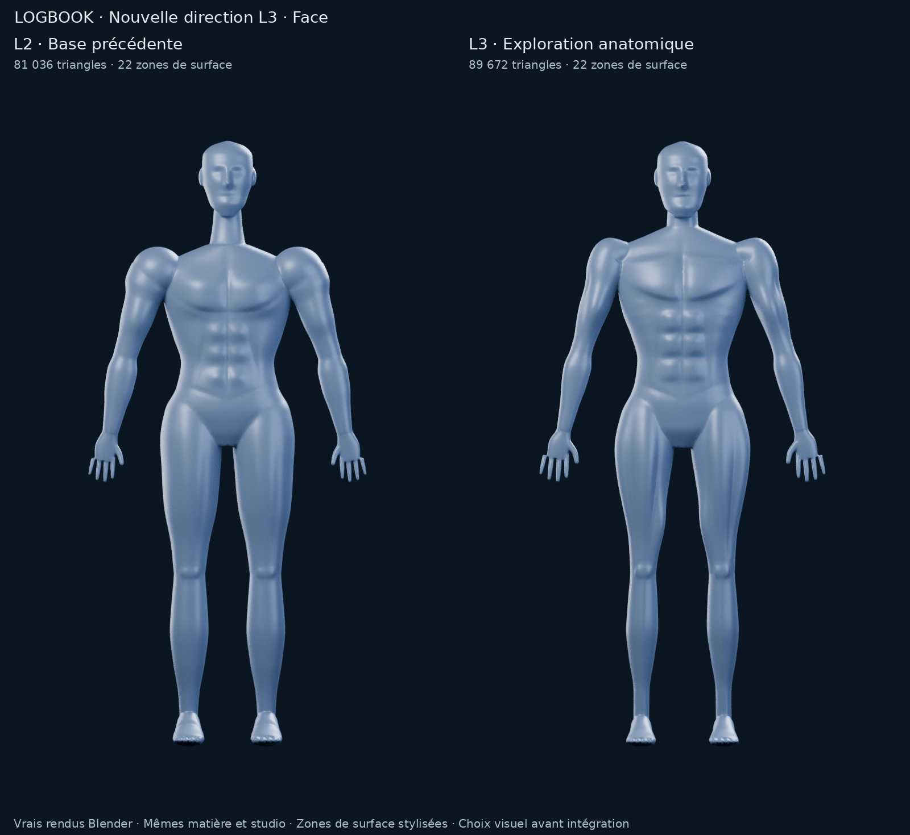

# M4A — L3, exploration d’un atlas fitness stylisé

**Proposition à valider visuellement, PR #11 toujours en brouillon.** L3 remplace
la direction artistique proposée pour L2 ; L1, L2 et toutes les études précédentes
sont conservées. Aucun fichier applicatif, SQLite, migration ou M4B n’est modifié.
Aucune fusion. Aucun recours à Astra Ultra.

[Comparaison trois quarts](m4a/l3/comparaison-three-quarter.png) ·
[Dos](m4a/l3/comparaison-back.png) · [Profil](m4a/l3/comparaison-side.png) ·
[Sélection orange](m4a/l3/comparaison-selection.png) ·
[Détail du torse](m4a/l3/detail-torse.png) · [Vue d’ensemble](m4a/l3/comparaison.png).

## Ce qui change réellement

L3 est construit avec de nouveaux profils et reliefs géométriques originaux.
Le traitement de surface et la partition en objets réutilisent le pipeline M4A ;
ce n’est pas un gonflement global du mesh L2.

| Région | Modification L3 |
| --- | --- |
| Cou / carrure | Jonction du thorax remontée et trapèzes prolongés vers le cou ; tête maintenue vers 1,80 m. Cou apparent raccourci. |
| Épaules | Suppression des ellipsoïdes de construction de L2 ; deltoïdes effilés dans le même loft que le bras, raccord clavicule / trapèze élargi. |
| Pectoraux | Masse en éventail, bord inférieur oblique et arrondi, insertion latérale plus haute ; projection réduite après contrôle du profil (coefficient de relief maximal 22 mm avant union), sillon sternal doux. |
| Abdomen / flancs | Trois paires de reliefs abdominaux, ligne blanche, obliques et quelques reliefs dentelés très atténués. |
| Bras | Ventres du biceps et du triceps distincts, brachial discret et avant-bras profilé ; pas de fibres gravées. |
| Dos | Plans scapulaires, trapèzes, dorsaux obliques et colonnes lombaires ; volumes séparés par des vallées larges. |
| Jambes | Droit fémoral, vaste latéral et goutte médiale différenciés ; deux reliefs postérieurs des ischios et deux têtes du mollet. |
| Extrémités | Mâchoire / visage remodelés, normales du visage adoucies ; paumes, doigts et contour du pied repris. |

L3 est globalement plus élancé que L2 : les reliefs locaux sont accentués, sans
augmentation globale de la masse. Les principaux groupes deviennent plus
lisibles dans le volume, dans la direction de la référence fournie : silhouette athlétique, torse structuré, jambes dessinées,
bleu argenté sur fond sombre, pectoraux orange lorsqu’ils sont sélectionnés.
Les sillons restent doux et les zones articulaires couvertes : pas d’organes,
de fibres musculaires exposées ou de texture médicale.

**Mon avis : L3 progresse vers la direction demandée, mais le niveau « atlas
fitness premium » de la référence n’est pas encore atteint.** Cela
reste une interprétation procédurale, moins détaillée et moins naturelle que
la référence, particulièrement au visage, aux mains et dans les insertions
épaule / aisselle. La vue arrière reste trop lisse : dorsaux,
biceps / triceps et ischios ne sont pas encore assez lisibles pour le rendu
d’atlas attendu. Le progrès est surtout visible sur le torse et les quadriceps. Le raccord des épaules est amélioré, mais conserve une
simplification visible. Ce prototype ne constitue pas un atlas anatomique validé.
Le choix visuel appartient à l’utilisateur avant toute suite technique.

## Comparaison et matière

Les dix images sont de **vrais rendus Blender 4.3.2 / Cycles CPU** : cinq vues par
modèle, 800 × 1 280, 128 échantillons, caméra orthographique, éclairages et matière
identiques entre L2 et L3. L2 est recalculé depuis son BLEND historique inchangé ;
les anciens PNG et scènes ne sont pas écrasés. La nouvelle comparaison change
la matière commune et la taille / intensité de deux éclairages par rapport à
l’ancienne étude ; comparer les deux colonnes de ces nouvelles planches.

Matière bleu argenté satinée : rugosité 0,42, métal 0,18, couche vernie 0,10,
diffusion sous-surface 0,05 et transmission 0,035. Ce léger effet de profondeur
reste discret : le mannequin n’est pas transparent comme du verre. Le matériau
Cycles constitue une intention visuelle, sans garantie de transposition directe
à un moteur mobile. L’orange est appliqué aux **deux objets pectoraux réels** ;
aucune peinture 2D ou image générée ne simule leur sélection.

## Faisabilité future, sans intégration

- **Segmentation : base conservée.** 22 zones de surface nommées, indépendantes
  pour une sélection et une couleur ; un support commun. Elles partitionnent
  exactement l’enveloppe continue, sans doublon de face ou fente aux frontières.
  Ce sont des régions de design, pas une segmentation musculaire complète ni des
  muscles internes. Leurs limites devront être validées avant un atlas fonctionnel.
- **Mobile : candidat à optimiser, fluidité non démontrée.** Environ 90 000
  triangles, aucun ajout de texture, 23 objets visibles. Une seule enveloppe est
  affichée ; la construction fermée cachée doit rester hors d’un éventuel export.
  Les coûts des objets, de la transparence et de la diffusion devront être mesurés
  sur téléphone. Aucun benchmark, LOD ou travail M4B n’a été lancé.
- **3D interactive : structure exploitable pour une exploration ultérieure.**
  Coordonnées métriques, axes cohérents, identifiants stables et surfaces séparées
  permettent d’envisager sélection et rotation. Pas de rig, export applicatif,
  moteur interactif ou retopologie d’animation livré à cette étape.

Les [contrôles géométriques](m4a/l3/l3/geometry-check.json), les
[contrôles de scène](m4a/l3/review-validation.json) et le
[manifeste](m4a/l3/manifest.json) accompagnent les sources. Surface continue fermée,
une composante, aucun bord non-manifold ou triangle dégénéré détecté ; 22 zones
sélectionnables connexes et empreintes source / scène identiques. Ces contrôles
ne constituent pas un test exhaustif d’intersection ou de validité médicale.

[Sources BLEND, paramètres et reproduction](m4a/l3/README.md).
**Arrêt ici pour validation de L3, avant toute intégration.**
