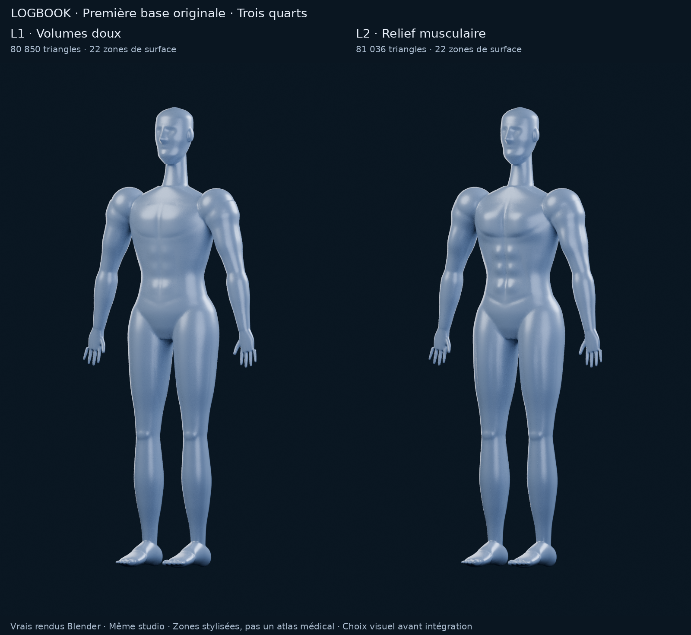

# M4A — Première base 3D originale Logbook

**18 octobre 2026 · PR #11 en brouillon · choix visuel attendu avant intégration.**

La nouvelle approche crée la géométrie pour Logbook : aucun mannequin externe
n’est importé ou remanié. Deux propositions, et seulement deux, sont présentées :
**L1 — Volumes doux**, plus lisse, et **L2 — Relief musculaire**, plus dessiné.
Les [audits écorchés](M4A_ECORCHE.md), [A/B/C](M4A_CHOIX_MODELE.md),
[B+](M4A_B_PLUS.md), [B+ V2](M4A_B_PLUS_V2.md), licences et sauvegardes précédentes
restent conservés. La recherche d’un modèle externe n’est plus l’axe de travail.

**Recommandation : L2 comme première base à valider**, pour mieux lire les
pectoraux, épaules, abdominaux et volumes des cuisses sans stries médicales.
Ce sont des prototypes de direction artistique, pas un mannequin de production
déjà validé. Le visage, les mains/pieds et plusieurs transitions musculaires
restent schématiques ; la lecture des dorsaux/triceps mérite notamment un avis
visuel utilisateur. La finition conserve encore un caractère de mannequin
technique, notamment au cou, aux épaules et aux genoux. L1 permet de comparer une
finition plus discrète.

## Rendus calculés sur les deux vrais modèles

| Comparaison commune | Rendu |
| --- | --- |
| Face | [PNG](m4a/original/comparaison-front.png) |
| Trois quarts | [PNG](m4a/original/comparaison-three-quarter.png) |
| Dos | [PNG](m4a/original/comparaison-back.png) |
| Profil, utile pour comparer les volumes | [PNG](m4a/original/comparaison-side.png) |
| Pectoral gauche orange | [PNG](m4a/original/comparaison-selection.png) |
| Vue d’ensemble des trois angles | [PNG](m4a/original/comparaison.png) |
| Détail du torse, recadrage identique agrandi | [PNG](m4a/original/detail-torse.png) |

| Proposition | Face | Trois quarts | Dos | Profil | Orange |
| --- | --- | --- | --- | --- | --- |
| L1 — Volumes doux | [PNG](m4a/original/soft/front.png) | [PNG](m4a/original/soft/three-quarter.png) | [PNG](m4a/original/soft/back.png) | [PNG](m4a/original/soft/side.png) | [PNG](m4a/original/soft/selection.png) |
| L2 — Relief musculaire | [PNG](m4a/original/defined/front.png) | [PNG](m4a/original/defined/three-quarter.png) | [PNG](m4a/original/defined/back.png) | [PNG](m4a/original/defined/side.png) | [PNG](m4a/original/defined/selection.png) |

**Dix rendus Blender 4.3.2 / Cycles CPU, 128 échantillons, 800 × 1280**, sans
débruitage ni image générative. Même pose, échelle, cible caméra, fond bleu nuit,
quatre lumières et matière satinée bleu/gris pour les deux propositions.
Caméra orthographique 2,15 ; angles 0°, 35°, 180° et 90°. Le surlignage utilise
le même trois quarts. Les PNG bruts restent disponibles ; les planches ajoutent
des légendes et les recadrages/redimensionnements annoncés, sans repeindre le corps.

## Approche de construction originale

Le [générateur](../tools/m4a/build_original_mannequin.py) ne reçoit aucun fichier
de modèle. Il dessine des profils numériques et construit des surfaces en anneaux
pour le torse, la tête fermée, le cou, les bras, les jambes et les pieds. Les
oreilles, extrémités et doigts complètent cette construction avec des volumes
simples. Les profils et paramètres sont conservés dans chaque `construction.json`.
La silhouette fait environ 1,79 m ; les axes sont +Z vers le haut, −Y vers l’avant,
et +X à gauche anatomique.

Les volumes musculaires sont des déformations dessinées : plans pectoraux en
éventail vers l’épaule, épaules arrondies, reliefs des bras dans leur axe,
trois rangées abdominales, obliques diagonaux, dos en V, volumes fessiers,
reliefs longitudinaux des cuisses et mollets. Pas de fibres fines, d’organes,
d’os exposés ni d’enveloppes médicales ajoutées.

Les volumes de construction sont réunis en une surface continue par voxelisation
à **2,5 mm**, puis adoucis. Une moitié sert à reconstruire la symétrie corporelle,
avant une réduction à un budget initial proche de 72 000 triangles. Les limites
des zones sont ensuite **découpées dans les triangles** à partir des courbes de
conception. Les intersections sur une arête sont partagées entre faces voisines :
le contour orange n’est pas un escalier de triangles attribués par leur centre.
Cette découpe explique les quelque 81 000 triangles finaux.

Des creux très doux soulignent les frontières utiles, avec atténuation aux
extrémités pour éviter des anneaux mécaniques autour des membres. Un lissage
spatial des normales, pondéré par l’aire des faces dans un rayon de 8 mm, adoucit
les reflets du corps sans déplacer ni densifier sa géométrie. Les détails de la
tête, des mains et des pieds sont préservés. Ces mêmes normales sont transférées
aux zones adjacentes pour garder des reflets continus. L’espacement des doigts
évite les ponts involontaires de fusion.

**Les zones sont des régions de surface stylisées, pas des muscles volumétriques
ou une segmentation anatomique médicale.** Les objets affichés sont des
sous-ensembles disjoints des faces du corps : la séparation est réelle, sans
coques musculaires flottantes au-dessus d’un mannequin non segmenté.

## Ce qui distingue L1 et L2

| Aspect | L1 — Volumes doux | L2 — Relief musculaire |
| --- | --- | --- |
| Lecture générale | Mannequin plus calme et lisse | Musculature plus présente, même construction générale |
| Pectoraux et épaules | Reliefs arrondis discrets | Pectoraux plus pleins, sous-pectoral plus lisible, deltoïdes accentués |
| Bras et dos | Transitions plus douces | Relief des biceps/triceps et plans du dos renforcés |
| Abdominaux/obliques | Suggestions légères | Relief abdominal et diagonales latérales plus visibles |
| Cuisses/mollets | Volumes simples | Bombés et sillons longitudinaux davantage marqués |
| Matière, studio, pose | Identiques | Identiques |

Les coefficients de relief sont 0,55 pour L1 et 1,35 pour L2. Ce ne sont pas des
facteurs d’échelle du corps : seule l’amplitude des champs de volume change.
Les creux de frontière ont une profondeur demandée de référence de 0,65 mm et
1,35 mm, pondérée localement sur une largeur de 4,5 mm. Un garde-fou réduit cette
profondeur si un triangle change trop d’orientation : les valeurs effectivement
appliquées sont enregistrées dans les paramètres. Aucun triangle ne se retourne
par rapport à la surface précédant ces creux. Les deux maillages n’ont pas une topologie identique ;
leurs **noms de zones** sont communs, pas leurs indices de sommets. Aucune
interpolation de morphs entre variantes n’est présentée comme prête.

## Zones prévues pour une future sélection

**22 zones sélectionnables**, plus un objet de surface de soutien non
sélectionnable. Chaque zone est un objet maillé continu, nommé, avec son côté.

| Groupe demandé | Objets / identifiants |
| --- | --- |
| Pectoraux gauche/droit | `pectoralis.left` / `.right` |
| Deltoïdes gauche/droit | `deltoid.left` / `.right` |
| Biceps gauche/droit | `biceps.left` / `.right` |
| Triceps gauche/droit | `triceps.left` / `.right` |
| Trapèzes | `trapezius.midline` |
| Dorsaux gauche/droit | `latissimus.left` / `.right` |
| Grand droit abdominal | `rectus-abdominis.midline` |
| Obliques gauche/droit | `oblique.left` / `.right` |
| Quadriceps gauche/droit | `quadriceps.left` / `.right` |
| Ischio-jambiers gauche/droit | `hamstrings.left` / `.right` |
| Fessiers gauche/droit | `gluteal.left` / `.right` |
| Mollets gauche/droit | `calf.left` / `.right` |

Les objets Blender portent le préfixe `LB.`. Le `support` rassemble notamment
tête/cou, mains/pieds, avant-bras et surfaces de transition non couvertes par cette
première carte. Ils ne sont pas arbitrairement attribués à un muscle voisin.
Les quadriceps, ischio-jambiers et mollets sont des **groupes**, sans séparation
médicale de chaque chef ou muscle profond.

L’orange est appliqué uniquement à **`LB.pectoralis.left`**, le véritable objet
maillé de cette zone. Le corps entier n’est pas recoloré par un rectangle ou un
masque image. Aucun moteur de picking ou geste tactile n’est développé pour cette
démonstration. Les frontières sont des choix de design à valider visuellement ;
les tests géométriques ne garantissent pas leur exactitude anatomique.

## Contrôles et potentiel mobile

| Mesure réellement vérifiée | L1 | L2 |
| --- | ---: | ---: |
| Triangles visibles, sans subdivision de rendu | 80 850 | 81 036 |
| Sommets de la surface continue | 40 427 | 40 520 |
| Sommets visibles, doublons de frontière inclus | 44 918 | 45 092 |
| Objets visibles | 23 | 23 |
| Zones sélectionnables continues | 22 | 22 |
| Composantes de l’enveloppe continue | 1 | 1 |
| Arêtes ouvertes / non-manifold | 0 / 0 | 0 / 0 |
| Triangles quasi dégénérés au seuil contrôlé | 0 | 0 |
| Coordonnées non finies | 0 | 0 |
| Genre topologique de l’enveloppe | 0 | 0 |
| Faces perdues ou utilisées plusieurs fois dans les zones | 0 | 0 |

Rapports : [L1](m4a/original/soft/geometry-check.json),
[L2](m4a/original/defined/geometry-check.json).
La fermeture concerne l’enveloppe agrégée ; les objets de zone ont des bords
ouverts **par conception**, exactement coïncidents avec ceux de leurs voisins.
Le contrôle vérifie chaque position de frontière et chaque face correspondante.

Ce budget est nettement plus raisonnable que les centaines de milliers ou millions
de triangles des atlas précédents. **La rotation et la sélection sur iPhone sont
envisageables**, avec 23 objets visibles, aucune texture et une matière grise
partagée ; la sélection orange ajouterait une seconde matière. Positions,
normales et indices 32 bits représentent un ordre de grandeur brut d’environ
**2 Mo** pour la représentation visible, hors surcoûts du moteur.

Cela ne prouve pas une fréquence d’images : **aucun benchmark iPhone, moteur
interactif ou export GLB n’est réalisé**. Le fichier de recherche conserve aussi
une enveloppe continue cachée pour l’édition et les contrôles. Elle n’est pas
rendue ; un futur asset mobile devra éviter de charger deux représentations du
corps. Les attributs de traçabilité et le studio ne sont pas un package runtime.

La triangulation issue de voxelisation/réduction convient à un prototype statique
en rotation ; ce n’est pas une retopologie quad prête pour l’animation. Pas de
contrôle exhaustif d’auto-intersections, de rig, de limites d’occultation ou de
raycast tactile. La lecture des groupes et leurs limites doivent encore être
validées, puis l’optimisation mesurée sur les appareils visés.

La future UX reste le critère de choix : corps entier seul, rotation au doigt,
pas de boutons de vue ni zoom manuel ; sélection orange du groupe touché,
rapprochement depuis l’orientation courante et fiche nom/tonnage/séries/part du
volume ; fermeture vers le corps entier. **Aucune de ces interactions n’est
intégrée dans Logbook à cette étape.**

## Origine, sauvegarde et point d’arrêt

[Origine des géométries](m4a/original/ORIGINE.md) ·
[Fichiers Blender, empreintes et commandes de reproduction](m4a/original/README.md).

Les deux sources et deux scènes de revue sont versionnées directement. Les scènes
de revue disposent du studio et de la caméra trois quarts, prêtes à ouvrir dans
Blender. Les profils numériques, le script et les contrôles permettent de reprendre
la construction sans récupérer d’atlas ou d’asset externe.

Les [contrôles de livraison](m4a/original/validation.json) vérifient les empreintes
des dix PNG et des fichiers Blender, le protocole commun, les JSON, la syntaxe des
outils et les liens locaux. La géométrie, les normales et les attributs de zone
sont identiques entre chaque source et sa scène de revue sauvegardée.
Les **129 fichiers historiques** de sources, licences, audits, rendus et outils
présents au commit précédent sont inchangés octet pour octet. Aucun test
applicatif n’est lancé : les modifications restent dans les outils et documents M4A.

Aucune géométrie, texture ou target morphologique
BodyParts3D, Z-Anatomy, Écorché, Blender Studio ou MPFB n’est incorporée dans ces
modèles. Les obligations de partage des anciens assets ShareAlike ne sont pas
transférées par une dérivation de leurs maillages. Les logiciels de construction
restent des outils hors application ; aucune licence du code Logbook n’est changée.
Il ne s’agit pas d’une nouvelle autorisation sur les anciens modèles tiers.

**Choix demandé : L1, L2 ou aucune des deux si le style ne convient pas.**
La recommandation L2 porte sur cette première direction, pas sur une validation
artistique finale ni un feu vert d’intégration. Arrêt après les rendus et l’analyse.

Même branche M4A et PR #11 en brouillon. Aucun achat, travail M4B, moteur intégré,
segmentation médicale complète, changement SQLite, dépendance applicative,
fonctionnalité annexe, fusion ou recours à Astra Ultra.
