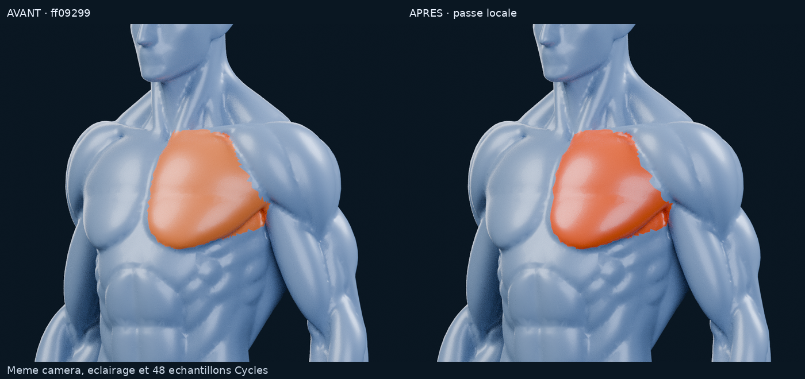
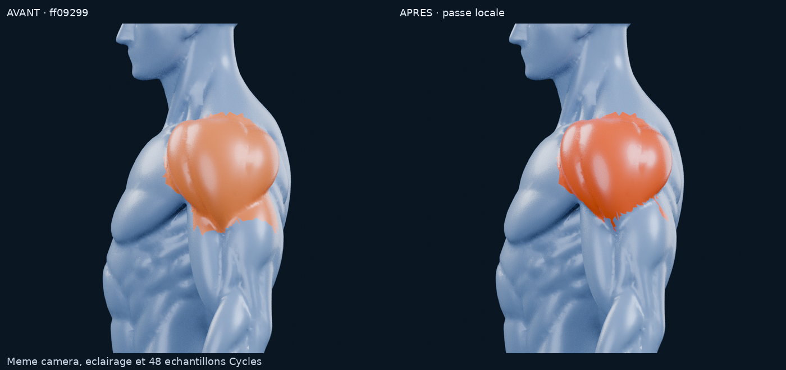
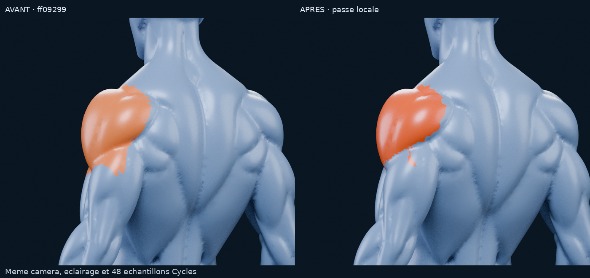
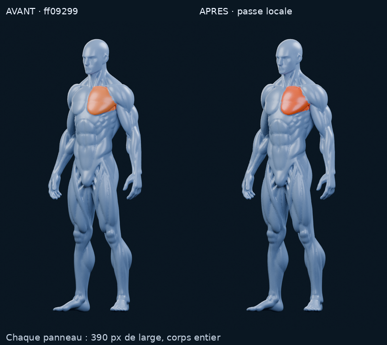

# M4A Meshy — correction locale des trois masques

**Verdict : PARTIEL.** Le retrait local réduit le débordement bas/postérieur du
deltoïde et les trois sélections sont exportables indépendamment. Le critère
« contours précis, sans débordement visible » **n’est pas atteint** : une petite
languette postérieure et des marches de triangles restent visibles sur le
deltoïde ; la limite axillaire des pectoraux reste ambiguë. Aucune deuxième passe
automatique n’est engagée. La reprise précise exige une édition humaine des faces
repérées dans le fichier Blender livré, avant toute extension ou intégration.

Travail sur `feat/m4a-meshy-masques-musculaires`, PR **#12 en brouillon**, depuis
`ff092992bb55e005dd850563ca59765b2fbffd4f`. Le POC initial, ses documents, ses
scripts et tous ses fichiers restent à leur emplacement. Cette livraison ajoute
un dossier `docs/m4a/meshy/correction/` et des outils autonomes de correction.
PR #11 et branche M3.4C préservées. Budget additionnel : **0 €**, sans Astra.

## 1. Résultat à examiner

Les captures sont de **vrais rendus Blender 4.3.2 / Cycles CPU**, sur le Meshy
fourni. Les sélections utilisent les indices de matériau des faces de ce même
maillage. Pas de retouche 2D des muscles, d’objet superposé, de volume invisible,
de nouvelle anatomie ou d’image de synthèse générative. L’image anatomique
turquoise fournie guide le comportement de sélection, sans être reproduite ni
utilisée pour inventer une anatomie absente du Meshy.

| Vue demandée | Rendu après correction |
| --- | --- |
| Neutre, face | [Corps entier bleu](m4a/meshy/correction/renders/after-neutral-front.png) |
| Pectoral gauche, face | [Sélection indépendante](m4a/meshy/correction/renders/after-left-front.png) |
| Pectoral gauche, trois quarts | [Sélection indépendante](m4a/meshy/correction/renders/after-left-three-quarter.png) |
| Pectoral droit, face | [Sélection indépendante](m4a/meshy/correction/renders/after-right-front.png) |
| Deltoïde gauche, profil | [Limite inférieure exposée](m4a/meshy/correction/renders/after-deltoid-profile.png) |
| Deltoïde gauche, arrière trois quarts | [Limite postérieure exposée](m4a/meshy/correction/renders/after-deltoid-back.png) |
| Gros plan diagnostique, face | [Les trois contours](m4a/meshy/correction/renders/after-diagnostic.png) |
| Pectoral gauche seul, gros plan | [Pli de l’aisselle visible](m4a/meshy/correction/renders/after-left-detail.png) |
| Pectoral droit seul, gros plan | [Contrôle indépendant](m4a/meshy/correction/renders/after-right-detail.png) |
| Deltoïde gauche seul, face rapprochée | [Jonction avec le bras](m4a/meshy/correction/renders/after-deltoid-front.png) |

Le diagnostic multicolore n’est pas une sélection simultanée prévue pour l’app :
orange = pectoral gauche, jaune = droit, turquoise = deltoïde. Les autres vues
colorent **uniquement** le muscle annoncé, les voisins conservant leur matériau
bleu. L’identité anatomique exacte de certaines faces de frontière reste à valider.

### Comparaison directe avec `ff09299`

Avant à gauche, après à droite. Les trois comparatifs rapprochés utilisent les
mêmes caméras, lumières, matériau bleu, AgX, graine 0 et **48 échantillons**. Le
fichier Blender avant est exactement celui du commit initial ; ses sélections
individuelles sont rendues ici sans modifier ce fichier. Le nouveau matériau
orange s’applique après seulement : la différence de saturation est donc distincte
de la correction des labels. Les masques et la liste des changements permettent
de contrôler cette dernière sans se fier à la couleur.

Le profil montre la réduction de la large bande sur le haut du bras, **mais aussi
la petite languette encore colorée et le bord inférieur irrégulier**. L’arrière
montre les marches résiduelles le long du sillon. Ces défauts interdisent de
déclarer la frontière corrigée dans son ensemble.

### Lecture à 390 pixels

Chaque panneau conserve le corps entier et mesure **390 px de large**, sans
zoom. Le panneau avant reprend la sélection déjà publiée à `ff09299` (96
échantillons), l’après utilise 48 échantillons. La réduction, l’assemblage et les
libellés sont les seules opérations sur les images. Les sources et empreintes
figurent dans [comparisons-metadata.json](m4a/meshy/correction/renders/comparisons-metadata.json).

L’orange rend le pectoral facile à repérer et conserve la lecture du volume.
Cependant, la réduction atténue les défauts du contour : elle ne suffit pas à
prouver une sélection propre au niveau du pli axillaire ou de l’épaule.
**Résultat mobile visuel partiel, pas validé pour production.** Aucun test tactile,
de fluidité ou de performance sur un iPhone réel n’a été effectué.

## 2. Modifications effectuées

Une seule passe locale sur les attributions de faces existantes :

- Deltoïde : repérage du sillon inférieur sur des vues **neutres du Meshy**,
  profil et arrière trois quarts ; retrait des débordements identifiés sous
  ce sillon. Les tracés projetés servent à proposer des retraits locaux du
  masque existant, pas à segmenter globalement le corps. Chaque retrait est
  figé par son indice de triangle source dans `face-edits.json`.
- Trois régions : retrait local de pointes de frontière formées d’une seule
  face reliée par un seul bord à sa région. C’est une règle de nettoyage
  topologique, **pas une déduction anatomique**. Les deux pectoraux sont traités
  sur leurs propres faces et leurs propres voisinages, sans miroir.
- Protection de continuité : une attribution n’est retirée que si la région
  reste connectée avec caractéristique d’Euler 1. **33 candidats ne sont pas
  forcés** ; ils sont listés pour examen humain. Aucun trou de masque n’est
  rempli arbitrairement, aucune nouvelle zone musculaire n’est créée.
- Application dans une copie du Blender éditable, puis export des véritables
  `material_index` par `save_regions.py`. L’attribut `muscle_zone` est synchronisé.
  `segment.py` n’est pas relancé et n’écrase pas la correction.

| Région stable | Faces avant | Faces après | Faces rendues bleues | Bords de frontière avant → après |
| --- | ---: | ---: | ---: | ---: |
| `pectoralis.left` / 1 | 1 356 | 1 333 | 23 | 180 → 157 |
| `pectoralis.right` / 2 | 1 145 | 1 128 | 17 | 161 → 144 |
| `deltoid.left` / 3 | 2 215 | 1 735 | 480 | 151 → 185 |
| Non attribué / 0 | 90 710 | 91 230 | — | — |

**520 faces changent d’étiquette, aucune face du mannequin n’est supprimée.**
La frontière du deltoïde comporte davantage de petits bords après découpe : sa
zone débordante est réduite, mais sa régularité n’est pas résolue. Le nettoyage
des pointes ne remplace pas un tracé anatomique précis. Les principales frontières
des pectoraux restent proches du premier POC ; cette passe ne prétend pas avoir
résolu la clavicule ou le pli axillaire.

Le travail est une édition de faces pilotée par script à partir d’un repérage
visuel, **pas une retouche réalisée à la souris dans Blender**. Les outils
disponibles permettent les attributions et leur vérification ; ils ne permettent
pas de garantir une frontière anatomique manuelle fine sur les transitions
ambiguës de ce modèle. La passe est arrêtée à ce stade.

### Matériau de sélection seulement

Orange linéaire : `(1, 0.085, 0.006)`, roughness 0.32, metallic 0.08, coat 0.12.
Avant : `(1, 0.18, 0.025)`, roughness 0.37, metallic 0.12, coat 0.08. La teinte
est plus soutenue, les reflets restent ceux du relief réel. Pas d’émission,
de bloom, de halo, de texture peinte ou de déplacement. Le bleu argenté,
l’éclairage et le fond restent identiques. Le GLB de présentation reste bleu au
repos ; la sélection orange est démontrée dans les scènes Blender.

## 3. Limites repérées, sans les déclarer résolues

| Zone | Observation | Statut |
| --- | --- | --- |
| Sternum gauche et droit | Nettoyage de petites pointes, bord toujours polygonal ; contrôle des côtés séparément | Provisoire |
| Clavicule gauche et droite | Transition de surface large, sans ligne anatomique continue permettant une limite incontestable | Non validé |
| Jonction pectoral/deltoïde | Le bombé principal est distingué, mais l’attache supérieure n’est pas entièrement séparée sur ce Meshy | Non validé |
| Pli axillaire / dessous du pectoral | Repli encore orange sous le volume principal, surtout en trois quarts ; appartenance anatomique incertaine | Non validé |
| Bas du pectoral / abdomen | Le volume principal est coloré et le ventre reste bleu ; marches résiduelles sur le bord | Partiel |
| Deltoïde inférieur/postérieur | Large débordement réduit ; petite languette postérieure et pointe inférieure encore présentes | Non validé |
| Surface du muscle sélectionné | Relief conservé, région attachée à la surface 3D dans toutes les vues | Vérifié techniquement |

[manual-review.json](m4a/meshy/correction/manual-review.json) fournit les IDs de
faces à examiner : notamment **14** faces dans la zone de la languette postérieure
du deltoïde et **34** près de la pointe inférieure, ainsi que des zones de revue
indépendantes pour chaque pectoral. Ce sont des zones d’examen, pas des ordres de
suppression. Le nouveau Blender embarque ces données et un guide de sélection.

## 4. Géométrie, masques et future sélection

- **47 711 sommets, 95 426 triangles**, inchangés dans les deux Blender et dans
  l’export de présentation. Coût géométrique supplémentaire : **0**.
- GLB original intact, SHA-256
  `9fab861a65407e69b9401bec077bf7b40f58d36404e80bad9db6147f24320a14`.
- Un seul mesh partagé entre cinq scènes Blender. Les trois régions restent
  chacune une composante, une boucle de frontière, Euler 1, sans îlot ni trou
  involontaire. Ce résultat topologique ne valide pas leurs contours anatomiques.
- Les 95 426 labels uint8 indexent les triangles **originaux**. Les identifiants
  `pectoralis.left`, `pectoralis.right`, `deltoid.left` sont conservés.
- Le GLB de présentation réunit exactement les mêmes triangles dans quatre
  primitives partageant les mêmes positions et normales lissées. Sa table
  `draw-triangle-to-source.u32` et son binding sont **régénérés ensemble**, puis
  relus et comparés aux vrais buffers du GLB écrit.
- Lookup futur inchangé : `sourceTri = map[primitive.map_triangle_offset + faceIndex]`,
  puis `region = labels[sourceTri]`. Les raycasts BVH source/export contrôlent
  les trois régions, le reste du corps et des faces retirées des trois masques.
  Ce ne sont pas des tests Three.js, Expo Go ou tactiles.

[Résultats complets](m4a/meshy/correction/verification.json) : identité exacte des
positions et des triplets d’indices, attribution des 520 faces, labels inchangés
ailleurs, sélection indépendante sans émission, invariance du bleu/lumières/fond,
continuité des masques, bijection d’export, raycasts et empreintes des rendus.
[Contrôle de livraison](m4a/meshy/correction/verification-livraison.json) :
aller-retour depuis le Blender final et conservation des fichiers initiaux.

La structure reste utilisable pour préparer le raycasting par zone. Aucun gain
de performance mobile n’est revendiqué ; la topologie du mannequin n’a pas été
réduite et la segmentation complète n’a pas été commencée.

## 5. Livrables et arrêt

- [Blender corrigé, éditable](m4a/meshy/correction/renders/meshy-masques.blend)
- [Masques et métadonnées](m4a/meshy/correction/regions)
- [GLB, binding et nouvelle permutation](m4a/meshy/correction/export)
- [Liste exacte des modifications](m4a/meshy/correction/face-edits.json)
- [Procédure de reprise et d’export](m4a/meshy/correction/README.md)
- [État initial conservé](M4A_MESHY_MASQUES.md)

**Recommandation : ne pas étendre à d’autres muscles et ne pas intégrer ce masque
comme une segmentation validée.** Le prochain travail utile est une reprise
humaine locale des faces signalées, si elle est autorisée, avec contrôle face,
profil et dos ; pas une nouvelle série de segmentations automatiques.

Attribution conservée : **Model created with Meshy – CC BY 4.0 License**.
[Provenance et licence de la formule gratuite](m4a/meshy/LICENCE_ET_PROVENANCE.md).
Aucun changement applicatif, SQLite, M4B, achat ou fusion. Arrêt après publication
dans la PR #12 en brouillon, pour accord de l’utilisateur.
