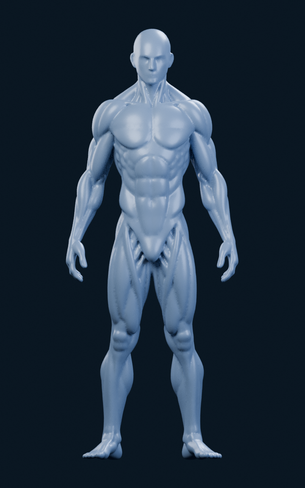
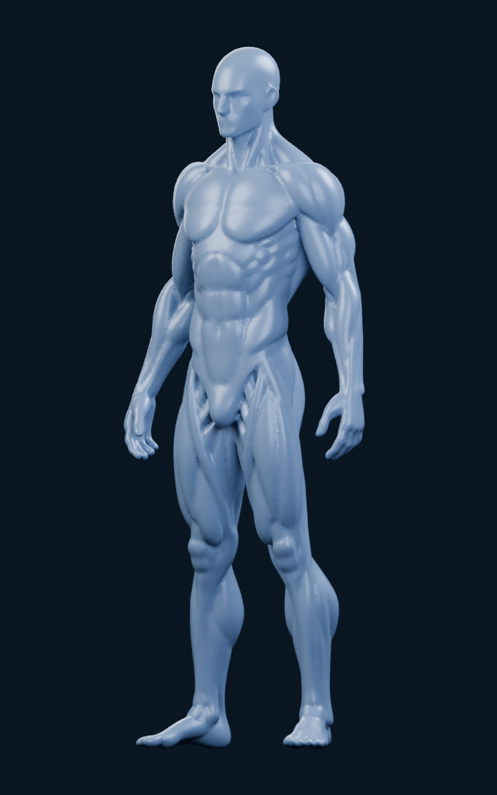
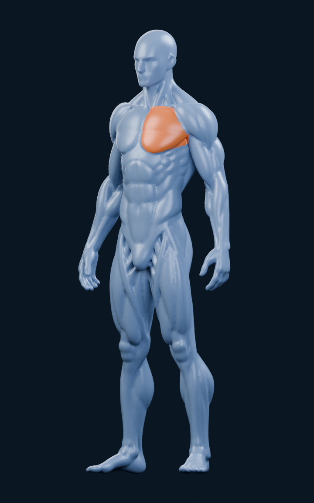
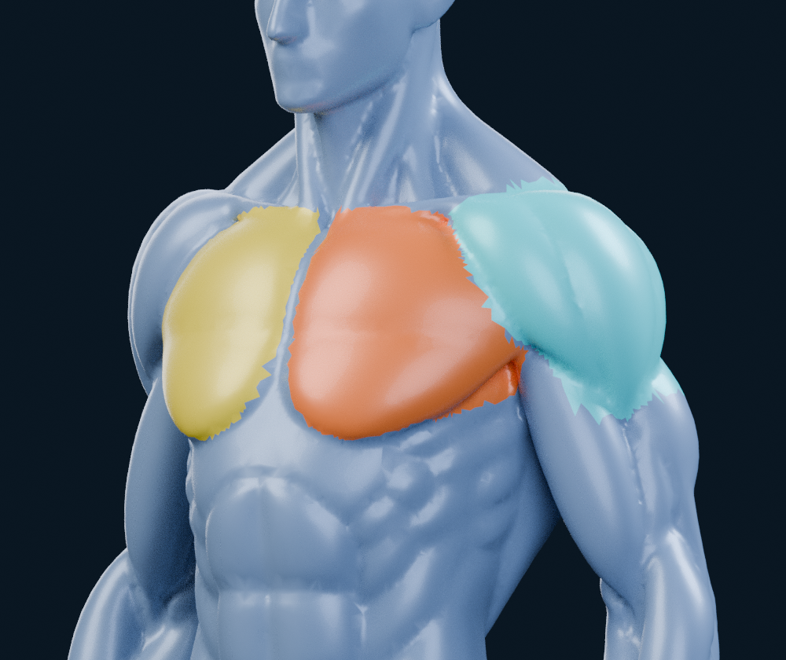
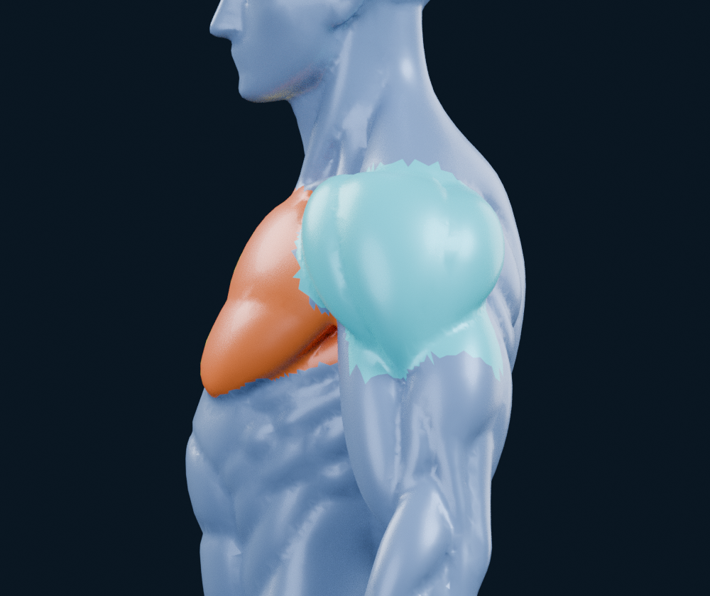

# M4A — Masques musculaires sur le mannequin Meshy intact

20 octobre 2026 · branche `feat/m4a-meshy-masques-musculaires` ·
base exacte `7c2aa5c47994f1bc58758302274a8c5b9693200b`, branche M3.4C.
La [PR #11](https://github.com/mkfreyer/logbook/pull/11) et tous ses essais restent
intacts et en brouillon. Cette preuve est indépendante, sans ancienne reconstruction.

**Verdict : POC partiel. La sélection et la correspondance de triangles
fonctionnent sans déformer le mannequin ; les trois contours ne sont pas encore
validés anatomiquement.** Le pectoral gauche suit son volume principal ; le bord
bas/postérieur du deltoïde reste trop interprétatif pour affirmer l’absence de
débordement sur le haut du bras. Le critère de réussite complet n’est donc pas
atteint. Arrêt après ce constat, sans extension du corps ni nouvelle variante.

## Rendus réels, mêmes géométrie et présentation

Blender 4.3.2, Cycles CPU, 96 échantillons, seed 0, sans débruitage. Matériau
bleu argenté satiné, fond bleu nuit, quatre lumières communes. Les vues du corps
entier sont centrées sans tronquer tête ou pieds. Seuls les matériaux changent
entre la vue neutre et la sélection ; aucun halo, disque ou élément anatomique ajouté.

### Face

### Même vue trois quarts, neutre puis pectoral gauche orange

| Neutre | Pectoral gauche sélectionné |
| --- | --- |
|  |  |

Dans cette sélection, le pectoral droit, le deltoïde et le reste du corps restent
bleus. Les silhouettes et les buffers de géométrie sont identiques.

### Contrôle des frontières : les trois couleurs sont diagnostiques

Orange = pectoral gauche ; jaune = droit ; turquoise = deltoïde gauche.
Cette vue de contrôle ne représente pas une sélection unique.

Le profil est livré pour montrer le défaut, pas pour le masquer. La limite basse
turquoise présente des pointes et un raccord avec le haut du bras qui doit être
repris manuellement. Le haut près de l’acromion et la transition postérieure restent
également des interprétations visuelles. Les petites marches de triangles sont
visibles en gros plan et ne sont pas effacées en 2D.

Les PNG sont rendus à partir du `.blend` livré. Le mannequin lui-même a été généré
par Meshy et fourni par l’utilisateur ; aucune nouvelle génération d’image ou de
mannequin n’a remplacé les rendus. [Paramètres et empreintes](m4a/meshy/renders/render-metadata.json).

## Source et conservation

[GLB utilisateur intact](m4a/meshy/source.glb), nom original
`Meshy_AI_Anatomical_Form_1020050912_generate.glb`, 1 718 428 octets.
SHA-256 : `9fab861a65407e69b9401bec077bf7b40f58d36404e80bad9db6147f24320a14`.

Contrôle du fichier réel : GLB 2.0, **47 711 sommets, 95 426 triangles**, un mesh,
une primitive indexée, un nœud à matrice identité ; aucune texture, image, UV,
normale ou matériau fourni dans le fichier source. Le générateur indiqué est
`meshy-scene`. Meshy 6 Lite et la formule gratuite sont déclarés par l’utilisateur.

Les données Blender conservent exactement les coordonnées float32 et les triplets
uint32 des triangles. La conversion glTF Y-up → Blender Z-up est uniquement une
rotation d’objet de +90° autour de X. Aucun déplacement local, sculpture, remesh,
subdivision, décimation, union, muscle primitif, peau de soutien ou reconstruction
BodyParts3D. Les normales lissées et les matériaux relèvent de la présentation.
Le fichier source demeure inchangé, y compris ses métadonnées d’origine.

## Annotation de trois régions, sans segmentation du reste du corps

| Valeur | Identifiant stable | Triangles attribués |
| ---: | --- | ---: |
| 1 | `pectoralis.left` | 1 356 |
| 2 | `pectoralis.right` | 1 145 |
| 3 | `deltoid.left` | 2 215 |
| 0 | `unassigned` — corps restant | 90 710 |

+X est défini comme gauche anatomique, +Y vers le haut et +Z vers l’avant dans
le repère source. La face rendue permet de contrôler ce repère. Les nombres de
triangles ne mesurent ni la masse du muscle ni le volume d’entraînement.

Les [contours](m4a/meshy/contours.json) ont été tracés sur un rendu orthographique
calibré de la surface existante. Les pectoraux utilisent ce contour et une limite
de profondeur vers la face antérieure ; le deltoïde interpole des limites avant
et arrière autour du volume existant. Les faces sont attribuées par leur centre.
Ce sont des annotations visuelles de ce mannequin, sans identité FMA ni précision
clinique inventée. Aucune déformation ou création d’anatomie ne découle de ce calcul.

Le graphe d’adjacence des faces sert ensuite à conserver une composante connectée
par région et contrôler les trous. Des candidats isolés ont été laissés en zone 0
(36 faces pour le pectoral gauche, 12 pour le droit, 0 pour le deltoïde), **sans
supprimer de triangle du modèle**. Aucun trou n’a dû être rempli. Chaque masque
final forme une composante avec une boucle de frontière, sans îlot isolé.
Cette propriété topologique ne suffit pas à rendre sa frontière anatomiquement correcte.

Une première revue a révélé une limite pectorale trop haute près de la clavicule
et un masque du deltoïde coupé sur le côté. **Une correction bornée des contours**
a abaissé la limite haute et couvert la face latérale de l’épaule. Le raccord
bas/postérieur reste insatisfaisant ; les masques sont figés après ce constat.
Aucun deuxième mannequin, nouvelle méthode automatique ou traitement du reste du
corps n’a été lancé. La base Meshy reste visuellement plus cohérente qu’une
reconstruction de volumes fusionnés, mais son anatomie générée ne fournit pas
toujours un sillon net à suivre.

## Identifiants exportables et raycasting

[regions.json](m4a/meshy/regions/regions.json) décrit les identifiants, la primitive
source, les empreintes des buffers et le [masque uint8](m4a/meshy/regions/triangle-regions.u8).
Un octet par triangle original : 95 426 octets. Avec le GLB original non réindexé,
un impact de rayon donne l’ordinal du triangle, puis son identifiant musculaire.
Aucun attribut personnalisé Blender n’est supposé automatiquement exporté en GLB.

Le [GLB de présentation](m4a/meshy/export/meshy-zones.glb) démontre aussi une voie
par matériaux : quatre primitives partagent le même accessor de positions, sans
sommet dupliqué. Leurs triangles sont regroupés par région, donc **leur ordre
change**. Une [permutation explicite](m4a/meshy/export/draw-triangle-to-source.u32)
et le [binding d’export](m4a/meshy/export/export-binding.json) convertissent
primitive + face locale vers triangle original. Les normales lissées ajoutées
pour cet export ne changent aucune position.

La lecture des buffers de cet export vérifie que chaque triangle original apparaît
exactement une fois, avec les mêmes indices de sommets à l’intérieur du triplet.
Le générateur Meshy d’origine est conservé. Ce fichier n’est pas une nouvelle
variante de mannequin. Les matériaux sont tous bleus au repos et indépendants.

Le contrôleur teste des impacts de rayons sur les deux pectoraux, le deltoïde et
une zone non attribuée, avec récupération du même triangle source depuis l’export.
Ce sont des tests BVH hors application, **pas un moteur tactile Three.js ni un
benchmark iPhone**. La rotation 360°, le toucher, une animation de zoom et les
statistiques restent une architecture décrite, sans implémentation applicative.
[Détails de lookup, export et correction de faces](m4a/meshy/RAYCAST_ET_EXPORT.md).

## Défauts, correction manuelle et décision

- Les volumes principaux des pectoraux sont lisibles et colorables indépendamment.
  La frontière supérieure claviculaire et le pli axillaire restent à valider
  visuellement ; aucune absence universelle de débordement n’est affirmée.
- Le deltoïde couvre maintenant une surface connectée de l’avant vers l’arrière,
  mais sa limite inférieure/postérieure ne suit pas assez sûrement le sillon vers
  biceps/triceps. **Ce masque ne doit pas être validé comme fini.**
- La sélection par triangle produit des marches et pointes aux frontières. Une
  retouche locale de faces peut améliorer le contour, mais ce format ne peut pas
  couper plus finement l’intérieur d’un triangle sans une autre représentation.
- Les détails de mains, attaches et proportions restent ceux du modèle généré ;
  ils ne sont pas corrigés ou validés médicalement dans cet essai limité.

Le `.blend` est éditable dans `04_CONTROLE_REGIONS` : sélectionner les faces,
leur assigner le slot 0/1/2/3 sans toucher les sommets, puis exporter les labels
avec l’outil fourni. Il vérifie la provenance de chaque face avant d’écrire le
masque dans l’ordre du GLB original. Le guide embarqué décrit cette procédure.
Les cinq scènes partagent un seul mesh ; les scènes de sélection sont des
matériaux d’objet, sans halos ou géométrie superposée.

**Recommandation : conserver Meshy comme base expérimentale intacte et faire
valider/corriger uniquement ces contours avant toute extension.** La mécanique
triangle → ID est vérifiable et extensible ; le coût manuel des frontières et
les ambiguïtés du mannequin restent le véritable travail à évaluer. Cette
extension n’est pas engagée ici. Aucun modèle prêt pour iPhone n’est annoncé.

## Livraison et périmètre

[Fichier Blender](m4a/meshy/renders/meshy-masques.blend) ·
[Utilisation et reproduction](m4a/meshy/README.md) ·
[Vérifications](m4a/meshy/verification.json) ·
[Licence et provenance](m4a/meshy/LICENCE_ET_PROVENANCE.md).

Formule gratuite Meshy confirmée : modèle et adaptations de cette livraison sous
CC BY 4.0, avec attribution à Meshy. Le code applicatif n’est pas relicencié.
Budget additionnel **0 €**, aucun achat, outil payant ou recours à Astra.

Nouvelle branche issue du commit exigé ; anciens fichiers et PR #11 préservés.
Aucun changement applicatif, SQLite, M4B ou fusion. **Arrêt pour validation après
publication dans une nouvelle PR en brouillon.**
