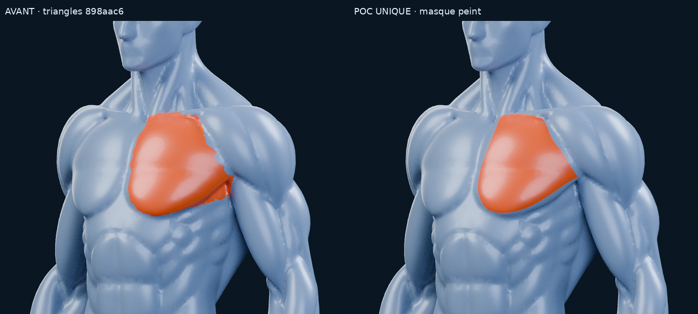
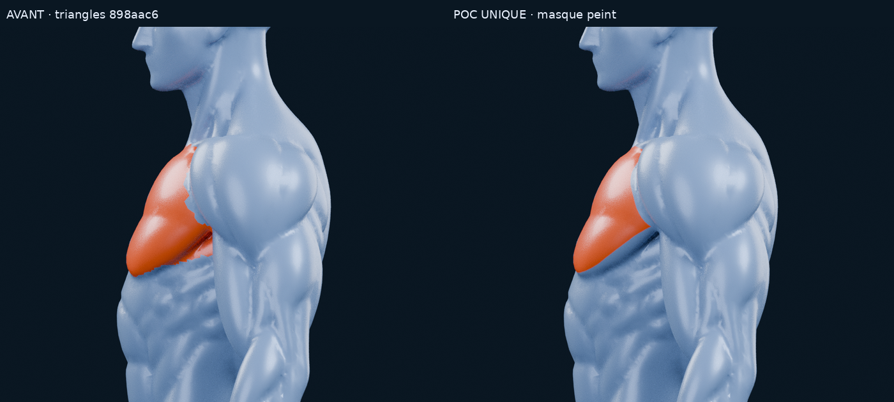
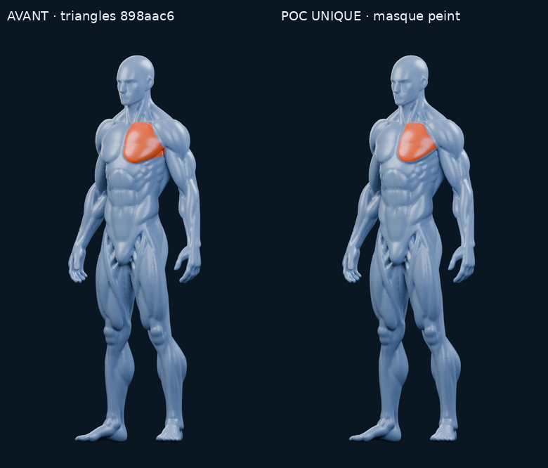

# M4A Meshy — POC unique de masque peint, pectoral gauche

**Verdict : approche prometteuse.** Sur ce seul pectoral, la texture donne un
contour nettement plus continu que l’ancienne attribution de triangles. Le repli
sous l’aisselle reste bleu et la jonction avec le deltoïde est plus propre en
trois quarts comme en profil. Le critère de propreté visuelle du POC est atteint,
sans valider une anatomie finale ni une carte musculaire complète.

Départ : `898aac640dee6fdba27d4a16484035843a35d053`, branche
`feat/m4a-meshy-masques-musculaires`, **PR #12 en brouillon**. Un seul dessin,
un seul masque, aucune série de variantes. Tous les travaux précédents sont
conservés. PR #11 et branche M3.4C préservées ; budget additionnel **0 €**, sans Astra.

## Comparaison visuelle

Même Meshy, caméras, éclairage, bleu argenté, orange et paramètres de matériau
qu’au commit de départ. Vrais rendus Blender 4.3.2 / Cycles CPU, 48 échantillons,
graine 0, sans débruitage. Les planches ajoutent seulement des libellés et un
redimensionnement proportionnel ; aucun muscle n’est recoloré sur une capture.

| Vue | Fichier |
| --- | --- |
| Neutre, face | [Rendu normal](m4a/meshy/texture-poc/renders/neutral-front.png) |
| Sélection, face | [Corps entier](m4a/meshy/texture-poc/renders/painted-front.png) |
| Sélection, trois quarts | [Corps entier](m4a/meshy/texture-poc/renders/painted-three-quarter.png) |
| Gros plan, trois quarts | [Aisselle et jonction avec le deltoïde](m4a/meshy/texture-poc/renders/painted-detail.png) |
| Gros plan, profil | [Repli axillaire](m4a/meshy/texture-poc/renders/painted-profile.png) |
| Gros plan, face | [Sternum et clavicule](m4a/meshy/texture-poc/renders/painted-detail-front.png) |

À **390 px de large**, sans zoom sur le corps entier, le pectoral reste lisible
et le bord paraît plus fluide. Les gros plans permettent d’examiner les limites
que cette réduction atténue. Il s’agit d’une vérification d’image à taille mobile,
pas d’un test de fluidité, de toucher ou de WebView sur iPhone.

## Méthode

1. Ouverture du Blender Meshy déjà corrigé, sans nouvelle base ni retouche de
   géométrie. Dépliage **UV local** du pectoral et de son contexte, par Angle Based.
   Les 3 485 triangles du support UV ne définissent pas la zone orange : ils
   comprennent un contexte non peint. Le reste du corps utilise une case noire.
2. Dessin d’un contour fermé en courbes de Bézier sur la vue trois quarts réelle
   du Meshy : [source SVG éditable](m4a/meshy/texture-poc/painted-contour.svg).
   C’est une peinture par projection pilotée par script, pas une séance de peinture
   à la souris et pas un floutage des anciens labels de triangles.
3. Projection du dessin vers une **texture UV de masque 1024 × 1024**, avec
   contrôle BVH de visibilité par texel : les surfaces cachées derrière le volume
   principal ne reçoivent pas de peinture. 5 755 échantillons cachés sont rejetés.
   Le résultat est attaché à la surface et conserve son contour quand la caméra tourne.
4. Le masque, en données linéaires, mélange le bleu et l’orange dans un matériau
   Principled BSDF. Roughness, metallic et coat passent entre les mêmes valeurs
   que précédemment. Aucune émission, surcouche géométrique, nouvelle normal map,
   sculpture, subdivision ou retouche d’image des rendus.

Le masque peut couper **l’intérieur d’un triangle**, ce que l’ancienne attribution
par faces ne permettait pas. Les contrôles trouvent 128 triangles dont les coins
échantillonnent du noir et du blanc. Deux raycasts sur le **même triangle source
49249** donnent respectivement environ **0,003** et **0,994** dans le masque :
non sélectionné / sélectionné au seuil 0,5. Le repli axillaire testé sur le triangle
74059, précédemment orange, donne **0**.

## Ce que cela améliore, et ce qui reste limité

| Point | Résultat |
| --- | --- |
| Marches imposées par les faces | Remplacées par un bord de texture antialiasé, indépendant des arêtes |
| Dessous du pectoral / pli axillaire | La bande orange indésirable disparaît dans les vues contrôlées |
| Jonction avec le deltoïde | Courbe plus continue, deltoïde conservé bleu |
| Relief et identité du Meshy | Conservés ; le rendu neutre est **identique pixel par pixel** à celui de `898aac6` |
| Bord médial près du sternum | Encore légèrement ondulé de face, du fait du relief et de la projection sur ce modèle |
| Clavicule et attache du muscle | Tracé volontairement simple et conservateur ; interprétation artistique, pas délimitation médicale |
| Anatomie, fibres, proportions | Aucune amélioration nouvelle : le masque ne crée pas une anatomie absente du modèle |
| Autres muscles | Aucun travail effectué ; seul `pectoralis.left` est testé |

La couverture est volontairement resserrée sur le volume lisible du pectoral,
plutôt que prolongée sur un repli ambigu. Elle ne prouve pas que tout le grand
pectoral anatomique est délimité. La peinture projetée depuis une vue doit être
contrôlée sur plusieurs orientations ; ici face, trois quarts et profil ont été
examinés. Un tour complet interactif et tous les éclairages possibles ne sont
pas validés. Aucune seconde passe de peinture n’est engagée.

## UV, texture et export futur

- **Un UV utilisable est nécessaire.** Ce POC possède un dépliage local continu,
  sans chevauchement sous la zone peinte, avec masque nul à sa couture. Ce n’est
  pas un atlas UV propre pour tout le corps : avant d’étendre la méthode, il
  faudra organiser un atlas cohérent ou des supports locaux séparés sans conflit.
- Une **texture de masque scalaire**, stockée ici en PNG gris RGB, suffit pour
  cette zone. Aucun atlas d’IDs de tous les muscles n’est fabriqué. L’échantillon
  de masque peut servir à la couleur comme à un futur lookup de sélection.
- Le [GLB de test](m4a/meshy/texture-poc/export/meshy-painted-selection.glb)
  embarque UV, normales et textures PBR standard, avec `KHR_materials_clearcoat`
  pour le coat. L’orange est précalculé dans la texture couleur de cet export :
  **c’est un export statique de contrôle, pas une sélection interactive livrée**.
- Le masque original est fourni séparément et embarqué comme texture 2, référencée
  par les extras du matériau. Un chargeur glTF ne l’active pas automatiquement :
  un futur shader et/ou lookup CPU par UV devra le charger explicitement, en
  données linéaires, et gérer l’état sélectionné. Ce travail applicatif n’est pas fait.
- Structure compatible avec les données attendues par GLB / GLTFLoader / Three.js :
  `TEXCOORD_0`, PNG et PBR. Import effectif dans Blender réussi, textures et coat
  retrouvés. Aucun test WebView / Three.js / Expo Go / iPhone réel n’est revendiqué.

Géométrie Blender : **47 711 sommets et 95 426 triangles**, positions et triplets
d’indices identiques aux buffers source. **0 triangle ajouté ou retiré.** Pour les
coutures UV, l’export duplique seulement **229 sommets** à positions identiques,
soit **47 940 sommets** (+0,48 %), sans modifier la surface. Le GLB fait
**2 813 580 octets**. Le masque PNG fait **60 366 octets** ; cela ne représente
pas sa mémoire GPU : une texture RGBA8 1024² représente environ 4 Mio, ou 5,33 Mio
avec ses mipmaps. Les textures PBR précalculées du test ajoutent leur propre coût.
Un canal de masque unique et un shader éviteraient ces textures précalculées dans
une implémentation ultérieure, mais cette optimisation n’est pas réalisée ici.

La primitive unique conserve l’ordre des triangles source. Le
[binding d’export](m4a/meshy/texture-poc/export/export-binding.json) et sa table
sommet exporté → sommet source permettent de vérifier l’égalité des surfaces.
**Ne pas réutiliser la permutation de l’ancien GLB à quatre primitives.** Le
lookup de ce test utilise l’UV interpolé du point d’impact et le canal rouge du
masque, avec la convention de V documentée et contrôlée.

## Fichiers et contrôles

- [Blender éditable, masque embarqué](m4a/meshy/texture-poc/meshy-painted-mask.blend)
- [Sources, textures et reproduction](m4a/meshy/texture-poc/README.md)
- [Textures PNG](m4a/meshy/texture-poc/textures)
- [Export GLB et binding](m4a/meshy/texture-poc/export)
- [Vérifications géométrie / UV / PBR / raycasts / import](m4a/meshy/texture-poc/verification.json)
- [Contrôle du masque et des comparatifs](m4a/meshy/texture-poc/comparisons-and-mask-audit.json)
- [Conservation de l’existant et périmètre de livraison](m4a/meshy/texture-poc/verification-livraison.json)

Contrôles réussis : source GLB intact, géométrie Blender bit-identique, UV sans
chevauchement sous la peinture, masque en une composante sans trou au seuil 0,5,
couture hors peinture, nouvelle correspondance d’export vérifiée sur les vrais
buffers, sept raycasts source/export avec interpolation UV, import glTF indépendant,
rendu neutre pixel-identique, empreintes des sept rendus vérifiées.

**Recommandation : retenir cette méthode comme piste prometteuse pour une
validation visuelle du pectoral gauche.** Elle résout mieux la propreté du contour
que les labels de faces dans ce test. Attendre le choix de l’utilisateur avant
toute extension à d’autres muscles, travail de runtime ou intégration.

Model created with Meshy – CC BY 4.0 License.
[Provenance et obligations conservées](m4a/meshy/LICENCE_ET_PROVENANCE.md).
Aucune modification applicative ou SQLite, aucun M4B, aucune fusion. Arrêt après
publication dans la PR #12 en brouillon.
