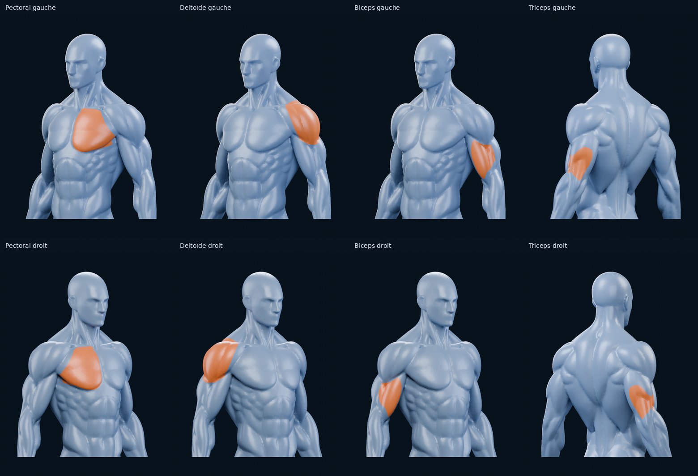

# M4A — Lot pilote haut du corps, huit pièces indépendantes

**Prototype de sélection géométrique livré. Le niveau « atlas fitness premium » n'est pas validé.**

La branche dédiée `feat/m4a-pilote-haut-corps-segmente` part de M3.4C
(`7c2aa5c`), sans fusion d'une ancienne branche M4A. Les PR #11 et #12 restent
intactes et leurs historiques sont [archivés par références figées](m4a/segmente/ARCHIVES.md).
Aucun fichier d'application, flux M3.x, SQLite ou dépendance applicative n'est modifié.
Budget externe supplémentaire : **0 €**. Aucun Astra Ultra ni génération payante.

## À regarder d'abord

- [Face, source / pilote à 390 px par panneau](m4a/segmente/renders/comparison-front-390.png)
- [Trois quarts, même comparaison](m4a/segmente/renders/comparison-three-quarter-390.png)
- [Profil](m4a/segmente/renders/comparison-profile-390.png) et [dos](m4a/segmente/renders/comparison-back-390.png)
- [Huit sélections orange, une seule pièce par image](m4a/segmente/renders/selections-8-pieces.png)
- [Pectoral isolé et vue éclatée](m4a/segmente/renders/isolation-et-eclate.png)
- [BLEND éditable](m4a/segmente/pilote-haut-corps.blend) · [GLB neutre](m4a/segmente/pilote-haut-corps.glb)
- [Sources et reproduction](m4a/segmente/README.md) · [Contrôles du GLB et des rayons](m4a/segmente/verification.json)

## Base retenue et méthode

Le GLB Meshy fourni précédemment par le propriétaire est conservé **octet pour octet**
([original](m4a/segmente/source/meshy-original.glb), SHA-256
`9fab861a65407e69b9401bec077bf7b40f58d36404e80bad9db6147f24320a14`).
Sa silhouette et ses volumes musculaires sont plus directement réutilisables pour
ce pilote que l'atelier BodyParts3D, qui demandait une reconstruction artistique.
Aucun torse reconstruit à partir de primitives, aucune géométrie d'un autre atlas.
[Attribution Meshy / CC BY 4.0 et modifications](m4a/segmente/LICENCE.md).

Le corps source est coupé géométriquement à `Y = 0,12` dans son repère glTF :
torse, tête, bras et portions d'avant-bras servent au contexte du pilote. Le bassin
et les jambes ne sont pas dans le modèle exporté. Le fichier original complet
est uniquement une archive d'entrée, pas une extension du travail au corps complet.

Les huit régions sont tracées sur les volumes réels. Les pectoraux, biceps et
triceps utilisent des courbes Catmull-Rom fermées et des limites de profondeur ;
le deltoïde utilise une frontière tridimensionnelle de calotte d'épaule.
Ces fonctions servent **à couper les triangles**, en ajoutant des sommets aux
intersections. Aucun masque peint, texture de sélection, ID de faces activé dans
un shader ou contour rapporté n'est embarqué.

La partition utilise chaque portion de la surface externe une seule fois : la
somme des aires avant fermeture égale exactement celle du témoin recadré, dans
la précision du calcul. Les surfaces des huit pièces sont retirées du support ;
il n'y a pas un mannequin complet caché sous huit plaques superposées.
Les petits débordements déconnectés du pectoral droit (4 triangles découpés) et du
biceps droit (39) sont réaffectés au support, sans suppression de surface.

Chaque pièce reçoit une paroi interne adoucie, construite à partir d'un retrait
nominal de 18 mm, puis des flancs reliant ses frontières. Les distances effectives
atteignent environ 21 à 27 mm après adoucissement. Le support est fermé par un
retrait de 6 mm. Un joint creusé dans la géométrie, de profondeur maximale 0,8 mm
et de transition 4 mm, rend les limites discrètes sans modifier sensiblement la
silhouette. Les coordonnées externes restent celles du Meshy, hormis ce retrait.

**Nature exacte du résultat : huit volumes fermés de groupes musculaires de surface
stylisés. Ce ne sont pas huit muscles internes reconstruits avec leurs insertions,
tendons et plans profonds anatomiquement exacts.** Cette distinction reste visible
sur la vue isolée ; elle conditionne le verdict.

## Pièces séparées et export

Les côtés sont anatomiques : « gauche » correspond à la gauche du mannequin,
donc à droite sur la vue de face. Chaque ligne correspond à un objet, un datablock
maillé, un nœud glTF, un maillage glTF et un matériau distincts.

| Pièce | Identifiant stable / suffixe du nœud `M4A.` | Triangles fermés |
| --- | --- | ---: |
| Pectoral gauche | `pectoralis.left` | 2 980 |
| Pectoral droit | `pectoralis.right` | 2 532 |
| Deltoïde gauche | `deltoid.left` | 4 108 |
| Deltoïde droit | `deltoid.right` | 4 132 |
| Biceps gauche | `biceps.left` | 1 784 |
| Biceps droit | `biceps.right` | 1 572 |
| Triceps gauche | `triceps.left` | 1 532 |
| Triceps droit | `triceps.right` | 1 672 |

Les huit pièces totalisent **20 312 triangles**. Le support de contexte en compte
73 700, soit **94 012 triangles** affichables au total. Le GLB fait **2 187 868 octets**,
sans texture, animation, rig, caméra ou lumière. Le support représente environ
78 % des triangles : ce modèle de revue n'est pas un export mobile optimisé. La tête et le dos restent du
contexte non sélectionnable. Trapèzes, dorsaux et abdominaux ne sont pas de
nouvelles pièces finies ou prétendument validées.

Le BLEND conserve aussi un témoin source recadré, nommé `M4A.baseline`, masqué au
rendu et exclu du GLB. Il sert à vérifier la conservation du volume. Les neuf
objets exportés portent `muscle_id` et `selectable` dans leurs extras glTF.

## Preuves et vérifications

- Huit pièces connexes, fermées au sens des arêtes, zéro bord ouvert et zéro
  arête non-manifold par pièce ; datablocks indépendants. Le support est lui
  aussi connexe et fermé au sens des arêtes.
- Relecture du BLEND sauvegardé et import du **GLB effectivement livré** dans une
  scène vide. Tous les triangles correspondent à la géométrie sauvegardée, en
  comparant leurs coordonnées à 1 µm malgré les duplications de normales.
- Huit rayons partant de l'extérieur atteignent chacun la pièce attendue comme
  **premier objet de la scène**. Origines, directions, points et objets touchés
  sont consignés dans [verification.json](m4a/segmente/verification.json).
- Neuf matériaux distincts à l'export : recolorer une pièce ne recolore pas les
  autres. Huit images orange individuelles et une isolation réelle complètent
  la preuve. Aucun moteur de sélection applicatif n'est développé.
- **Validateur Khronos glTF : zéro erreur, zéro avertissement**,
  [rapport complet](m4a/segmente/gltf-validation.json). Ce contrôle de format
  ne certifie ni l'anatomie ni l'absence d'intersection géométrique.
- Rendus Blender 4.3.2 / Cycles CPU, 64 échantillons, 780 × 1 000, même matière,
  lumière, cadrage et exposition entre témoin et pilote. Dix-huit PNG sont
  calculés depuis la géométrie. Les planches ajoutent seulement des titres et
  redimensionnent les panneaux à 390 × 500 : aucune anatomie repeinte en 2D,
  aucune image générative.

[Partition et conservation d'aire](m4a/segmente/partition-audit.json) ·
[Topologie et volumes](m4a/segmente/geometry-audit.json) ·
[Protocole des rendus](m4a/segmente/render-metadata.json).

## Limites géométriques observées

La première fermeture à épaisseur uniforme repliait ses parois internes dans les
plis du maillage source. L'adoucissement limité à la construction intérieure
réduit ce défaut : aucun auto-croisement non adjacent n'est détecté pour les
six pièces deltoïdes/biceps/triceps, ni sur les surfaces externes des huit pièces.

**Il reste toutefois 19 paires d'intersections internes détectées dans les
pectoraux : 2 à gauche, 17 à droite.** Elles concernent les flancs et les parois
internes. Le support comporte 607 paires internes ou de flancs. Les décomptes
proviennent du diagnostic BVH livré, après exclusion des triangles adjacents ;
ils ne constituent pas une certification de solides imprimables. Les contacts
et recouvrements internes entre objets distincts ne sont pas certifiés.

Des triangles très fins subsistent près des coupes. Les frontières sont continues
et ne présentent plus un escalier imposé par les anciennes faces, mais leur
implantation reste artistique. **La sélection du pectoral gauche inclut encore
un repli sous-pectoral, visible comme une languette orange en trois quarts.
Le deltoïde gauche comprend également un petit débord supérieur près de la
clavicule. Ces défauts de frontière sont bloquants pour la validation visuelle,
même si chaque pièce est connexe et techniquement sélectionnable.** Les attaches pectorales, la séparation brachial /
biceps / triceps et les parties profondes du deltoïde ne sont pas anatomiquement
validées. La symétrie des courbes ne corrige pas les asymétries de la source.

La méthode démontre des pièces indépendantes utilisables pour une sélection.
Elle ne livre pas encore une segmentation anatomique experte ni des volumes
internes de production. Il serait trompeur de présenter la fermeture topologique
ou le succès du validateur glTF comme une résolution de ces défauts.

## Verdict visuel et mobile

Les comparaisons permettent d'évaluer séparément la conservation du volume et la
lecture de la sélection. Le torse Meshy reste la base visible ; cette étape ne
prétend pas avoir sculpté un nouveau mannequin de niveau supérieur.

- **Volumes et silhouette :** conservés, avec des masses fitness déjà lisibles ;
  les huit groupes ne sont pas ajoutés en relief par-dessus la peau.
- **Frontières :** le découpage continu élimine le crénelage des sélections par
  triangles. Le raccord épaule/bras reste une interprétation ; le repli orange
  sous-pectoral et le débord supérieur du deltoïde restent visibles. La propreté
  anatomique des frontières n'est donc pas obtenue.
- **Style premium :** direction cohérente, finition insuffisante. Les irrégularités et
  certains plis du modèle source, le cou/visage, les transitions du bras et la
  construction intérieure demandent encore un travail artistique local.
- **À 390 px :** les grandes pièces orange sont identifiables. Les biceps et
  triceps occupent une cible plus petite et nécessiteront probablement un zoom
  ou une tolérance de toucher. Une image de 390 px n'est pas un test sur iPhone.
- **WebView / Three.js futur :** plausible pour un modèle statique PBR : un objet
  touché fournit directement `muscle_id`, sans lookup UV ni masque. Le support
  peut être exclu des cibles ; un matériau individuel peut être recoloré et les
  autres objets masqués. Aucun runtime, WebView, geste tactile, FPS, mémoire GPU
  ou consommation sur téléphone réel n'est implémenté ou mesuré.

**Décision recommandée : retenir la preuve de séparation/sélection ; ne pas
valider ce lot comme base premium finalisée et ne pas lancer le corps complet.**
On ne peut pas encore affirmer que le critère de succès global est atteint.
Une reprise manuelle compétente sur ces mêmes huit groupes est nécessaire pour
les attaches et les fermetures, puis une nouvelle revue visuelle mobile limitée
au même périmètre. Cette reprise n'est pas engagée ici.

## Arrêt

Nouvelle PR en brouillon, sans fusion. Les sources, exports, rendus et diagnostics
sont livrés pour décision. **Aucune intégration à l'application, aucune extension
au corps complet et aucun M4B. Attente de la validation utilisateur.**
