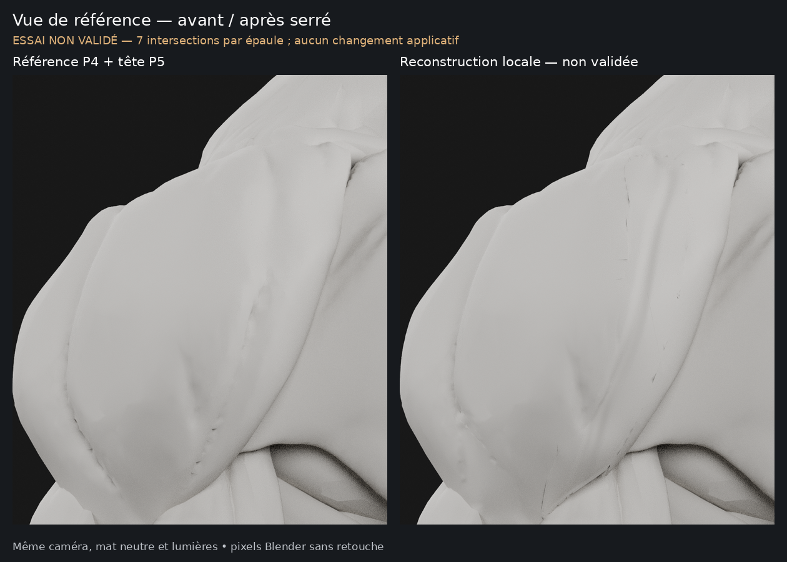
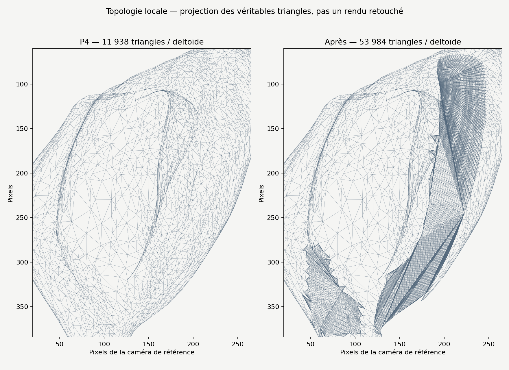

# M4A — reconstruction locale suivant les guides bleus

**Verdict : essai insuffisant, non validé. Conserver `0ab3d83` comme base visuelle
et `0fc6f0b` comme référence des trajectoires. Cette copie ne doit pas devenir
le modèle de référence de Logbook.**

## Comparatifs

- [Bombé central préservé](m4a/ecorche-beatriz-reconstruction-guides/renders/bombe-preserve.png).
- [Premier creux](m4a/ecorche-beatriz-reconstruction-guides/renders/creux-1-detail.png)
  et [second creux](m4a/ecorche-beatriz-reconstruction-guides/renders/creux-2-detail.png).
- [Autre épaule](m4a/ecorche-beatriz-reconstruction-guides/renders/comparatif-epaule-gauche.png),
  [face](m4a/ecorche-beatriz-reconstruction-guides/renders/comparatif-face.png),
  [profil](m4a/ecorche-beatriz-reconstruction-guides/renders/comparatif-profil.png),
  [trois quarts](m4a/ecorche-beatriz-reconstruction-guides/renders/comparatif-trois-quarts.png)
  et [arrière oblique](m4a/ecorche-beatriz-reconstruction-guides/renders/comparatif-arriere-oblique.png).

Même caméra dans chaque paire, mêmes cinq lumières et même matériau mat neutre.
La vue de référence reprend le cadrage approuvé avec les guides. Les images
proviennent de Blender Cycles ; les planches sont uniquement des assemblages
et recadrages, sans dessin de sillons ni retouche des formes.

## Travail réellement effectué

La copie repart de **P4 + tête P5 (`0ab3d83`)**, sans appliquer les déformations
des essais précédemment rejetés. Les trajectoires utilisent les échantillons
des courbes bleues validées de `0fc6f0b`.

Les anciens sillons comportent des replis superposés. La densification seule
ne permettait pas de les reconstruire proprement. La proposition remplace
**1 724 faces d’origine par épaule** dans deux patches locaux comprenant les
anciens trajets, les nouveaux et leurs raccords. Le bombé central reste exclu.
Les fonds sont reconstruits par une surface lisse calculée à partir des berges
P4, puis des dépressions arrondies sont formées suivant les guides bleus.
Le calcul dans le repère de caméra sert à construire de véritables positions
3D : aucune texture, bump map ou ligne peinte n’est utilisée.

La triangulation locale est reconstruite et densifiée. Certains points de bordure
sont régularisés, avec un déplacement plafonné à **2,5 mm**, pour raccorder les
replis ; ce raccord reste précisément le point faible de l’essai. La profondeur
nominale du nouveau profil atteint **2,6 mm dans la direction de vue**, avec une
section arrondie et des extrémités progressives. Le comblement d’anciens fonds
profonds déplace localement davantage la surface : ce n’est pas une augmentation
du ventre principal. Aucun transfert de volume compensatoire n’est appliqué.

Les terminaisons validées sous les pièces du bras restent sous-jacentes ; les
objets voisins ne sont pas déplacés pour les rendre visibles. Les modifications
sont répliquées en miroir sur l’autre épaule.

## Contrôles et limites

| Contrôle | Résultat |
| --- | --- |
| Bombé central P4 | **901 sommets d’origine par épaule strictement identiques**, déplacement 0. |
| Autres objets | **298 objets identiques**, y compris tête P5, gorge, pectoraux, bras et reste du corps ; géométrie brute/évaluée, normales, UV et matériaux vérifiés. |
| Dimensions maximales | Identiques à P4. |
| Enveloppe projetée | Conservée dans la vue de référence droite ; certains autres angles présentent une sortie d’enveloppe jusqu’à environ **1,7 mm**. La silhouette n’est donc pas préservée parfaitement sous tous les angles. |
| Volume total du deltoïde | Environ **+0,44 %**, dû aux seuls raccords/comblements locaux ; aucun gonflement compensatoire du bombé. |
| Symétrie | Écart maximal entre miroir et autre épaule inférieur à **0,0001 mm**. |
| Fermeture topologique | Maillage fermé, deux faces par arête, sans bord ouvert. |
| Intersections géométriques | **7 croisements de triangles par épaule** : critère non atteint. Un maillage fermé peut néanmoins s’intersecter localement. |

**Les anciens creux sont-ils supprimés ?** Leurs fonds sont remplacés dans les
patches, mais des marques résiduelles et des croisements subsistent aux raccords.
Il n’est donc pas possible de déclarer les anciens trajets entièrement effacés,
ni de garantir l’absence de doubles dépressions sur toute la zone.

Les nouveaux sillons gagnent en continuité sur certaines portions, surtout le
second, mais les raccords montrent encore de petites marques sombres et des
transitions irrégulières. **Le résultat ne satisfait pas la demande de creux
continus, propres et naturels.** Les contrôles de préservation du bombé ne doivent
pas masquer cet échec visuel et géométrique.

## Coût de la topologie

| | P4 | Copie d’essai |
| --- | ---: | ---: |
| Triangles par deltoïde | 11 938 | 53 984 |
| Triangles du mannequin complet | 498 058 | 582 150 |
| Objets de maillage | 300 | 300 |

La densification est limitée aux deux deltoïdes. **10 214 faces d’origine par
épaule restent présentes**, mais quelques sommets de leur bordure participent au
raccord local. Les identifiants de sommets/faces du deltoïde changent dans les
patches ; les identifiants des objets sont conservés. Aucun découpage des trois
faisceaux ni masque de sélection interactive n’est créé.

Le coût local est trop élevé pour présenter cet essai comme une retopologie
mobile finale, d’autant qu’il reste non conforme. Les outils de préparation
sont gratuits et libres ; ils ne deviennent pas des dépendances de Logbook.
L’export GLB contient 582 149 triangles : l’exporteur retire une copie d’un
triangle coïncident sur une pièce inchangée du corps, sans trou supplémentaire.

## Arrêt

**Ne pas valider cette copie.** L’essai montre qu’une reconstruction des fonds
et une densification ne suffisent pas encore à produire ici les raccords attendus.
Une reprise manuelle de topologie/sculpture dans Blender serait préférable à une
nouvelle série automatique de déformations. Elle n’est pas lancée dans cette tâche.

La référence de sécurité et toutes les versions précédentes sont préservées.
Aucune intégration, modification de Logbook ou SQLite, segmentation interactive,
M4B ou fusion. PR #12 maintenue en brouillon. Arrêt après publication des rendus
et de ce constat, pour votre décision.

[Sources, attribution et reproduction](m4a/ecorche-beatriz-reconstruction-guides/README.md)
· [Contrôles du master et de l’export](m4a/ecorche-beatriz-reconstruction-guides/verification.json).
