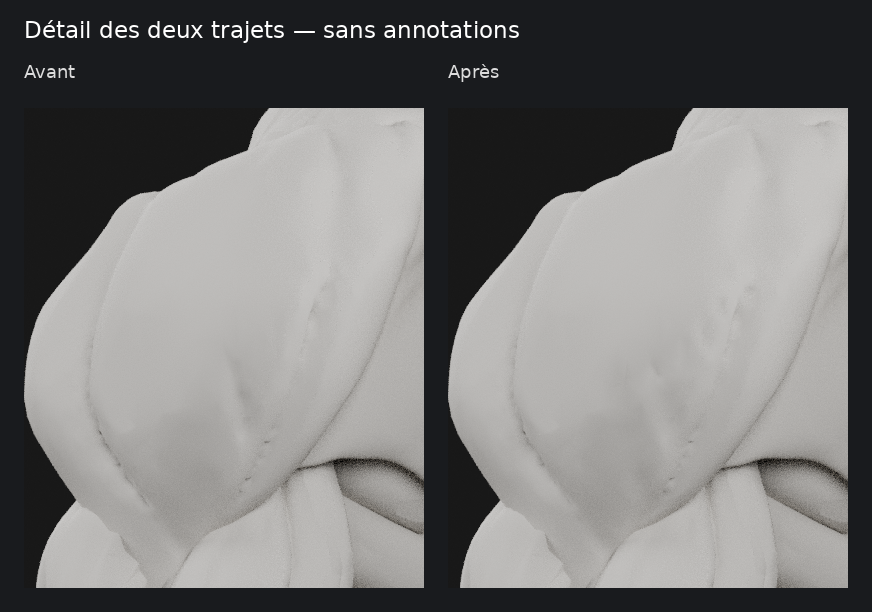

# M4A — retouche locale des creux des deltoïdes

**Proposition à valider sur la combinaison P4 + tête P5, issue de `0ab3d83`.**
Seuls les deux deltoïdes sont retouchés. Leurs proportions générales sont
conservées ; la tête humaine, toute la gorge, les pectoraux et toutes les autres
pièces du corps restent inchangés. Les fichiers et scènes précédents sont préservés.

## Rendus sans annotations

- [Comparatif complet dans la vue de référence](m4a/ecorche-beatriz-trajets-deltoides/renders/comparatif-reference.png).
- [Les deux épaules après retouche](m4a/ecorche-beatriz-trajets-deltoides/renders/deux-deltoides-apres.png).
- [Comparatif épaule gauche](m4a/ecorche-beatriz-trajets-deltoides/renders/comparatif-epaule-gauche.png).
- [Épaules de face](m4a/ecorche-beatriz-trajets-deltoides/renders/comparatif-epaules-face.png),
  [de profil](m4a/ecorche-beatriz-trajets-deltoides/renders/comparatif-epaule-profil.png)
  et [trois quarts arrière](m4a/ecorche-beatriz-trajets-deltoides/renders/comparatif-epaule-arriere.png).
- Corps entier : [face](m4a/ecorche-beatriz-trajets-deltoides/renders/comparatif-face.png),
  [profil](m4a/ecorche-beatriz-trajets-deltoides/renders/comparatif-profil.png),
  [trois quarts](m4a/ecorche-beatriz-trajets-deltoides/renders/comparatif-trois-quarts.png)
  et [dos](m4a/ecorche-beatriz-trajets-deltoides/renders/comparatif-dos.png).

La vue de référence reprend la caméra d’origine `P4P5_epaule-droite` à −55°.
Les trajectoires ont été repérées manuellement dans les images fournies et
rapportées aux reliefs réels du maillage ; il ne s’agit pas d’un recalage
automatique pixel par pixel du recadrage envoyé dans le chat.
Chaque paire avant/après utilise **le même objet caméra, le même cadrage,
les mêmes cinq lumières et le matériau mat neutre des passes précédentes**.
Dix captures avant sont reprises à l’identique de `0ab3d83`, dix captures après
sont rendues dans Blender/Cycles CPU à 48 échantillons. Aucune ligne colorée,
accentuation de contraste ou retouche de surface n’est ajoutée aux images.

## Modifications réellement effectuées

1. **Premier creux, à gauche sur la référence** : partie supérieure laissée
   en place ; ancien retour oblique inférieur atténué, dépression prolongée
   suivant une terminaison plus basse et plus verticale.
2. **Second creux, à droite sur la référence** : les dépressions existantes
   sont transférées vers un trajet décalé vers l’intérieur de l’image et
   prolongé plus bas. Le fond des anciennes dépressions est relevé localement,
   plutôt que de conserver intentionnellement deux sillons parallèles.
3. **Finition** : profondeur locale et courbure arrondie renforcées sur le
   trajet proposé. Les irrégularités transportées sont régularisées ; aucune
   bosse compensatrice n’est ajoutée sur les portions voisines.
4. **Symétrie** : le même déplacement géométrique est appliqué en miroir
   sur l’autre épaule, en conservant les minuscules écarts numériques de P4.

Le transfert est calculé à partir d’une carte de profondeur temporaire du
maillage. Celle-ci sert uniquement d’outil numérique pour enlever l’ancien
creux et appliquer sa nouvelle position **aux sommets 3D**. Elle n’est ni
une texture livrée au matériau, ni une normal map, ni un trait peint.
Les contours verts ne sont pas utilisés pour créer de nouvelles formes.

## Préservation et contrôle

- **Topologie conservée** : 5 971 sommets et 11 938 triangles par deltoïde,
  avec les mêmes indices de faces. Aucun remesh ni ajout de triangles.
- Déplacement maximal local : environ **3,50 mm** ; il comprend le comblement
  des anciens creux et l’enfoncement du nouveau trajet.
- Variation de volume par deltoïde : environ **−0,20 %**, sans compensation
  globale susceptible de regonfler les épaules.
- Les dimensions maximales varient de **moins d’un micromètre** ; les coupes
  de silhouette de face sont également comparées au modèle de départ.
  Sur 41 coupes, la hausse locale maximale de largeur bilatérale est de **0,12 mm**.
- Les **298 autres objets**, dont tête, yeux et surface tête/gorge/cou, sont
  comparés au fichier d’origine : coordonnées, topologie et données conservées.
- Contrôles de fermeture, retournement des faces, auto-intersections et
  symétrie ; vérification indépendante du GLB sérialisé et réimportation Blender.

[Résultats détaillés des contrôles](m4a/ecorche-beatriz-trajets-deltoides/verification.json).
Le master conserve **300 objets et 498 058 triangles**. Le GLB de contrôle
contient 498 057 triangles, l’exporteur supprimant une occurrence d’une face
déjà dupliquée dans une pièce antérieure, sans retirer de surface unique.

## Limites et arrêt

La fidélité des trajets aux annotations et la netteté anatomique restent à
juger sur les rendus : les mesures de volume et d’intégrité ne prouvent pas
une validation visuelle. La profondeur est volontairement raccordée et atténuée
près des insertions ; l’éclairage mat doux rend certaines transitions moins
contrastées que les séparations ouvertes des obliques/dentelés. La seconde
transition conserve par endroits une lecture irrégulière : la proposition
n’est pas présentée comme une finition anatomique définitive.

Cette livraison est **une seule proposition**, pas une base déclarée validée.
Aucune segmentation interactive des faisceaux n’a été commencée, aucun test de
performance mobile ni intégration n’a été réalisé. Aucun changement du code
applicatif, de SQLite ou de M4B ; PR #12 maintenue en brouillon, sans fusion.

[Sources Blender, GLB et reproduction](m4a/ecorche-beatriz-trajets-deltoides/README.md).
