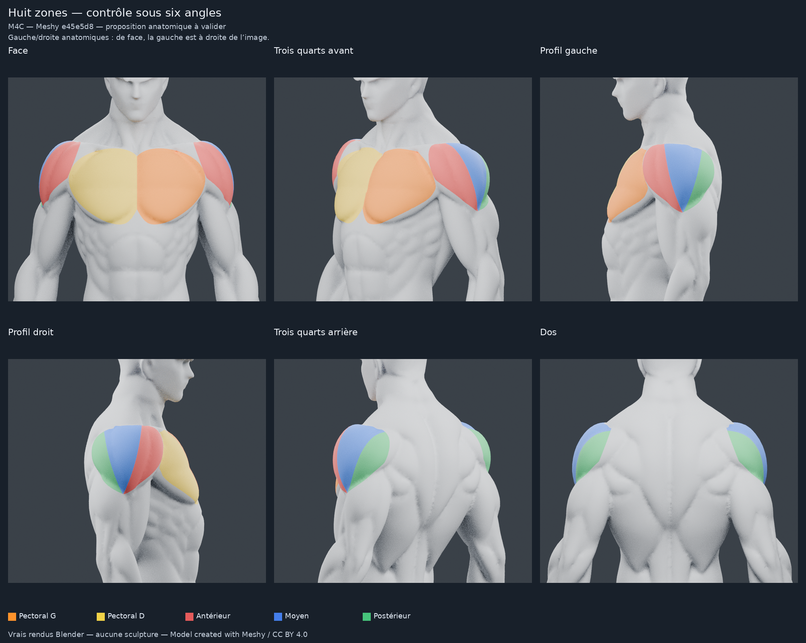

# M4C — huit zones sur le Meshy validé, sans sculpture

**Proposition prête à examiner ; placement anatomique non encore validé.**
Le visualiseur M4B SDK 58 a été validé par l’utilisateur sur son iPhone.
Cette livraison prépare uniquement les contours et les données de huit zones ;
elle ne change pas ce visualiseur et ne connecte pas la sélection tactile.

Base applicative : PR #16, `11d56d0`. Source esthétique : GLB `e45e5d8`, conservé
intact dans `assets/models/meshy-e45e5d8.glb` (copie binaire du master
`meshy-corps-tete-assemble.glb`). Nouvelle branche `feat/m4c-meshy-huit-zones`.
Les PR #12, #15 et #16 restent en brouillon, sans fusion.

## Rendus à examiner

- [Gros plans des deux pectoraux](m4c/meshy-huit-zones/renders/planche-pectoraux.png).
- [Deltoïdes gauche/droit, avant/arrière](m4c/meshy-huit-zones/renders/planche-deltoides.png).
- [Référence / masques désactivés, face/profil/dos](m4c/meshy-huit-zones/renders/controle-neutre.png).
- [Mannequin complet neutre](m4c/meshy-huit-zones/renders/neutre-complet.png).
- [Un seul pectoral activé, autres zones neutres](m4c/meshy-huit-zones/renders/independance-pectoral-gauche.png).

Les [images brutes](m4c/meshy-huit-zones/renders) incluent face, profils gauche
et droit, trois quarts avant et arrière, dos et gros plans. Vrais rendus Blender
4.3.2 / Cycles CPU, 24 échantillons, sans débruitage. Même matériau mat, mêmes
lumières et caméras pour les comparatifs ; aucune couleur peinte sur une capture.

**Gauche anatomique = +X du GLB ; de face, elle apparaît à droite de l’image.**
Orange : pectoral gauche ; jaune : droit. Rouge : deltoïde antérieur ; bleu :
moyen ; vert : postérieur. Les couleurs sont uniquement des contrôles.

## Méthode retenue

Le [POC de masque peint de la PR #12](https://github.com/mkfreyer/logbook/blob/e45e5d8444ff54a96b43eae4f8727081d1452764/docs/M4A_MESHY_MASQUE_PEINT.md)
a été relu. Il montrait l’intérêt d’un masque traversant les triangles, mais
portait sur un **ancien Meshy de 95 426 triangles**. Aucun de ses masques, UV ou
indices n’est transféré ; aucun recours au mannequin Beatriz/P4.

La méthode choisie est un **atlas UV d’identifiants discrets**, accompagné de
masques et d’une palette de contrôle :

1. Créer des UV sur un support de haut du corps de 23 749 triangles. Ce support
   comprend un contexte neutre ; il ne constitue pas la zone musculaire.
2. Définir les contours dans le **repère 3D du modèle**, indépendamment de la
   caméra : contour courbe du volume pectoral, visibilité géométrique contre
   les replis profonds, enveloppe du deltoïde et limites en éventail variant
   entre origine supérieure et insertion inférieure.
3. Réserver le dôme latéral au faisceau moyen ; envelopper l’avant/clavicule
   avec l’antérieur et l’arrière avec le postérieur. Les limites fonctionnelles
   ne sont pas forcées à suivre les rainures sculptées de ce modèle généré.
4. Échantillonner ces régions sur les vrais triangles UV dans un PNG L8 de
   **2048 × 2048** : 0 = neutre, 1 à 8 = une seule identité par texel. Le contour
   peut passer dans l’intérieur des faces existantes.
5. Dériver huit masques indépendants, deux images RGBA de travail et une texture
   couleur PBR de contrôle. Dans Blender, huit couples de nœuds `SHOW::<id>` /
   `COLOR::<id>` permettent d’activer et recolorer chaque zone séparément.

Il s’agit d’une délimitation artistique paramétrée puis vérifiée sur la surface,
**pas d’une reconnaissance automatique d’anatomie ni d’une nouvelle sculpture**.
Les repères et règles restent éditables dans le [JSON](m4c/meshy-huit-zones/regions.json)
et les [sources](../tools/m4c/README.md).

Le découpage des triangles n’est pas nécessaire. Par rapport à des matériaux
attribués aux faces entières, les masques évitent les marches imposées par les
arêtes. Des sous-maillages n’apporteraient ici aucun avantage pour huit zones et
ajouteraient des primitives à gérer ; le contrôle reste à un maillage/une primitive.

## Huit identifiants stables

| Zone | Identifiant |
| --- | --- |
| Grand pectoral gauche | `pectoralis.left` |
| Grand pectoral droit | `pectoralis.right` |
| Deltoïde antérieur gauche | `deltoid.left.anterior` |
| Deltoïde moyen gauche | `deltoid.left.lateral` |
| Deltoïde postérieur gauche | `deltoid.left.posterior` |
| Deltoïde antérieur droit | `deltoid.right.anterior` |
| Deltoïde moyen droit | `deltoid.right.lateral` |
| Deltoïde postérieur droit | `deltoid.right.posterior` |

Les codes de l’atlas sont explicitement associés à ces noms. Les
[bounds, centres, noms et bindings](m4c/meshy-huit-zones/region-binding.json)
sont fournis dans le repère original du GLB pour préparer une future sélection
et un cadrage. Les bornes sont conservatrices, issues de faces échantillonnées ;
elles ne constituent pas une prescription de zoom déjà intégrée.

## Préparer `SurfaceHit → zone`, sans interface

Le GLB validé du visualiseur n’a pas d’UV. Le binding compact associe donc ses
faces à des UV par coin. Un outil **hors application** prend le `SurfaceHit`
existant, vérifie le modèle et son empreinte, calcule les coordonnées barycentriques,
interpole l’UV et lit l’ID discret. Il renvoie l’un des huit noms, ou `null`
pour la surface neutre. L’indice de face sert seulement à retrouver l’UV sur
cette source protégée par SHA-256 ; ce n’est jamais un identifiant anatomique.

Avec le GLB UV de contrôle, `hit.uv` suffit pour lire le même atlas : les IDs ne
dépendent donc pas de l’ordre des triangles d’un nouvel export. Il faudrait
régénérer le binding source si la géométrie ou l’ordre de ses faces changeait.

Les [huit raycasts Three.js source/export](m4c/meshy-huit-zones/picking-audit.json)
identifient les huit zones, avec la bonne convention gauche/droite. Deux impacts
sur un **même triangle source** donnent aussi deux faisceaux distincts. Les
mauvais modèles, empreintes et points hors face sont rejetés. Aucun listener
ou écran tactile de Logbook n’a été modifié.

Le GLB coloré est un **export PBR statique de contrôle**. L’ID PNG est embarqué
et référencé dans les extras ; GLTFLoader ne l’utilisera pas automatiquement.
La coloration dynamique nécessitera ultérieurement une palette/shader et le
chargement explicite de cette donnée linéaire. Il ne faut pas interpoler les
valeurs d’IDs ni leur appliquer une conversion sRGB. Seuls les poids/couleurs
peuvent être filtrés pour un affichage doux.

## Préservation et contrôles

- **110 588 triangles avant et après ; aucun triangle 3D ajouté ou découpé.**
- Blender conserve les **55 288 sommets source**. Le GLB UV contient **60 622
  sommets**, soit 5 334 doublons de couture (+9,65 %), aux mêmes positions.
- Chaque coin de chaque triangle exporté a une **position et une normale
  bit-identiques** à la référence, vérifiées par les vrais buffers. Aucun
  déplacement, changement de silhouette, relief, visage, cheveux, cou ou corps.
- Quelques petites faces ont reçu des îlots UV distincts pour éliminer cinq
  collisions de projection. C’est un changement d’UV, pas un découpage du mesh.
  [Réparation documentée](m4c/meshy-huit-zones/uv-repair.json).
- Une identité unique par texel, masques sans chevauchement. L’audit de continuité
  recolle les composantes de l’atlas par les arêtes réelles de la surface : une
  composante par zone, aucun trou neutre interne détecté sur les texels couverts.
  Quelques artefacts d’un texel ont été nettoyés dans la texture uniquement.
- Les diagnostics par centres de triangles sont conservés séparément : ils
  peuvent former de petits groupes, car les vrais contours traversent les faces.
  Ils ne remplacent pas l’audit du masque continu.
- Import du GLB dans Blender réussi : UV, image PBR, positions et faces conservés.
  Les comparaisons neutres face/profil/dos sont **identiques pixel par pixel**
  à la référence sous les mêmes caméras et lumières : aucun pixel changé.

[Buffers](m4c/meshy-huit-zones/verification.json) ·
[Continuité](m4c/meshy-huit-zones/continuity-audit.json) ·
[Import](m4c/meshy-huit-zones/blender-import-audit.json) ·
[Rendus neutres](m4c/meshy-huit-zones/render-verification.json) ·
[Coûts et conservation applicative](m4c/meshy-huit-zones/delivery-metrics.json).

## Coût mobile et limites

La segmentation reste hors application : le GLB neutre actuellement chargé par
Expo Go est inchangé. Aucun coût supplémentaire n’est ajouté au prototype iPhone
validé dans cette livraison.

L’export coloré ajoute environ **0,7 Mo** au GLB de 1 993 204 octets, principalement
UV et doublons de couture. Le chiffre exact et les tailles des fichiers sont
[détaillés ici](m4c/meshy-huit-zones/delivery-metrics.json). Le binding source
compact représente **664 972 octets** ; il n’est utile que si l’on conserve le
GLB sans UV pour le futur picking.

Un atlas 2048² représente **4 Mio en R8 explicite**, ou **16 Mio en RGBA8**, avant
mipmaps. Une texture couleur RGBA8 atteint environ 21,3 Mio avec mipmaps. Les
huit PNG séparés et les deux RGBA servent à l’édition et au contrôle Blender ;
les charger tous sur mobile serait inutile. La piste recommandée pour la suite
est **un atlas d’IDs + une palette**, sans multiplier les objets ni les draw calls.
La qualité à 1024² pourra être évaluée séparément après validation des contours.
Aucune fluidité, mémoire GPU ou performance iPhone de **M4C** n’est mesurée ici.

Les repères claviculaire/scapulaire et les insertions ne sont pas documentés
anatomiquement sur ce Meshy généré par IA. Les frontières proposées restent des
**approximations fitness de surface**, notamment en haut des épaules, près du
pli axillaire et à l’insertion inférieure. Les deux côtés sont examinés mais la
surface source présente de petites asymétries. Les raycasts et audits d’images
ne constituent pas une validation médicale ; le contour reste limité par la
résolution d’un texel, particulièrement au très gros zoom.

## Livraison et arrêt

[Blender, GLB, masques et bindings](m4c/meshy-huit-zones/README.md).
Le master neutre et tout l’historique sont conservés. SQLite, entraînements,
programmes, historique, statistiques, SDK 58 et moteur du visualiseur ne changent
pas. Budget additionnel **0 €**, sans Astra, achat ou service payant.

**Recommandation : retenir l’atlas UV d’IDs comme méthode technique et examiner
ces huit contours avant toute intégration.** Attendre la validation de leur
placement ; aucune extension à d’autres muscles, sélection tactile, zoom de zone
ou carte thermique n’est lancée automatiquement.

Model created with Meshy — CC BY 4.0.
[Provenance et attribution conservées](../assets/models/README.md).
