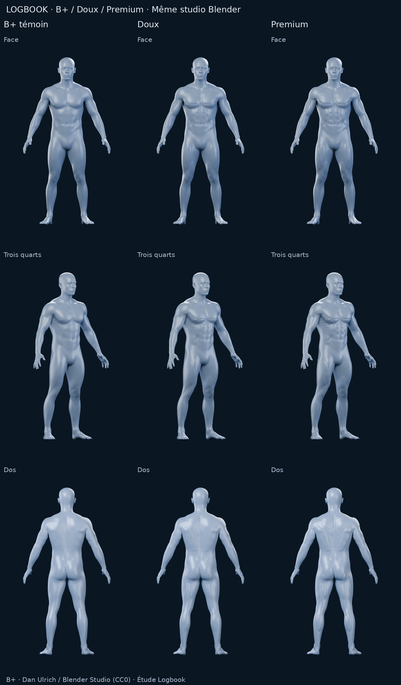
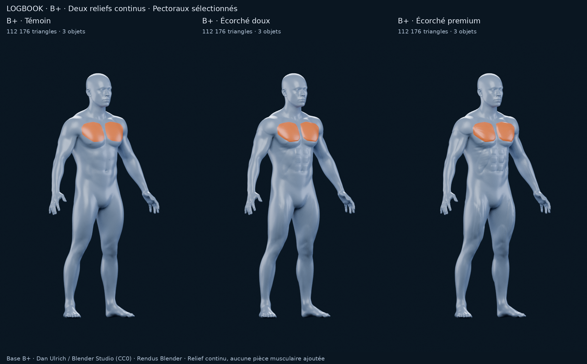

# B+ — Deux variantes de relief fitness

**PR #11 en brouillon. Arrêt pour choix visuel ; aucune intégration.**

[Rapport comparatif et recommandation](../../M4A_B_PLUS_ECORCHE.md) · [Provenance](PROVENANCE.md) · [Validation](validation.json) · [Manifest SHA-256](manifest.json)

Colonnes identiques dans toutes les planches : **B+ témoin / B+ Écorché doux / B+ Écorché premium**. Le témoin n'est pas une nouvelle variante ; il conserve le B+ original avec le même allègement que les candidats.



[Face](comparaison-front.png) · [Trois quarts](comparaison-three-quarter.png) · [Dos](comparaison-back.png) · [Profil](comparaison-side.png) · [Sélection orange](comparaison-selection.png) · [Détail torse](detail-torse.png)



## Sources et données

112 176 triangles visibles et 3 objets par colonne : corps continu de 110 000 triangles, deux yeux de 1 088 triangles. Deux zones pectorales de démonstration, sans segmentation finale. Chaque dossier contient les cinq PNG bruts, les paramètres et les contrôles.

| Modèle | Source statique | Studio prêt F12 | Construction | Géométrie | Rendus |
|---|---|---|---|---|---|
| B+ témoin | [BLEND](baseline/model.blend) | [Scène](baseline/scene-review.blend) | [JSON](baseline/construction.json) | [Audit](baseline/geometry-check.json) | [Paramètres](baseline/render-metadata.json) |
| Écorché doux | [BLEND](soft/model.blend) | [Scène](soft/scene-review.blend) | [JSON](soft/construction.json) | [Audit](soft/geometry-check.json) | [Paramètres](soft/render-metadata.json) |
| Écorché premium | [BLEND](premium/model.blend) | [Scène](premium/scene-review.blend) | [JSON](premium/construction.json) | [Audit](premium/geometry-check.json) | [Paramètres](premium/render-metadata.json) |

Les scènes de revue sont enregistrées à trois quarts, sélection éteinte. Dans l'éditeur de matériau Blender, la valeur **M4A selection enabled** à 1 colore les deux pectoraux en orange via l'attribut `m4a_pectoral_mask`. Les attributs `m4a_pectoral_L` et `m4a_pectoral_R` sont disponibles pour un essai unilatéral ultérieur. Ce sont des masques scalaires sur le corps, pas des objets musculaires distincts ou une interaction applicative.

**Limite connue :** les contacts tête / pieds de B+ comportent de petits auto-croisements, présents dans la source et les copies. Aucun n'est détecté dans les zones sculptées par le contrôle livré. Lire le [rapport](../../M4A_B_PLUS_ECORCHE.md) avant de considérer une utilisation en production.

## Reproduire sans écraser les livrables

Depuis la racine du dépôt, Blender 4.3.2 avec NumPy ; Pillow pour les planches. Utiliser un dossier de travail indépendant, puis répéter pour `baseline`, `soft` et `premium` :

```bash
blender --background --factory-startup --threads 2 --python tools/m4a/build_bplus_fitness.py -- \
  --source docs/m4a/alternatives/studio-realistic-plus/B-plus.blend \
  --reference docs/m4a/alternatives/studio-realistic-plus/render-metadata.json \
  --variant premium --output /workspace/work/bplus-reproduction/premium --triangles 110000
blender --background --factory-startup --threads 2 --python tools/m4a/check_bplus_fitness.py -- \
  --prepared /workspace/work/bplus-reproduction/premium
blender --background --factory-startup --threads 2 --python tools/m4a/render_bplus_fitness.py -- \
  --prepared /workspace/work/bplus-reproduction/premium \
  --output /workspace/work/bplus-reproduction/premium --samples 96 --resolution 720 1152
```

Après les trois variantes :

```bash
python tools/m4a/make_bplus_fitness_sheets.py --root /workspace/work/bplus-reproduction
blender --background --factory-startup --python tools/m4a/audit_bplus_fitness_review.py -- \
  --root /workspace/work/bplus-reproduction
blender --background --factory-startup --threads 2 --python tools/m4a/check_bplus_native_contacts.py -- \
  --output /workspace/work/bplus-reproduction/native-contact-check.json
```

Le validateur de livraison contrôle le dossier publié dans le dépôt :

```bash
python tools/m4a/validate_bplus_fitness_delivery.py
```

La comparaison avant / après studio est dans [review-validation.json](review-validation.json), le contrôle ciblé de la source B+ dans [native-contact-check.json](native-contact-check.json). Aucune mesure FPS iPhone, intégration, export applicatif ou segmentation complète n'est revendiqué.
