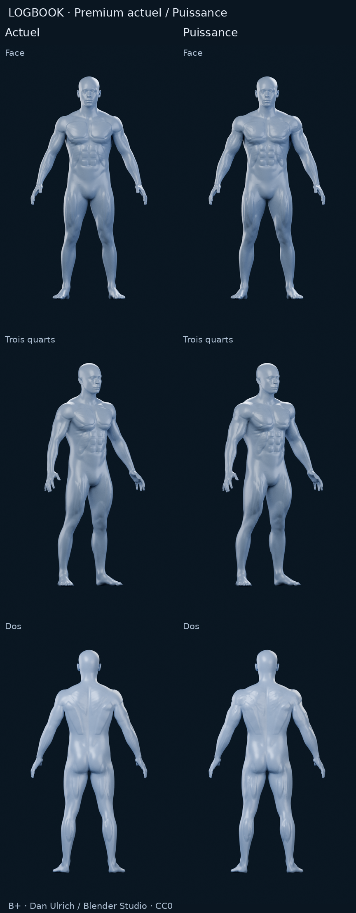
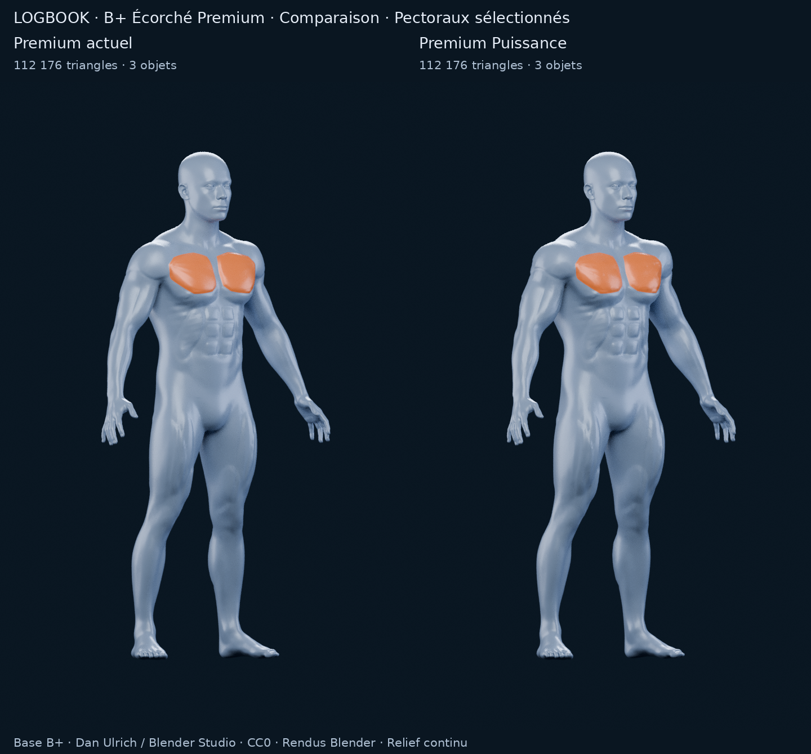

# B+ Écorché Premium — Actuel / Puissance

**Une seule nouvelle proposition. Arrêt pour validation avant toute intégration.**

[Rapport et recommandation](../../M4A_B_PLUS_PREMIUM_PUISSANCE.md) · [Provenance CC0](../bplus-fitness/PROVENANCE.md) · [Validation](validation.json) · [Manifest](manifest.json)

Colonnes : **Premium actuel / Premium Puissance**. Les cinq PNG actuels sont réutilisés à l'identique ; seuls les cinq nouveaux angles ont été calculés.



[Face](comparaison-front.png) · [Trois quarts](comparaison-three-quarter.png) · [Dos](comparaison-back.png) · [Profil](comparaison-side.png) · [Sélection orange](comparaison-selection.png) · [Détail torse](detail-torse.png)



| Version | Modèle | Studio F12 | Construction | Contrôle géométrique | Rendus |
|---|---|---|---|---|---|
| Premium actuel | [BLEND](../bplus-fitness/premium/model.blend) | [Scène](../bplus-fitness/premium/scene-review.blend) | [Paramètres](../bplus-fitness/premium/construction.json) | [Audit](../bplus-fitness/premium/geometry-check.json) | [Protocole](../bplus-fitness/premium/render-metadata.json) |
| Premium Puissance | [BLEND](power/model.blend) | [Scène](power/scene-review.blend) | [Paramètres](power/construction.json) | [Audit](power/geometry-check.json) | [Protocole](power/render-metadata.json) |

112 176 triangles / trois objets par version. Topologie du corps et trois attributs de masques pectoraux inchangés. Un corps continu, deux yeux ; aucun objet musculaire ajouté. Les contacts tête / pieds connus de la base restent documentés, sans affirmation de modèle globalement exempt d'auto-intersection.

Les scènes de revue sont enregistrées à trois quarts, sélection éteinte. Dans le matériau Blender, la valeur **M4A selection enabled** à 1 active l'orange sur les deux pectoraux. Aucune interaction dans l'application n'est implémentée.

## Reproduire

Blender 4.3.2 / NumPy, Python / Pillow pour les planches. Depuis la racine du dépôt, écrire les essais dans un dossier de travail indépendant :

```bash
blender --background --factory-startup --threads 3 --python tools/m4a/build_bplus_power.py -- \
  --source docs/m4a/bplus-fitness/premium/model.blend \
  --output /workspace/work/bplus-power-reproduction/power
blender --background --factory-startup --threads 2 --python tools/m4a/check_bplus_fitness.py -- \
  --prepared /workspace/work/bplus-power-reproduction/power
blender --background --factory-startup --threads 3 --python tools/m4a/render_bplus_fitness.py -- \
  --prepared /workspace/work/bplus-power-reproduction/power \
  --output /workspace/work/bplus-power-reproduction/power --samples 96 --resolution 720 1152
```

Le générateur déforme directement le Premium parent ; il ne réallège pas sa topologie. Les masques de sélection sont conservés. Pour refaire les planches et l'audit avec le témoin historique, les outils attendent le dossier témoin relatif `../bplus-fitness/premium` ; placer une copie du dossier témoin à cet emplacement dans l'espace de reproduction, ou utiliser les chemins publiés :

```bash
python tools/m4a/make_bplus_power_sheets.py --root docs/m4a/bplus-power
blender --background --factory-startup --threads 2 --python tools/m4a/audit_bplus_power_review.py -- \
  --root docs/m4a/bplus-power
python tools/m4a/validate_bplus_power_delivery.py
```

[Correspondance des sommets, zones protégées et mesures régionales](comparison-geometry.json) · [Audit des scènes de revue](review-validation.json)

Les mesures régionales sont des offsets de surface sur les mêmes sommets, pas des circonférences ou une validation anatomique. Aucun FPS mobile, export applicatif, rig ou segmentation complète n'est revendiqué.
