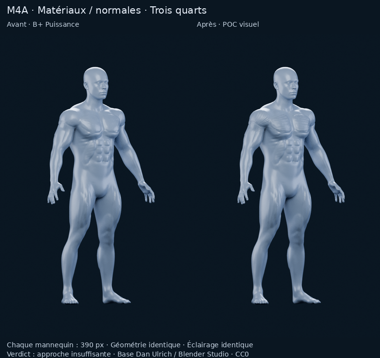

# POC visuel de matériaux — approche insuffisante

**Un seul prototype, sans modification de géométrie. Arrêt après constat d'insuffisance.**

[Rapport et verdict](../../M4A_POC_MATERIAUX_ECORCHE.md)

1. [Avant / après de face, mannequins de 390 pixels](comparaison-front.png).
2. [Avant / après de trois quarts](comparaison-three-quarter.png).
3. [Gros plan sur pectoraux / épaules](renders/detail.png).
4. [Pectoral gauche seul en orange](renders/selection.png).



[Prototype BLEND autonome](experiment/model.blend) · [Scène F12](renders/scene-review.blend) · [Paramètres](experiment/construction.json) · [Textures originales](experiment/textures/textures.json) · [Audit](audit.json) · [Validation](validation.json) · [Manifest SHA-256](manifest.json)

112 176 triangles, trois objets, **+0 triangle**. Toutes les textures sont embarquées dans les BLEND et disponibles séparément :

- Pectoraux : [normales](experiment/textures/pectoral-normal.png), [surface](experiment/textures/pectoral-surface.png).
- Deltoïdes : [normales](experiment/textures/deltoid-normal.png), [surface](experiment/textures/deltoid-surface.png).

La scène F12 est enregistrée sur le cadrage rapproché avec la sélection désactivée. Le nœud de valeur **M4A selected region** du matériau accepte 0 (aucune), 1 (pectoral gauche), 2 (pectoral droit), 3 (deltoïde gauche), 4 (deltoïde droit). Ce sont des masques de matériau provisoires, pas une sélection dans l'application ou une segmentation anatomique finale.

## Reproduire cet essai figé

Outils déjà installés : Blender 4.3.2, NumPy et Pillow, sans achat ou service externe. Depuis la racine du dépôt, utiliser un dossier de travail :

```bash
python tools/m4a/make_material_poc_textures.py --output /workspace/work/material-poc-reproduction/textures
blender --background --factory-startup --threads 3 --python tools/m4a/prepare_material_poc.py -- \
  --source docs/m4a/bplus-power/power/model.blend --output /workspace/work/material-poc-reproduction
blender --background --factory-startup --threads 3 --python tools/m4a/render_material_poc.py -- \
  --source /workspace/work/material-poc-reproduction/model.blend --output /workspace/work/material-poc-reproduction/renders --samples 96
```

Les commandes suivantes vérifient la livraison publiée et assemblent les deux planches :

```bash
blender --background --factory-startup --threads 2 --python tools/m4a/audit_material_poc.py -- --root docs/m4a/material-poc
python tools/m4a/finish_material_poc.py
```

[Protocole des nouveaux rendus](renders/render-metadata.json) · [Témoin B+ Puissance préservé](../bplus-power/power/render-metadata.json) · [Provenance du modèle CC0](../bplus-fitness/PROVENANCE.md)

Aucune nouvelle itération lancée, aucun export applicatif ou benchmark iPhone. PR #11 en brouillon ; aucun changement SQLite, M4B ou fusion.
