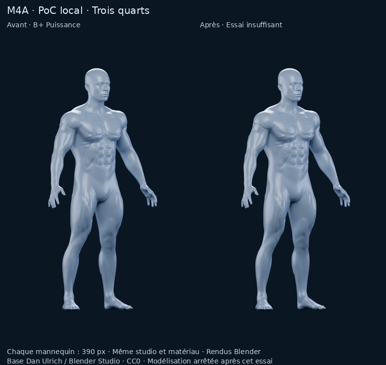

# Essai local d'écorché — non retenu

**Verdict : méthode insuffisante. Modélisation arrêtée après un seul essai visuel.**

[Rapport court et diagnostic](../../M4A_POC_ECORCHE_PECTORAUX.md)

Les quatre livrables :

1. [Avant / après de face — chaque mannequin à 390 px](comparaison-front.png).
2. [Avant / après de trois quarts — chaque mannequin à 390 px](comparaison-three-quarter.png).
3. [Gros plan diagnostique : lecture musculaire et fibres insuffisantes](after/detail.png).
4. [Sélection orange du seul pectoral gauche anatomique](after/selection.png).



[Modèle expérimental BLEND](experiment/model.blend) · [Scène de revue F12](after/scene-review.blend) · [Paramètres](experiment/construction.json) · [Géométrie](experiment/geometry-check.json) · [Audit du périmètre et des sélections](audit.json) · [Validation](validation.json) · [Manifest](manifest.json)

La scène F12 est enregistrée sur le cadrage de sélection, avec toutes les sélections éteintes. Le matériau contient trois valeurs indépendantes : **Select pectoralis.left**, **Select pectoralis.right**, **Select deltoid.right**. Une valeur à 1 active la région correspondante en orange. Les IDs `m4a_poc_region_id` portés par les faces sont 1 / 2 / 3 pour ces régions, 0 ailleurs. Ils sont provisoires ; aucune interaction applicative ou segmentation complète n'est livrée.

136 046 triangles affichés, dont 133 870 pour le corps ; trois objets. Le raffinement local coûte 23 870 triangles supplémentaires, sans progrès visuel suffisant. Ce modèle reste un **artefact de diagnostic**, pas une proposition validée pour l'intégration.

## Reproduction de cet essai, sans lancer une nouvelle variante

Blender 4.3.2 avec NumPy ; Pillow pour les deux planches. Depuis la racine du dépôt, utiliser un dossier de travail pour le modèle :

```bash
blender --background --factory-startup --threads 3 --python tools/m4a/build_pectoral_poc.py -- \
  --source docs/m4a/bplus-power/power/model.blend \
  --output /workspace/work/pectoral-poc-reproduction
blender --background --factory-startup --threads 2 --python tools/m4a/check_bplus_fitness.py -- \
  --prepared /workspace/work/pectoral-poc-reproduction
```

Les commandes suivantes décrivent la livraison publiée ; elles recalculeraient ses images et audits :

```bash
blender --background --factory-startup --threads 2 --python tools/m4a/render_pectoral_poc.py -- \
  --source docs/m4a/bplus-power/power/model.blend --output docs/m4a/pectoral-poc/before --kind before
blender --background --factory-startup --threads 2 --python tools/m4a/render_pectoral_poc.py -- \
  --source docs/m4a/pectoral-poc/experiment/model.blend --output docs/m4a/pectoral-poc/after --kind after
blender --background --factory-startup --threads 2 --python tools/m4a/audit_pectoral_poc.py -- --root docs/m4a/pectoral-poc
python tools/m4a/finish_pectoral_poc.py
```

[Paramètres des deux rendus avant](before/render-metadata.json) · [Paramètres des quatre rendus après](after/render-metadata.json) · [Provenance de B+ / CC0](../bplus-fitness/PROVENANCE.md)

Aucune V2 automatique. PR #11 en brouillon, aucun changement applicatif ou SQLite, aucun M4B et aucune fusion.
