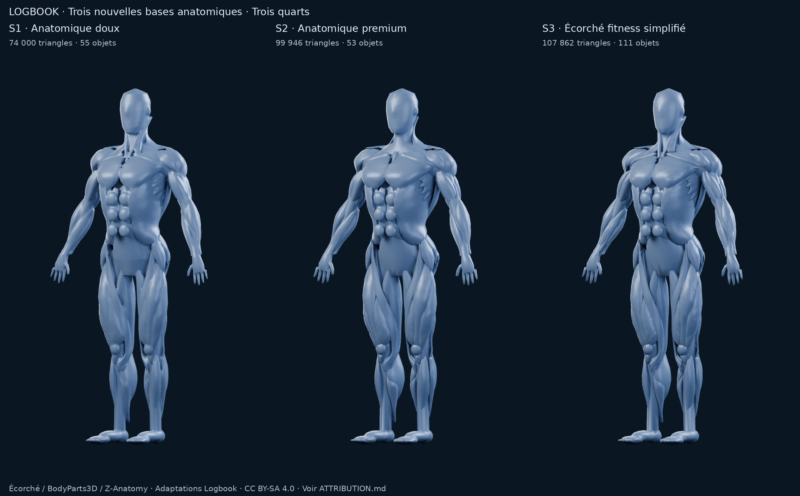

# S1 / S2 / S3 — sources et reproduction

[Rapport et recommandation](../../M4A_S1_S2_S3.md) ·
[Attribution obligatoire et licence des assets](ATTRIBUTION.md) ·
[Validation](validation.json) · [Manifeste](manifest.json).

| Contenu | S1 | S2 | S3 |
| --- | --- | --- | --- |
| Source géométrique | [BLEND](s1/model.blend) | [BLEND](s2/model.blend) | [BLEND](s3/model.blend) |
| Scène prête à rendre dans Blender, F12 | [BLEND](s1/scene-review.blend) | [BLEND](s2/scene-review.blend) | [BLEND](s3/scene-review.blend) |
| Paramètres et provenance | [JSON](s1/construction.json) | [JSON](s2/construction.json) | [JSON](s3/construction.json) |
| Audit de géométrie | [JSON](s1/geometry-check.json) | [JSON](s2/geometry-check.json) | [JSON](s3/geometry-check.json) |
| Réglages / empreintes des PNG | [JSON](s1/render-metadata.json) | [JSON](s2/render-metadata.json) | [JSON](s3/render-metadata.json) |

Chaque dossier contient les cinq PNG `front`, `three-quarter`, `back`, `side` et
`selection`. Les planches communes sont au niveau de ce README. **Aucune image
n’est générée par un modèle d’image ou repeinte pour simuler l’anatomie.**
Blender 4.3.2 est utilisé, sans exécution des scripts de l’atlas.



[Face](comparaison-front.png) · [Trois quarts](comparaison-three-quarter.png) ·
[Dos](comparaison-back.png) · [Profil](comparaison-side.png) ·
[Sélection orange](comparaison-selection.png) · [Détail du torse](detail-torse.png) ·
[Vue d’ensemble](comparaison.png).

## Périmètre de ces fichiers

Les trois modèles dérivent du même sous-ensemble superficiel de l’atlas Écorché,
avec des méthodes d’assemblage différentes. Aucun modèle L1/L2/L3 n’est lu.
L’inventaire source indique chaque structure retenue, l’utilisation du côté
gauche et sa réflexion à droite. Les notices d’Écorché, BodyParts3D, Z-Anatomy
et BodyExplorer sont conservées. Les **assets dérivés et rendus sont CC BY-SA
4.0**, pas des géométries entièrement originales Logbook.

Axes : +Z haut, −Y avant, +X gauche anatomique. Coordonnées en mètres ; hauteur
voisine de 1,80 m. Les objets affichés portent `render=True`, `zone`, `role` et
`selectable`. Les deux pectoraux sont orange dans le rendu de sélection ; S3
possède plusieurs pièces pour un même identifiant. Les limites restent provisoires.

S1 conserve `S1.hidden-continuous-source`, caché, avec `render=False` : **ne pas
l’exporter avec les patches affichés comme une seconde peau**, ni le considérer
comme un objet de sélection. Les propriétés héritées de l’objet de construction
ne remplacent pas le filtre d’affichage. Ses 3 composantes et tunnels résiduels
sont consignés dans l’audit. S2/S3 gardent des masses qui se recouvrent sur un
support fermé ; S3 conserve des défauts non-manifold. Aucun de ces fichiers ne
constitue une peau finale, un rig, un export applicatif ou une segmentation complète.

## Reconstruire sans écraser les livrables

Blender fournit NumPy. Restaurer si nécessaire la sauvegarde anatomique existante
vers un dossier libre, selon ses [instructions](../ecorche/checkpoint/README.md) :

```sh
python3 tools/m4a/restore_ecorche_checkpoint.py \
  --destination /workspace/work/s-anatomy-input
for variant in s1 s2 s3; do
  blender --background --factory-startup --disable-autoexec --threads 2 \
    --python tools/m4a/build_stylized_anatomy.py -- \
    --source /workspace/work/s-anatomy-input/prepared/ecorche/muscles-only.blend \
    --variant "$variant" --output "/workspace/work/s-rebuild/$variant"
  blender --background --factory-startup --disable-autoexec --threads 1 \
    --python tools/m4a/check_stylized_anatomy.py -- \
    --prepared "/workspace/work/s-rebuild/$variant"
done
```

Les sorties publiées ont été construites depuis la préparation musculaire locale
auditée ; son SHA-256 exact est consigné. La sauvegarde purgée peut avoir un autre
binaire BLEND : l’étude anatomique documente la conservation de sa géométrie.
Les BLEND publiés sont les fichiers effectivement inspectés ; une reconstruction
sur une autre plateforme/version ne promet pas la même empreinte binaire.
Les sources publiques et la préparation initiale sont également décrites dans
[la recherche anatomique](../../M4A_ECORCHE.md).

## Recalculer les images

Utiliser les sources `model.blend`, pas les scènes contenant déjà le studio :

```sh
for variant in s1 s2 s3; do
  mkdir -p "/workspace/work/s-rerender/$variant"
  cp "docs/m4a/stylized/$variant/construction.json" "/workspace/work/s-rerender/$variant/"
  blender --background --factory-startup --disable-autoexec --threads 2 \
    --python tools/m4a/render_stylized_anatomy.py -- \
    --prepared "docs/m4a/stylized/$variant" \
    --output "/workspace/work/s-rerender/$variant" \
    --resolution 720 1152 --samples 96
done
python3 tools/m4a/make_stylized_sheets.py --root /workspace/work/s-rerender
```

Cycles CPU, AgX, graine 0, pas de débruitage, pas de texture et pas de subdivision
au rendu. Matière satinée commune : couleur linéaire `(0.17, 0.245, 0.38)`,
rugosité 0,42, métal 0,18, couche vernie 0,10 ; pas de transmission ou diffusion
sous-surface pour ce protocole. Caméra orthographique 2,15 m ; orientations
0°, 35°, 180°, 90° et 35° avec sélection. Les quatre lumières sont identiques.
Le JSON de chaque modèle donne tous les paramètres et empreintes d’images.
Pillow / DejaVu Sans servent seulement à l’assemblage des planches.

Pour vérifier les scènes publiées et la livraison :

```sh
blender --background --factory-startup --disable-autoexec --threads 1 \
  --python tools/m4a/audit_stylized_review.py -- --root docs/m4a/stylized
python3 tools/m4a/validate_stylized_delivery.py
```

Les scènes F12 sont sauvegardées avec matériaux neutres et caméra trois quarts.
Les scripts ne touchent pas l’application ou SQLite. **Arrêt pour choix de base,
aucune suite technique automatique.**
